# Mooney M20G Statesman – Flight Manual – English Translation

> **Source**: `manual.pdf` (97 pages, "Flughandbuch M20G", Ausgabe/Edition 1, S/N 680001+, D‑ELCP).  
> **Process**: OCR'd with Tesseract, translated and corrected from German.  
> English pages (77–79, 93–97) are reproduced as-is.  
> **Page numbers** refer to the physical PDF pages 1..97.  
>  
> **NOTE**: This is a reading translation, not a certified copy. For operational use, refer to the original AFM.

---

## Page 1

**Mooney M20G – Flight Manual**

Model: Mooney M20G
Manufacturer: Mooney Aircraft Corp., Kerrville, Texas 78628, USA
Registration: D-ELCP
Airworthiness category: **Normal category**
Aircraft data sheet: §55

This flight manual belongs to the aircraft identified above. It must always be carried in the aircraft. The operating limits, instructions, and procedures stated herein must be followed carefully by the pilot, in his own interest.

The data in this manual are taken from the **M20G Owners Manual 1968**.

Scope and revision status are defined in the list of current pages.

Translated by: AGRO Flugzeug GmbH & Co. Vertriebs KG, 8300 Landshut

---

## Page 2 (cover inside)

[Cover interior page – Mooney M20G title block and aircraft registration data. No body text.]

---

## Page 3

### Table of Contents

| Section | Title | Pages |
|---|---|---|
| I | General | 1‑1 to 1-5 |
| II |Operating Limits |2-1 to 2-6 |
| III |Emergency Procedures | 3‑1 to 3‑10 |
| IV |Normal Procedures | 4‑1 to 4‑15 |
| V |Performance | 5‑1 to 5‑13 |
| VI |Weight and Loading | 6‑1 to 6‑10 |
| VII |Controls | 7‑1 to 7‑16 |
| VIII |Care and Maintenance | 8‑1 to 8‑6 |

---

## Page 4 (Section I TOC)

### Section I – General

| Sub-section | Pages |
|---|---|
| General description | 1‑1 to 1‑3 |
| Airframe/fuselage | 1‑2 |
| Powerplant | 1‑2 |
| Landing gear | 1‑2 to 1‑3 |
| Fuel and Oil | 1‑4 |
| Empty weight and payload | 1‑4 |
| Baggage compartment | 1‑4 |
| Diagram | 1‑5 |

---

## Page 5 (General description)

### General Description

The Mooney M20G "Statesman" is a **four‑seat low‑wing monoplane** with a **retractable tricycle landing gear**. It is powered by a **4‑cylinder Lycoming carburetted engine** (180 hp) and is certified by the FAA as a **Normal-category aircraft**.

The fuselage structure in the cabin area is reinforced with steel tubing. The laminar-flow wings have a full-length main spar with auxiliary spars. The forward two-thirds of the wing upper surface uses capped rivets to ensure a smooth airflow profile.

**Powerplant:** Lycoming **O‑360‑A1D**, 4‑cylinder horizontally‑opposed carburetted engine, **180 hp at 2,700 rpm**. The electrical system is supplied by either a **50‑ampere 12‑V generator** or a **60‑ampere 12‑V alternator**. The **two‑blade constant‑speed variable‑pitch propeller** is hydraulically operated.

**Flight controls:** Rudder and control surface actuation is through pushrods. The **Mooney Positive-Control System (PC)** is standard equipment. It provides stabilisation about the longitudinal axis and, once engaged, holds any given commanded bank angle for a period of time.

**Landing gear:** The tricycle gear provides maximum rolling mobility. **Hydraulic brakes** and a **steerable nose wheel** keep the aircraft aligned even in a strong crosswind.

The landing gear is **mechanically retractable**. A spring-assisted system reduces the manual force required. An acoustic warning signal, together with red and green indicator lights, warns the pilot if the aircraft is about to land with the gear retracted. **An electrically-retractable gear option is available at extra cost.**

---

## Page 6 

The **electrically retractable gear** (if fitted) has a micro-switch that prevents inadvertent retraction while the gear is loaded (airborne).

A **manual emergency extension system** is built in; it allows the gear to be extended even if the electric motor fails.

---

## Page 7 (Technical data)

### Powerplant

| Item | Specification |
|---|---|
| Engine model | Lycoming **O‑360‑A1D** |
| Engine rating | **180 hp at 2,700 rpm** |
| Carburettor | Marvel-Schebler **MA 4‑5** |
| Ignition | Scintilla **S 4 I N‑200** dual magnetos |
| Propeller | **Hartzell HC‑C2YK‑1B/7666 A‑2** constant-speed, 2-blade, hydraulic, single-action governor |
| Propeller diameter | **74 inches (188 cm)** |
| Blade pitch at 30 in station | **min. 13° ± 0° / max. 29° ± 2°** |
| Landing gear | **Mechanically or electrically retractable** tricycle, rubber-disc springing, steerable nose wheel, hydraulic disc brakes |
| Wheelbase  | **1.617 m** |
| Main wheel track  | **2.93 m** |
| Tires – nose | **3.09 × 5** |
| Tires – mains | **6.00 × 6** |
| Tire pressure – nose | **3.38 atm** |
| Tire pressure – mains | **2.07 atm** |
| Usable fuel | **52 gal (196 litres)** |
| Fuel grade | **100 L** |
| Oil (total) | **8 quarts (7.5 litres)** |
| Oil (minimum for flight) | **6 quarts** |

### Weights and Loading

| Item | Value |
|---|---|
| Max take-off / landing weight | **1,144 kg** |
| Empty weight – standard equipment | **720 kg** |
| Max payload | **424 kg** |
| Wing loading at max gross weight | **73.6 kg/m²** |
| Power loading at max gross weight | **6.35 kg/hp** |
| Max baggage compartment loading | **54 kg** |
| Max hat rack loading | **4.5 kg (10 lbs)** |

---

## Page 8 

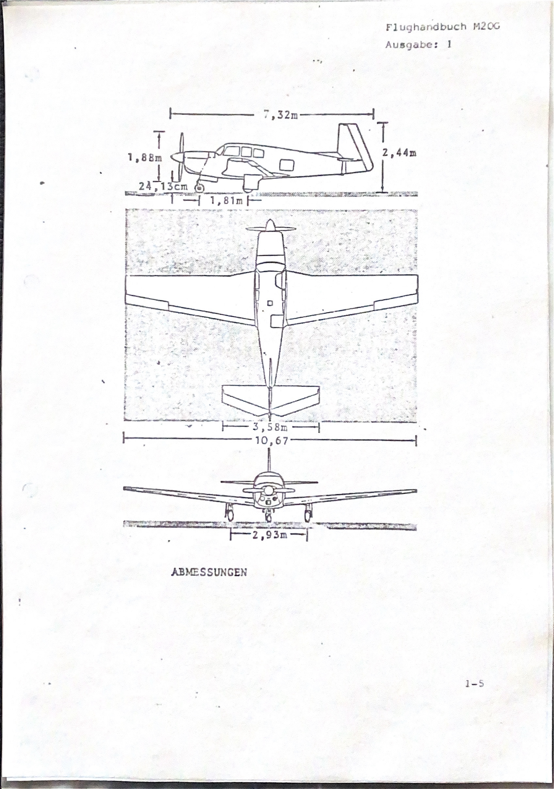

## Page 9 (Section II TOC)

### Section II – Operating Limits

| Sub-section | Pages |
|---|---|
| Speed limits | 2‑2 |
| Engine instruments | 2‑2 |
| Tachometer | 2‑3 |
| Cylinder head temperature | 2‑3 |
| Oil pressure | 2‑3 |
| Fuel pressure | 2‑3 |
| Oil temperature | 2‑3 |
| Vacuum warning lights | 2‑3 |
| Take-off and landing weight | 2‑4 |
| Centre of gravity | 2‑4 |
| Placards | 2‑4 |
| Loading limits | 2‑4 |
| Aerobatic manoeuvres | 2‑5 |
| Operation | 2‑5 to 2‑6 |
| Loading | 2‑6 |

---

## Page 10 (Speed limits)

### Operating Limits

FAA-approved operating limits of the Mooney M20G "Statesman". The following limitations must be observed during operation of the aircraft:

**Speed limitations:**

| Limitation | mph | kts |
|---|---|---|
| **Never-exceed speed (VNE)** | **200** | **174** |
| Maximum operating speed (Vmo) | 135 | 117 |
| Maximum speed in turbulence | 175 | 152 |
| Maximum gear extension speed (VLO) | 120 | 104 |
| Maximum flap operation speed | 125 | 109 |

**Airspeed indicator markings:**

| Marking | mph | kts |
|---|---|---|
| Red line | 200 | 174 | **VNE** |
| Yellow arc | 175 – 200 | 152 – 174 | Caution – calm air only, no full-power operation |
| Green arc | 69 – 175 | 60 – 152 | Normal operating range |
| White arc | 64 – 125 | 56 – 109 | Flap operating range |

**Engine:** Lycoming O‑360‑A1D, 180 hp at 2,700 rpm
**Fuel:** 100 LL avgas
**Propeller:** Hartzell HC‑C2YK‑12B/7666 Am2
**Blade pitch at station 36 in:** **min. 13° + 0° / max. 29° ± 2°**

---

## Page 11 (Engine monitoring instruments)

### Tachometer

| Marking | Value |
|---|---|
| Red line | **2,700 rpm** |
| Green arc, narrow  | **2,300 – 2,700 rpm** |
| Green arc, filled  | **2,300 – 2,500 rpm** |
| Red arc, filled | **2,000 – 2,250 rpm – NO CONTINUOUS OPERATION** |

### Cylinder Head Temperature

| Marking | Value |
|---|---|
| Red line | **Max. 500 °F** |
| Green area | **350° – 450 °F** (operating range) |
| Yellow area | **475° – 500 °F** – Continuous operation NOT ALLOWED |

### Oil Pressure

| Marking | Value |
|---|---|
| Red line — min. idle | **25 psi** |
| Red line — max | **100 psi** |
| Green arc (normal operating) | **60 – 90 psi** |
| Yellow arc (idle range) | **25 – 60 psi** |
| Yellow arc (start-up / warm-up) | **90 – 100 psi** |

### Fuel Pressure

| Marking | Value |
|---|---|
| Red line — min | **0.5 psi** |
| Red line — max | **6 psi** |
| Green arc, broad (normal operating) | **2.5 – 3.5 psi** |
| Green arc, narrow (full operating range) | **0.5 – 6 psi** |

### Oil Temperature

| Marking | Value |
|---|---|
| Red limit line | **Max. 245 °F** |
| Green arc (operating range) | **100° – 225 °F** |

### Vacuum Warning Lights

- Excessive vacuum: **5 inHg** (high)
- Low vacuum: **4.5 inHg** (low)

The following standard equipment is vacuum-driven:
1. Artificial horizon
2. Gyro compass
3. Turn coordinator
4. Positive-Control System

---

## Page 12 (CG, placards, load limits)

### Maximum permissible take-off and landing weight

**1,144 kg**

### Centre of Gravity

- Datum plane: **fuselage station 0.00**
- Position: **5 in aft of the centre line of the nose-wheel mounting bolts** and **33 in ahead of the wing leading edge**
- CG reference station: **59.25 in**

**CG limits — gear extended:**
| Weight | CG range |
|---|---|
| **1,144 kg** | **108 cm – 128 cm** |
| **1,118 kg** | **106 cm – 128 cm** |
| **957 kg or less** | **103 cm – 129 cm** |

### Placards – in the pilot's full field of vision

1. This aircraft must be operated as a **Normal-category aircraft** in accordance with the flight manual and placards. **Aerobatic flight and spinning are prohibited.**
2. **Maximum speed for gear extension: 120 mph (104 kts)**
3. **Maximum load factor:**
   - Flaps retracted: **+3.8 g / −1.5 g**
   - Flaps extended: **+2.0 g**

### Loading Limits

| Item | Limit |
|---|---|
| Front seats | **2 persons** |
| Minimum crew | **1** |
| Rear seats (if installed) | **2 persons** |
| Max baggage weight | **54 kg** |
| Max hat rack loading | **4.5 kg** |

---

## Page 13 (Aerobatic manoeuvres, load factors, operation)

### Aerobatic Manoeuvres

The aircraft must be operated as a **Normal-category** aircraft.

Aerobatic flight, **including spins, is not permitted**. Stalling and full control deflections should be limited to the **minimum flying speed**.

**Inverted flight is not permitted.**

**Operation in known icing conditions is prohibited.**

### Load Factors

| Condition | Limit |
|---|---|
| Positive – flaps and gear retracted | **+3.8 g** |
| Positive – flaps and gear extended  | **+2.0 g** |
| Negative – flaps and gear extended | **−1.5 g** |

**CAUTION:**
Up to **300 ft** of altitude loss can occur when recovering from a stalled flight condition at full take-off weight.

### Operation

This aircraft must be operated as a **Normal-category aircraft** in accordance with this manual and the placards. **Aerobatic flight and spins are prohibited.**

Fuses are grouped on the **right side** of the instrument panel. Only **fuse-matic** units or **switch-fuses** are used.

**Retract flaps after landing.**

**Pull carburettor heat fully ON** before reducing engine power for an approach or landing.

All warning lights and horns are **inoperative** when the **master switch is OFF**.

---

## Page 14 (Windows, stall warning, PC, loading)

Side windows: **Do not open above 150 mph (130 kts).**

An initially intermittent, then continuous tone warns of approach to the **stall speed**.

A continuously interrupted tone warns of **retracted gear** when manifold pressure drops below approximately **12 in Hg**.

The **Positive-Control or autopilot interrupt switch** is in the **left-hand control wheel grip** on the pilot's side.

Turning the **turn-coordinator trim knob** clockwise trims to the **right**; counter-clockwise trims to the **left**.

### Loading

The pilot is responsible for correct loading. The front seat positions can shift the CG beyond the permitted limits. When loading the baggage compartment, the positions of the two front seats must be taken into account.

Max baggage: **54.4 kg**. Max hat rack: **4.5 kg**. Only soft items in the hat rack.

---

## Page 15 (Section III TOC)

### Section III – Emergency Procedures

| Sub-section | Pages |
|---|---|
| Emergency manual gear extension | 3‑2 |
| Disabling the Positive-Control System | 3‑2 |
| Engine operation | 3‑3 |
| Re-start during flight | 3‑3 to 3‑4 |
| Fires | 3‑4 to 3‑6 |
| Emergency landings | 3‑6 to 3‑8 |
| Operations in icing conditions | 3‑8 to 3‑9 |
| Spinning | 3‑9 |
| Low oil pressure | 3‑10 |

---

## Page 16 (Emergency gear extension, PC override)

### Emergency Procedures: Gear Emergency Extension

*(For the electric-gear option. The M20G base model has a mechanically-operated gear lever.)*

With a partially discharged battery the gear may fail to fully extend and lock:

1. Pull the **electrical gear fuse (2 A)**.
2. Set the **electric gear switch** to the "Gear down" position.
3. Push the **hand-crank coupling knob forward** to engage the hand crank.
4. Turn the hand crank **clockwise** until the gear is fully extended and locked. Approximately **80 turns**.
5. The green **"GEAR DOWN AND LOCKED"** light must be illuminated.
6. If the electrical system is completely out: the **two "GEAR" marks on the cabin floor must be aligned one directly above the other**.

**CAUTION:**
- The gear must NOT be hand-cranked to **retract** it.
- The gear must NOT be operated electrically while the hand crank is engaged.

### Positive-Control System – Manual Override

The pilot can override the Positive-Control System at any time in the event of malfunction by applying manual input at the control wheel.

The PC system is disabled by pressing the **interrupt switch in the left-hand control wheel grip**. On loss of vacuum (indicated by the red warning light), the PC system **automatically shuts off**.

---

## Page 17 (Engine operation: failure at take-off / failure in flight)

### Engine Operation

**At take-off (with sufficient remaining runway length):**

1. Throttle – **idle**
2. Apply **brakes**
3. Retract **flaps** during the roll-out
4. Mixture – **fully lean**
5. Ignition switch and master switch – **OFF**

**After becoming airborne:**

1. Glide speed – **80 mph (70 kts)**
2. Mixture lever – **fully aft**
3. Fuel selector – **closed (centre position)**
4. Ignition switch – **OFF**
5. Master switch – **OFF shortly before touchdown**

**CAUTION:**
Conduct the landing **straight ahead**, making only minor course changes to avoid obstacles. Under no circumstances attempt to return to the landing field, as the altitude shortly after take-off is normally insufficient for a safe return.

### In Flight – Engine Restart

1. Glide speed – **105 mph (91 kts)** (optimal glide angle with tailwind and propeller still turning)
2. Fuel selector – **fuller tank**
3. Mixture – **rich**
4. Throttle – **1/4 open**
5. Boost pump – **ON**
6. Ignition switch – **both**

If the propeller is no longer being turned by the slipstream, the engine must be **motored with the starter**.

---

## Page 18 (Engine fire ground, water landing)

### Fires

**Engine fire on the ground – during starting**

Incorrect starting procedures, such as pumping the throttle when the engine is hard to start in cold weather, can lead to a **back-fire** and subsequent ignition of fuel that has collected in the intake manifold. In such a case:

1. **Continue motoring with the starter** and attempt to achieve a start; this will draw the flames and accumulated fuel back through the carburettor into the engine cylinders.
2. If the engine starts, **let it run for a few minutes at 1,700 rpm**, then shut down and inspect the damage.
3. If the engine does not start: **continue motoring with the electric switch and ignition initially OFF** (master switch ON, boost pump ON), while ground attendants prepare the fire extinguisher.
4. When all preparations are complete: release the starter switch, switch the **master switch and ignition OFF**, close the fuel selector valve.

---

## Page 19 (Engine fire in flight, electrical fire)

5. **Extinguish the flames** with a fire extinguisher, seat cushions, wool blankets, or sand.
6. **Inspect the fire damage** thoroughly; replace any affected parts before the next flight.

**Engine fire in flight**

Although engine fires in flight are extremely rare, the following measures should be taken if one should occur:

1. Pull the **mixture lever fully out** (cut off)
2. Turn the **fuel selector valve closed**
3. Switch the **master switch OFF**
4. **Close all cabin heating and ventilation controls**
5. Select a suitable **field for a forced landing**
6. If the fire has not been extinguished, **increase glide speed** in an attempt to find a speed at which a burning fuel-air mixture can no longer be supported
7. Conduct a **powered-off landing** as described under "Power-off landing – engine stopped." **Do NOT attempt to restart the engine.**

**Electrical fire in flight**

The first sign of an electrical fire is the **smell of burning or smouldering insulation**. The immediate correct action is to **switch the master switch OFF** and **reduce fresh-air flow as much as is feasible** to minimise the chance of a sustained fire.

If electrical power must be continued in flight, the following procedure may be used to identify and isolate the faulty circuit:

1. Master switch: **"OFF"**
2. All other switches except ignition: **"OFF"**

*(Continued on page 20)*

---

## Page 20 (Electrical fire (cont’d), emergency landing with power)

**Electrical fire in flight – continued:**

3. Check the state of the **fuses** to identify the faulty circuit. Leave the faulty circuit **switched off**.
4. Master switch: **"ON"**
5. Turn on the other switches **one at a time, with intervals**, until the short circuit is identified.
6. **Check that the fire is fully extinguished** before reopening the fresh-air supply.

### Emergency Landings

**— Emergency landing WITH engine power**

Before attempting an off-airport landing, fly the landing area **straight ahead at a safe altitude, but low enough**, to check the terrain for any damage and obstacles. Proceed as follows:

1. **Fly over the selected area with 15° flaps and 80 mph (70 kts)** to observe the proposed touchdown area for the next landing approach. Once all obstacles have been safely crossed, retract the flaps.
2. **Switch OFF all switches in the cockpit** except ignition and master switch.
3. **Approach with 30° flaps at 75 mph (65 kts)**.
4. **Unlock the cabin door** before the final approach.
5. **Set ignition and master switch to "OFF"** before touchdown.
6. Land in a **slightly tail-heavy attitude**.
7. **It is recommended to land on unpaved terrain with the gear retracted** to minimise landing distance and avoid flipping over.
8. **Pull the carburettor heat fully ON**.

**— Emergency landing with stopped engine (continued on next page)**

If the engine should stop in flight, **glide with flaps retracted and 100 mph (87 kts)**. *(See also glide-path approach.)* If time allows, attempt to restart the engine... (continued on page 21)

---

## Page 21 (Power-off landing, water ditching)

### Power-off Landing – Continued

If all attempts at a restart have failed and a forced landing is imminent, select a suitable field and proceed as follows:

1. Mixture lever: **fully aft (cut-off)**
2. Fuel selector: **closed**
3. All switches **except the master switch**: **"OFF"**
4. Speed: **100 mph (87 kts)** – gear and flaps retracted
5. Flaps: extend as necessary **within the glidepath** to the landing field
6. Speed: **70–75 mph (61–65 kts)** – flaps extended
7. Master switch: **"OFF"**
8. **Unlock the cabin door** before the final approach
9. Touchdown in a **slightly tail-heavy attitude**
10. **Allow the gear to remain retracted** for the touchdown

### Water Ditching

Prepare the water ditching by securing or discarding all heavy objects stowed in the baggage compartment, and by folding coats or cushions to be used as a **face shield** for the occupants on touchdown.

Call **MAYDAY on 121.5 MHz** with your position and intentions.

1. **Headwind approach** when strong wind and heavy sea are present. **Parallel to the current** in strong current with light wind.
2. Approach with **40 degrees of flap** and sufficient engine power to maintain a **300 fpm descent at 70 mph (61 kts)**
3. **Unlock the cabin door**
4. Maintain a **steady, level descent** to touchdown in a **horizontal flight attitude**
5. **Do NOT attempt to flare** – it is difficult to judge height above water

---

## Page 22 

**Water ditching – continued:**

4. At the moment of touchdown, hold the cushion or folded coat **in front of your face**.
5. Inflate **life jackets** and the **life raft** (if fitted) after leaving the cabin. It cannot be expected that the aircraft will float **longer than a few minutes** after touchdown.

### Flight in Icing Conditions

**Flight in known icing conditions is strictly prohibited.** However, should icing be encountered unexpectedly, proceed as follows:

1. Pitot heater switch: **“ON”**
2. **Turn back or change flight level** to reach temperatures at which icing is less likely to occur.
3. Pull the **cabin heating knob fully out** to obtain warm air for **windscreen deicing**. Set the **cabin vent knob** so that the warm-air supply for deicing is at its maximum.
4. **Increase RPM** to minimise ice accretion on the propeller blades.
5. Watch for signs of **carburettor/air filter icing**: an unexplained drop in engine RPM can be caused by ice accretion on the carburettor or air filter. Use **carburettor heat** as required.
6. Plan a **landing at the nearest airfield**. In the event of extremely rapid ice build-up, look for a suitable area for an **off-field emergency landing**.
7. With ice accretion on the wing leading edges **greater than 6 mm**, expect to have to handle a **significantly higher stalling speed**.
8. **Retract the flaps.** With heavy ice accretion on the horizontal stabiliser, the deflection of the wing airflow by the extended flaps can lead to a **loss of elevator effectiveness**.
9. Open the **left window** and, if possible, remove ice from… *(continued on page 23)*

---

## Page 23 (Anti-icing cont., spin recovery)

…to allow an angle of attack reduction to make the landing approach possible.
10. **Approach with a forward slip** if necessary, to obtain better visibility (use the **bad-weather window**).
11. Approach at **85–90 mph (74-78 knots)** depending on the severity of the ice accretion.
12. **Steep turns during the landing approach are to be avoided.**
13. Land in a **horizontal attitude**.

### Spins

To repeat the warning: this is a **Normal-category aircraft and spinning is not permitted.**
Should the aircraft enter a spin as a result of a stalled condition and uncoordinated control inputs, proceed as follows:

1. **Full rudder deflection in the opposite direction** to the turn (tail)
2. **Full forward elevator** to push the nose down
3. **Hold the rudder fully in the opposite direction** until the rotation has stopped
4. **Gently pull out** of the resulting dive and restore cruise power

**NOTE:**
The aircraft can continue to turn for up to **one full revolution** even with the rudder fully deflected opposite to the turn. As altitude loss can be up to **2,000 ft per spin turn**, spinning near the ground is very dangerous and must be avoided at all costs.

---

## Page 24 (Low oil pressure)

### Low Oil Pressure

If low oil pressure occurs together with **normal oil temperatures**, this indicates a possible fault in the oil pressure gauge or the pressure relief valve. A leak in the line to the instrument is not necessarily a reason for an immediate precautionary landing, because an orifice in that line prevents a sudden loss of oil from the engine sump.

However, **landing at the nearest airfield is advisable** to determine the cause of the fault.

If **complete loss of oil pressure** occurs together with a **rise in oil temperature**, this is sufficient grounds to suspect an impending engine failure. In that case, **reduce engine power immediately** and look for a suitable field for a forced landing. During the approach, run the engine at **minimum power**, being careful to use only as much power as is actually required to reach the selected landing point.

---

## Page 25 (Section IV TOC)

### Section IV – Normal Procedures

| Sub-section | Pages |
|---|---|
| Pre-flight inspection diagram | 4‑2 |
| Pre-flight inspection | 4‑3 to 4‑4 |
| Before start-up | 4‑4 |
| Check before starting | 4‑4 to 4‑5 |
| Starting | 4‑5 |
| Engine shut down / hard start | 4‑6 |
| Starting in cold weather | 4‑6 |
| Hand starting | 4‑6 |
| Run-up and taxiing | 4‑7 |
| Pre-take-off check | 4‑8 |
| Take-off | 4‑8 to 4‑9 |
| Climb | 4‑9 |
| Cruise | 4‑10 to 4‑14 |
| Descent | 4‑14 |
| Landing check | 4‑14 to 4‑15 |
| Landing | 4‑15 to 4‑16 |
| After landing | 4‑16 |
| Shutdown check | 4‑16 |

---

## Page 26 (Walk-around diagram)

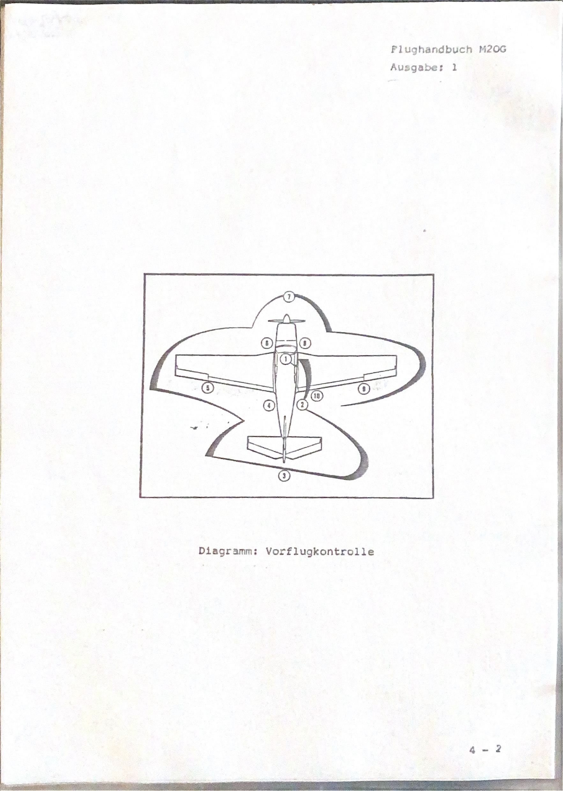

## Page 27 (Pre-flight walk-around steps 1–7)

### Pre-flight inspection – Steps 1 to 7

**1. Cockpit / Electrical checks**
- Ignition switch: **"OFF"**
- Master switch: **"ON"**
- Check **exterior lighting**, **stall warning switch** and related indicators
- Master switch: **"OFF"**
- **Drain the fuel lines**
- Fuel selector: **right tank** – operate the corresponding valve next to the fuel selector
- Fuel selector: **left tank** – same procedure

**2. Right static pressure port (Statische Druckabnahme rechte Seite)**
- Check that it is **not blocked** (when the aircraft is parked outside in the open)
- **Release the tail tie-down**

**3. Check the surface**
- If **ice, snow or frost** is present: **remove it**

**4. Fuselage door**
- Check that it is **firmly closed and secured**
- Static pressure port: check that it is **"clear"**

**5. Left wing**
- Check **ailerons** and **flap linkages**
- If **ice, snow or frost** is present: remove it

**6. Left wing leading edge, pitot tube, stall warning switch**
- Check wing leading edge, **pitot tube** and **stall warning switch**: all **"clear"**
- Fuel tank: **visual check of contents**, **secure the fill cap**
- **Visual check of left main gear and tyre**
- Left tank drain: **drain the pitot system**
- Fuel tank vent: **"clear"**
- Fuel system drain valve: **"closed"**
- Engine cowl: **closed and secured**

**7. Propeller**
- **Check the propeller for damage**

---

## Page 28 (Walk-around steps 8–10, pre-start, start check)

### Pre-flight inspection – Steps 8 to 10

**8. Right side**
- Engine cowl: **closed and secured**
- Engine oil level): between **6 and 8 quarts**
- Windshield: **clean**
- **Drain the fuel tank**
- Tank vent: **"clear"**
- If present, **release the tie-down**
- **Right main gear and tyre: check**
- Fuel tank: **visual check and secure the fill cap**

**9. Right wing**
- Check **right wing leading edge and overall wing condition**
- Check **ailerons** and their attachment points
- Check **flaps** and their attachment points
- If **ice, snow or frost** is present: remove it

**10. Baggage door**
- **Closed and secured**

### Before Take-off

After boarding, close the **cabin door** by swinging the door handle forward. **DO NOT SLAM THE DOOR.**

Check the **gear lever position and locking**. For electrically operated gear: check the **switch position**.

Make sure **all baggage is secured** and that all required **charts, computers, and other loose items** are stowed and secured in the cabin.

**Fasten the seat belts and pull them tight.** Lock the **seat position**. The pilot should be **comfortable and not cramped** behind the control wheel. On **night flights**, carry a **flashlight**.

### Check Before Starting

1. All switches: **"OFF"**
2. All radios: **"OFF"**
3. Landing gear: **extend and lock**
4. Landing flaps: **check all positions and return to take-off position**
5. Carburettor heat: **"CLOSED"**
6. Parking brake: **apply to check**
7. Throttle: **"CLOSED"**
8. Propeller: **high-RPM position (full forward)**

---

## Page 29 (Start check (cont’d), engine starting)

### Check Before Starting – continued:

9. **Check all fuses**
10. Mixture control: **position cut-off**
11. Fuel selector: **to the fuller tank**
12. Electric fuel pump: **"ON"**
13. Cabin heater: **"ON"**

### Starting the Engine

1. Master switch: **"ON"**
2. Check **fuel gauge and quantity**
3. Check **warning lights via test button**
4. **Gear light: GREEN must be lit**
5. Electric fuel pump: **"ON"**
6. Mixture control: **forward – RICH**
7. Throttle: **pump 2 to 3 times, then 1/4 open**
8. **Start: turn AND press the ignition key**
9. Throttle: set to **1,000–1,200 rpm**
10. **Oil pressure: in the green arc.** If no pressure is indicated after **30 seconds**, stop the engine and inspect the oil system.
11. Carburettor heat: **"ON" then "OFF"** – check the **RPM drop** is normal.

**CAUTION:**
The carburettor heat **must not be used on the ground** except for test purposes. When the carburettor heat is ON, **unfiltered air** enters the engine. Moisture, foreign objects, and dust can damage the **cylinders and pistons**.

12. **Lights: on as required**
13. **Radio and navigation: switch on and tune**
14. **Rotating beacon: "ON"**
15. **Heated pitot: check via panel indication**
16. **Trim: take-off position**
17. **Fuel selector: check left and right**

## Page 30 (Flooded engine, cold start, hand start)

### Flooded Engine

1. Throttle: **fully open**
2. Mixture lever: **closed (cut-off)**
3. Electric fuel pump: **"OFF"**
4. Turn ignition switch **and press in simultaneously**
5. When the engine fires: **move the throttle back to idle**
6. Mixture lever: slowly **forward to RICH**
7. **Electric fuel pump: ON**

### Starting in Cold Weather

The starting procedure for a cold engine is identical to that for an engine at normal operating temperature; **slightly more fuel** will be required. It is recommended to **pre-heat the engine** using an external heating source.

### Hand-Starting the Engine

1. **Wedge brake chocks** under the main wheels
2. Apply the **parking brake**
3. All switches: set as required for a normal start, **except ignition: "OFF"**
4. Propeller: set to high-RPM position (low pitch); turn the propeller several times **by hand** – with the ignition switch OFF
- **CAUTION:** When hand-turning the propeller: **close up your clothing** and stand at a **sufficient distance ahead of the propeller** to avoid injury, until the ignition switch is turned to the start position and the starter vibrator is operative
5. Turn the ignition switch to **"START"** but **do NOT push it in**
6. While holding the ignition switch in the "START" position: **hand-crank the engine over**
7. Release the ignition switch **as soon as the engine fires**
8. All further actions: **as for a normal start**

---

## Page 31 (Taxi, run-up)

The engine maintains a warm operating state at **1,000–1,200 rpm** during taxiing.

### CAUTION

**Do NOT rely solely on the gear safety switch**, which holds the gear down while loaded.
Instead, **watch the gear switch position** (or for the manual gear: the safety button position and green light) during taxiing and take-off.

Taxi with the **mixture in "full rich"** and the propeller control at **low pitch (low RPM)** to prevent engine overheating.

**Avoid prolonged idling at low RPM** to prevent spark-plug fouling.

**CAUTION:**
Before take-off, while taxiing, **verify that the Positive-Control System is operating normally** and that the gyro instruments are in full function.

When testing the PC system, **turn the control wheel in the opposite direction** to the intended turn. Make alternating left and right turns, and verify that the **control wheel returns to neutral when taxiing straight ahead**.

While doing this, also **verify the turn coordinator and the attitude indicator** are functioning.

Before final brake application for take-off, **align the aircraft into the wind** so that the **nose wheel is in the centre position**. Minimise ground time. Check the **propeller governing system by advancing the throttle to 1,700 rpm**, then pull the propeller control full aft (decrease RPM). As soon as a **100 rpm** drop is noted, return the propeller control to FULL INCREASE RPM.

In **cold weather**, **repeat this procedure 2–3 times**.

Check the **magnetos at 1,700 rpm**:
- OK

- Maximum drop: **125 rpm** per magneto
- Difference between the two magnetos: **not more than 50 rpm**
- After the engine check is complete, reduce the throttle to **1,000–1,200 rpm**

---

## Page 32 (Pre-take-off check, quick check, take-off)

### Pre-Take-Off Check – 16 items

1. Control surfaces: **check for full, free movement**
2. Fuel selector: **fuller tank**
3. Altimeter: set to **QNH or field elevation**
4. Gyro compass: **set**
5. Aircraft monitoring instruments: **check**
6. Engine monitoring instruments: **check**
7. Clock: **set**
8. Trim: **take-off position**
9. Propeller adjustment: **check at 1,700 rpm**
10. Magnetos: **check at 1,700 rpm**
11. Landing flaps: **take-off position**
12. Electric fuel pump: **"ON"** – **watch fuel pressure**
13. Seats: **locked**
14. Seat belts: **fastened**
15. Door and storm windows: **closed and secured**
16. Cabin floor: **clear for gear lever**

### Quick Check Before Full Throttle

1. Propeller: **small pitch angle**
2. Trim: **take-off position**
3. Landing flaps: **take-off position**
4. Fuel selector: **fuller tank**

**CAUTION:**
The fuel selector should **not be operated immediately before take-off**.

5. Carburettor heat: **"OFF"**

**Start as soon as possible** after completing the pre-take-off checks. If take-off is delayed, **run the engine at 1,400–1,500 rpm** to keep the engine well cooled and prevent the spark plugs from fouling.

### Take-off

In normal conditions, apply the throttle **slowly** so that the propeller **cannot ingest stones or debris** that could damage it. On **extremely short runways**, *(continued on next page)*

---

## Page 33 (Take-off (cont'd), climb)

### Take-off – continued

On **extremely short runways**, it may be necessary to apply **full throttle in place** and release the brakes only afterwards. For take-off distance information in combination with temperature and altitude, refer to **Section V**.

At approximately **65–75 mph (56–65 kts)**, apply slight back-pressure to lift the nose wheel. As the nose wheel starts to lift, **ease off the pressure** — the aircraft will then lift off **softly and without an abrupt change in attitude**.

**Note:**

In a **crosswind take-off**, keep the nose wheel on the ground a little longer, control direction with the **rudder**, lift off at approximately **80 mph (70 kts)**, and turn the aircraft into the wind using a **coordinated control input**. After the take-off, **brake the wheels before retracting the gear**. Then retract the gear. Set the **propeller to 2,550–2,600 rpm**. After clearing the first obstacles and reaching a **safe altitude**, retract the **flaps** and continue the climb at the **best rate of climb speed (Section V)**. Turn the **electric fuel pump off** and maintain adequate **fuel pressure** as shown on the indicator.

### Climb

It is recommended to climb at **105–110 mph (90–95 kts)** to ensure good cooling and **adequate forward visibility**. The precise speeds for best rate of climb and best angle of climb are given in the tables in **Section VI**.

The power setting for normal climb is **26 in. Hg manifold pressure** and **2,600 rpm**.

As altitude increases, manifold pressure will decrease, which can be compensated to a certain extent by **corresponding throttle increases**.

**CAUTION:**
**Flying in icing zones is NOT permitted!**

*(Page 4-9)*

---

## Page 34 (Cruise and Range Conditions, cruise flight)

### Cruise and Range Conditions

All cruise and range data in the tables in **Section V** include:

1. **Climb at full power to 3,000 ft**, continued climb at the power still available, mixture **full-rich** at the corresponding speed for best rate of climb to the selected cruise altitude
2. **Cruise** to the destination at the corresponding power and mixture setting
3. **45 minutes reserve** at the same altitude and power setting
4. All data are based on **52 gal (196 L)** of usable fuel, **standard atmosphere conditions**, and **zero wind (0-Wind)**

Take-off weight: **1,144 kg or 997 kg**.

The data in the Section V tables were derived from **flight tests** in which the mixture was kept **full-rich** at power settings **above 75%** and was **correspondingly leaned** at power settings **below 75%**.

### Cruise Flight

After reaching cruise altitude, **trim the aircraft**, pick up speed, and set the **engine power** selected for the cruise.

Mixture **should not be leaned below 5,000 ft** or at **engine power above 75%**. Cylinder head temperature should **not exceed 400 °F**.

When setting the cruise rpm, note that **continuous operation in the range 2,000–2,250 rpm should be avoided**.

**To fly economically, lean the mixture:**
Slowly pull the mixture control toward **LEAN** until the engine begins to run **rough**. Then slowly push the mixture control **forward** until the engine runs **smoothly and without defect**.

When **increasing engine power**, the mixture must be **re-adjusted**.

When using an **exhaust gas temperature (EGT) indicator**: pull the mixture control slowly toward **LEAN** until the EGT thermometer pointer reaches its **maximum position**.

*(Page 4-10)*

---

## Page 35 (EGT (cont'd), power changes, speed arcs, spin recovery)

### Cruise – continued

Set the **red drag pointer** at this position. For **best economy**, push the mixture control slowly toward **RICH** until the pointer has dropped **25 °F (one calibration division)**. For **best engine power**, push the mixture control further toward **RICH** until the pointer has dropped **100 °F (four divisions)**.

**When changing the engine power setting:**
- **To increase power**: first increase **RPM**, then increase **manifold pressure**
- **To decrease power**: first decrease **manifold pressure**, then decrease **RPM**

### Airspeed

**Aerodynamic efficiency is best in the normal cruise range.** The airspeed indicator has a **green arc from 66–175 mph (57–152 kts)** and a **yellow arc from 175–200 mph (152–174 kts)**.

The **yellow marking** indicates the speed range in which the aircraft may be flown **only in calm air – not in turbulence**. **Abrupt control inputs must be avoided** in this speed range. As soon as turbulence is encountered, **reduce speed to the green arc**.

**CAUTION:**

Operate the aircraft in accordance with the **Normal-category** operating limits, as marked by the placards, markings, and the data in this manual.

**Aerobatic flight, including spins, is NOT permitted.**

Should the aircraft enter a **stalled flight condition and begin to spin**, press the **Positive-Control System button on the left side of the control wheel** so that the (now disabled) autopilot does not oppose your control inputs.

**Recommended technique for spin recovery** (see also p. 23):

1. **Disable the Positive-Control System** by pressing the control-well button
2. **Ailerons to neutral (centred), throttle back**

---

## Page 36 (Spin recovery (cont'd), TIP)

### Spin Recovery – continued

3. **Full rudder deflection opposite to the direction of rotation**
4. **Elevator full forward**
5. After speed has recovered, **soft recovery and return to cruise power**

**CAUTION:**

The aircraft may continue to **spin up to one full turn** even with full opposite rudder applied. Since up to **2,000 ft altitude loss** can occur in one spin turn, **spins near the ground are very dangerous** and must be **avoided at all costs**.

**Do not attempt manoeuvres with full control deflection at speeds above 135 mph CAS (117 kts).**

### TIP

Learn the aircraft and its characteristics with the **autopilot disabled (PC button pressed)**, by pressing the **Positive-Control button** during all manoeuvres and flight movements. **Check the Positive-Control System periodically during flight** to ensure it is functioning correctly when you need it.

*(Page 4-12)*

---

## Page 37 (PC system, fuel tank selection)

### Positive-Control System

By continuously **balancing the aircraft's rolling movements about the longitudinal axis**, the Positive-Control System **holds the selected flight path for a limited time**. However, the **precise holding of a predetermined flight path over long periods is not guaranteed**.

**To verify the PC system during flight:** bank the aircraft into a **slight roll** and then **release the control wheel**. The aircraft must now **right itself automatically**, verified on the **artificial horizon**.

**CAUTION:**

Before using the Positive-Control System, you should first be **familiar with operating the aircraft without this system**. Also **verify the correct function** of the PC system before use, especially during an **IFR flight**.

In the event of **complete engine failure**, the Positive-Control System remains **in operation** as long as the engine is rotating at **at least 1,000 rpm**, since the **vacuum supply is maintained**. **Insufficient vacuum** is indicated by a **yellow warning lamp**. Unlike the other vacuum-driven flight instruments (artificial horizon, gyro compass), the **turn coordinator remains operative** because it is driven by **both vacuum and electrical power**.

### Fuel Tank Selection

To **facilitate stabilisation about the longitudinal axis**, be careful **not to fly with one full and one nearly empty tank**. Switch from one tank to the other **every 3/4 to 1 hour** during cruise.

**Note:** During a **full-power climb**, fuel consumption is approximately **40% above** consumption at **75% engine power** and **50% above** consumption at **best range**.

*(Page 4-13)*

---
## Page 38 (CAUTION, descent, pre-landing check)

**CAUTION:**

Be aware that **one tank must not be allowed to run dry**, causing the engine to stop. Should this happen, **make absolutely sure to pull back the throttle** to prevent **engine overspeed**.

### Descent

**Plan your descent in good time.** Configure the descent so that you can descend with **reduced power, but not at idle**. This is important to prevent **excessive engine cooling** and to **minimise spark-plug fouling**.

**Avoid abrupt changes in throttle position.** **Monitor cylinder head temperature and oil temperature** throughout the entire descent.

**Observe the following speeds:**
- **Gear extension:** **120 mph (104 kts) or slower**
- **Flaps, first position:** **125 mph (109 kts)**

The speeds for **extending the gear and flaps must NOT be exceeded**.

**CAUTION:**

**Before reducing engine power, the carburettor heat must ALWAYS be applied (pulled to ON).**

### Pre-Landing Check

1. **Fuel selector: fuller tank**
2. **Electric fuel pump: "ON"**
3. **Mixture control: "full-rich"**
4. **Carburettor heat: "full-ON"**
5. **Landing gear: extend and lock, green light "ON"**

*(Page 4-14)*

---
## Page 39 (Pre-landing check (cont'd), landing)

### Pre-Landing Check - continued

6. **Propeller: small pitch [low rpm]**
7. **Seat belts: fastened**
8. **Landing flaps: as required, below 125 mph (109 kts)**
9. **Trim: as required**

### Landing

Under normal conditions, the **pre-landing check should be completed during the downwind leg**. Before at least the **first flap position** is extended, **airspeed should not be below, nor significantly above, 90 mph (78 kts)**.

**CAUTION:**

If the **Master switch is OFF**, neither the **stall warning horn** nor the **gear warning horn** is operative.

**On final approach**, **trim the aircraft** to maintain **80 mph (70 kts)**. Depending on altitude, the **second flap position** may be extended. When **abreast the runway threshold**, slowly take the **throttle to idle** and **reduce sink rate** by **pulling back on the control wheel**. After the **main gear has touched down**, **ease off the back-pressure** so that the **nose wheel also touches down**.

**CAUTION:**

**Nose wheel landings** and **landings at excessive speed** must be **avoided at all costs**, due to the risk of **damaging the nose wheel or propeller**, and because at excessive speed the aircraft tends to **"bounce".**

**Avoid unnecessary braking.**

After **leaving the runway**, **retract the flaps**, **switch the electric fuel pump off**, and **turn off the carburettor heat**.

During **taxi-out**, maintain **1,000-1,200 rpm** for good cooling. At **extremely short airfields**, make a **trail-braking (deceleration) landing**, but **wait to brake until all three wheels are on the runway**. **Do not over-brake**; *(continues on next page)*

*(Page 4-15)*

---
## Page 40 (Braking (cont'd), after-landing, shutdown)

### Braking - continued

In such a case, **do not over-brake either**, because **skidding wheels have a lesser braking effect** than they do **just before lock-up**.

### After Landing - Check:

1. **Electric fuel pump: "OFF"**
2. **Carburettor heat: close**
3. **Landing flaps: retract**
4. **Rudder trim: "take-off position"**
5. **Throttle: 1,000-1,200 rpm**

### Pre-Shutdown Check

1. **Throttle: reduce to 1,000-1,200 rpm** until **CHT begins to drop**
2. **All radios: OFF**
3. **All electrical switches: OFF**
4. **Mixture control: to "closed" (cut-off)**
5. **Throttle: full back** (when engine stops)
6. **Ignition key: to "OFF"** (when engine stops)
7. **Parking brake: set as required**
8. **Rudder trim: take-off position**
9. **Flaps: retracted**
10. **Master switch: OFF**
11. **Control wheel: locked with seat belts**
12. **Upper air intake: close**
13. **Brake chocks and tie-downs: as required**

**CAUTION:**

**Do not leave flaps extended or brakes applied when parked**, because **heating of hydraulic fluid by sun exposure** can **cause damage to the system**.

*(Page 4-16)*

---
## Page 41 (Section V TOC)

### **Section V — Performance**

| Topic | Page |
|--------|------|
| Flight Planning | 5-2 |
| Take-off Distance | 5-3 |
| Landing Distance | 5-4 |
| Climb Performance | 5-5 |
| Airspeed Correction | 5-6 |
| Stall Speeds | 5-6 |
| Altitude Correction Chart | 5-7 |
| Cruise and Range Conditions | 5-8 |
| Cruise/Range Performance at 0 ft | 5-9 |
| Cruise/Range Performance at 2,500 ft | 5-10 |
| Cruise/Range Performance at 5,000 ft | 5-11 |
| Cruise/Range Performance at 7,500 ft | 5-12 |
| Cruise/Range Performance at 10,000 ft | 5-13 |

---

## Page 42 (Flight planning intro)

### Flight Planning

All performance tables and charts in this manual are presented to allow **quick reference and lookup**. All data correspond to the **actual flight performance** of the aircraft and engine when both are in **good maintenance condition**. The performance data **do not account** for specific **wind and weather conditions** or **navigation errors**. All **take-off and landing data** assume **no wind** and a **paved runway**.

**Careful flight planning is a prerequisite for good flight performance.** After preparing a flight plan using the flight data in this manual, **compare the conditions for actual performance** under the real conditions with the values calculated from this manual, and **determine the difference** between the two. Accounting for this difference enables **precise flight planning**.

*(Page 5-2)*

---
## Page 43 (Take-off distance)

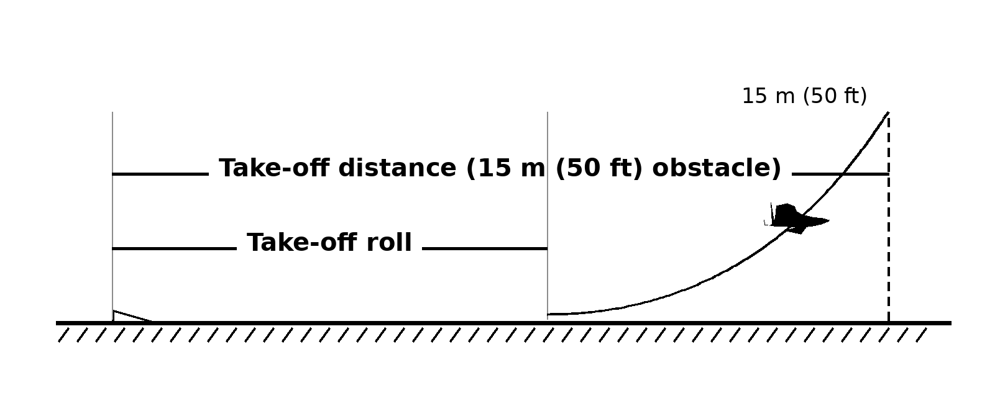

*(Redrawn in English as a schematic; distances not to scale.)*

### Take-off distance (15 m obstacle clearance)

**Take-off conditions:**
- Paved runway
- Standard altitude/setup
- Flaps in **take-off position**
- **No wind**
- **Power: full throttle, 2,700 rpm**
- For **dry grass runway**: **increase take-off distances by 75%**

| Altitude (ft) | Temp (°C) | 997 kg: Take-off run (m) | 997 kg: over 15 m (50 ft) obstacle (m) | 1,144 kg: Take-off run (m) | 1,144 kg: over 15 m (50 ft) obstacle (m) |
|---------------|-----------|----------------------------|---------------------------------------------------|------------------------------|----------------------------------------------------|
| **MSL** | 38 | 210 | 358 | 282 | 444 |
| | 15 | 177 | 308 | 238 | 381 |
| | -7 | 148 | 264 | 205 | 325 |
| **2500** | 32 | 244 | 414 | 332 | 512 |
| | 10 | 209 | 358 | 280 | 444 |
| | -12 | 174 | 306 | 238 | 378 |
| **5000** | 27 | 300 | 505 | 402 | 624 |
| | 5 | 254 | 435 | 343 | 538 |
| | -18 | 210 | 363 | 280 | 448 |
| **7500** | 21 | 368 | 620 | 498 | 730 |
| | 0 | 314 | 530 | 420 | 652 |
| | -24 | 258 | 445 | 348 | 520 |

*(Page 5-3)*

---
## Page 44 (Landing distance)

### Landing distance (over 15 m obstacle)

**Landing conditions:**

- **Landing speed: 80 mph (70 Kts)**
- **Flaps fully extended**
- **Paved runway**
- **Power: idle**
- **No wind**
- **For dry grass runways, landing distances are to be increased by 75 %**

| Height | Temp °C | **997 kg** (m) | **997 kg** Over 15 m obstacle (m) | **1,144 kg** (m) | **1,144 kg** Over 15 m obstacle (m) |
|---------------|---------|-------------------------:|--------------------------------------:|---------------------------:|------------------------------------------:|
| **Mean sea level** | 38 | 200 | 445 | 237 | 538 |
|                    | 15 | 186 | 407 | 221 | 508 |
|                    | −7 | 172 | 386 | 203 | 472 |
| **2,500 ft**       | 32 | 216 | 469 | 265 | 572 |
|                    | 10 | 200 | 442 | 238 | 538 |
|                    | −12 | 186 | 416 | 218 | 508 |
| **5,000 ft**       | 27 | 234 | 498 | 275 | 618 |
|                    | 5 | 216 | 468 | 255 | 573 |
|                    | −18 | 196 | 433 | 233 | 530 |
| **7,500 ft**       | 21 | 252 | 530 | 298 | 655 |
|                    | 0 | 233 | 500 | 276 | 618 |
|                    | −24 | 214 | 466 | 251 | 568 |

*(Page 5-4)*

---
## Page 45 (Climb performance)

### Climb Performance

**Climb conditions:**

- **Gear retracted**
- **Mixture full-rich**
- **Flaps retracted**
- **Full power, 2,700 rpm**

| Standard height in thousands of feets | Rate of climb at 997 kg (ft/min) | Rate of climb at 1144 kg (ft/min) | Speed for best climb angle (Vx) (CAS) mph (kts) | Speed for best rate of climb (Vy) (CAS) mph (kts) |
|---|---:|---:|---:|---:|
| Mean sea level | 1100 | 870 | 82 (71) | 100 (87) |
| 1 | 1040 | 810 | 82 (71) | 99 (86) |
| 2 | 970 | 750 | 82 (71) | 98 (85) |
| 3 | 900 | 690 | 82 (71) | 97 (84) |
| 4 | 830 | 630 | 82 (71) | 95 (83) |
| 5 | 760 | 570 | 82 (71) | 94 (82) |
| 6 | 690 | 510 | 82 (71) | 93 (81) |
| 7 | 620 | 450 | 82 (71) | 90 (78) |
| 8 | 560 | 390 | 82 (71) | 89 (77) |
| 9 | 490 | 330 | 82 (71) | 89 (77) |
| 10 | 420 | 270 | 82 (71) | 87 (76) |
| 11 | 350 | 210 | 82 (71) | 86 (75) |
| 12 | 280 | 150 | 82 (71) | 84 (73) |
| 13 | 110 | 90 | 82 (71) | 83 (72) |

*(Page 5-5)*

---
## Page 46 (Airspeed correction, stall speeds)

### Air speed indicator correction (IAS → CAS)

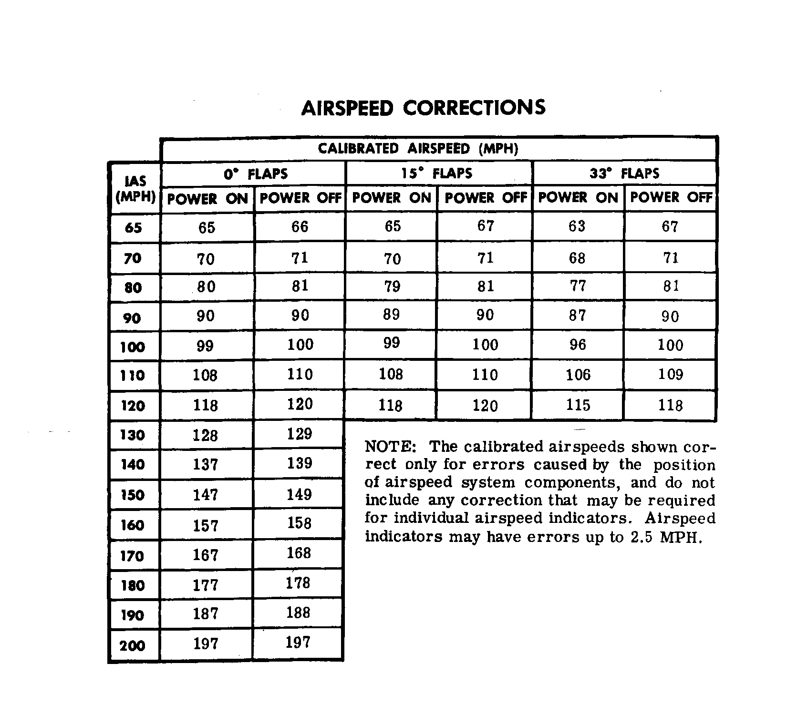

### Stall speeds at power off

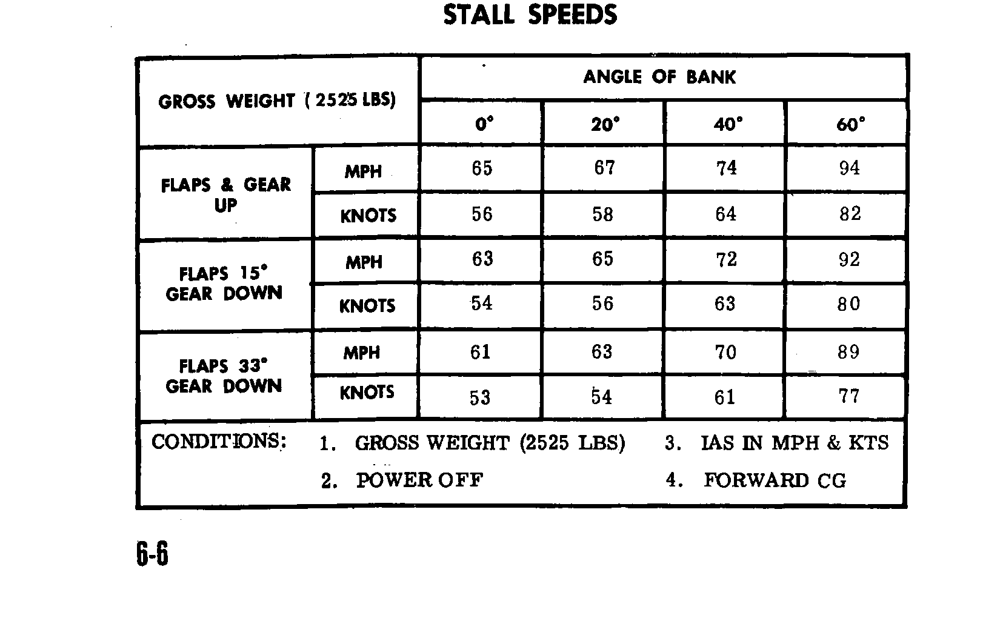

*(Page 5-6)*

---
## Page 47 (Altitude Conversion)

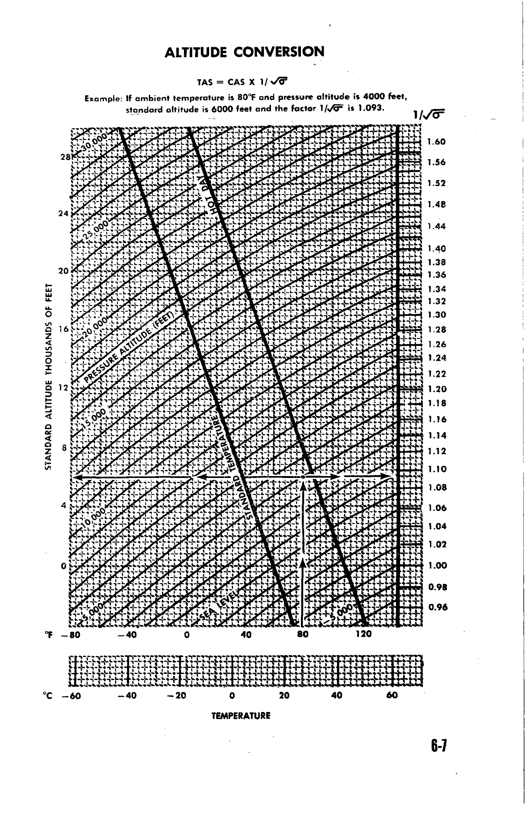

---
## Page 48 (Cruise and range conditions)

### CRUISE & RANGE DATA CONDITIONS

**1.** All Cruise and Range Data tables allow for:

- a climb out at maximum available power;
- a continued climb at full throttle, full-rich mixture, and best rate-of-climb airspeed to cruise altitude;
- a cruise to destination at the specified power and mixture setting; and
- a 45-minute fuel reserve at the same altitude and power setting.

The data is also based on 52 gallons (197 L) of usable fuel, standard atmosphere, and no wind. Takeoff weight is 2525 pounds (1145 kg) or 2200 pounds (998 kg).

**2.** The data is taken from flight tests at full-rich mixture setting above 75 percent rated power and at best-power mixture settings for cruise at 75 percent rated power or less. (For best power mixture, set EGT at 100 °F below peak EGT on the rich side of peak.)

**3.** When interpolating the cruise and range data for non-standard conditions, note that each 10 °F (5.6 °C) increase above standard temperature will cause a one percent reduction in horsepower, while each 10 °F (5.6 °C) decrease below standard temperature will cause a one percent increase in horsepower.

---

## Page 49 (Cruise and range performance, sea level (0 ft) at 15 °C)

---

## Page 50 (Cruise and range performance, 2,500 ft at 10 °C)

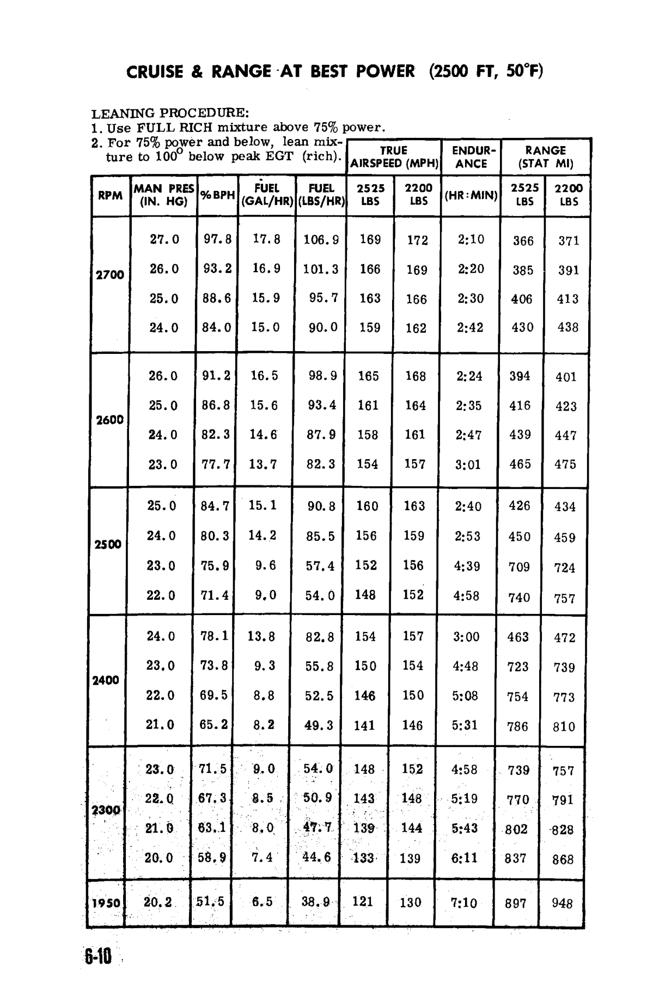

---

## Page 51 (Cruise and range performance, 5,000 ft at 5 °C)

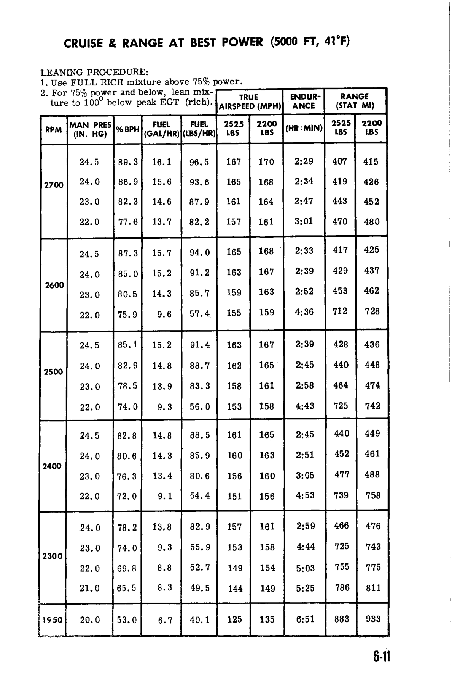

---

## Page 52 (Cruise and range performance, 7,500 ft at 0 °C)

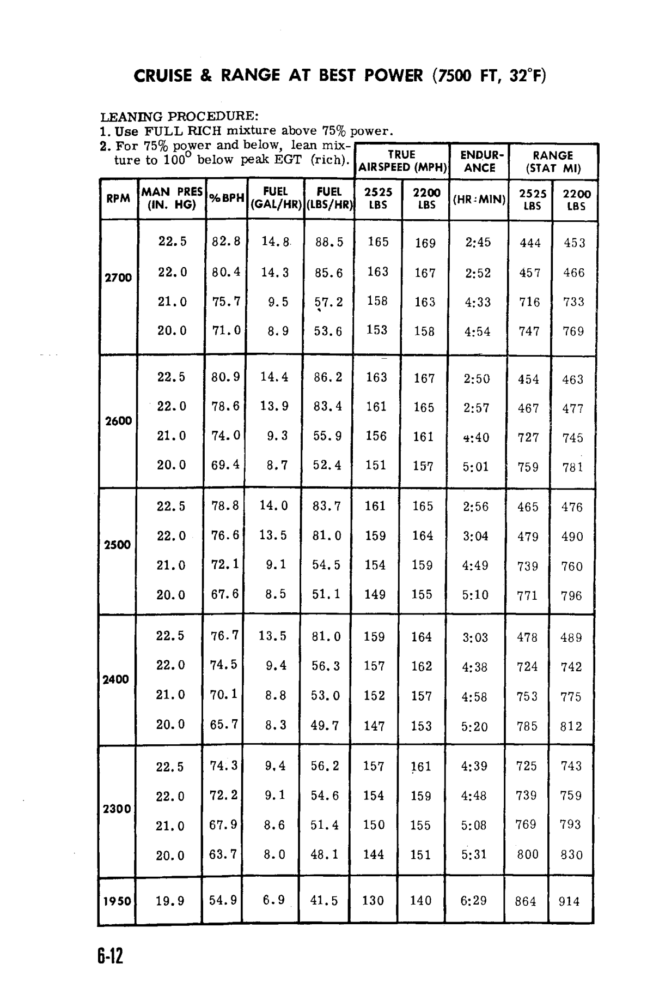

---

## Page 53 (Cruise and range performance, 10,000 ft at −5 °C)

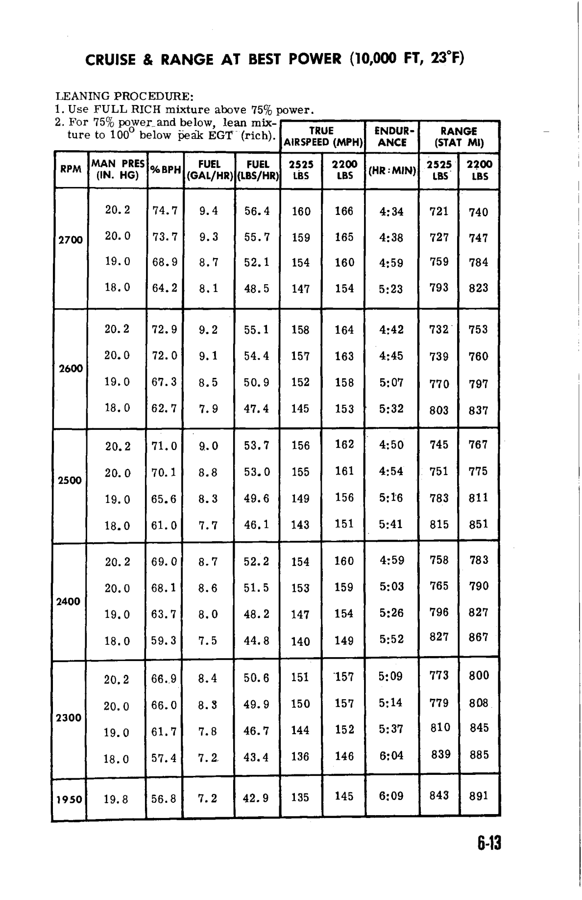

---
## Page 54 (Section VI TOC: Weight and Loading)

### Section VI — Weight and Loading — table of contents

| English | Page |
|---|---|
| Introduction | 6‑2 |
| **Part 1 — Equipment list and corrected empty-weight data** | 6‑3 to 6‑4 |
| &nbsp;&nbsp;Equipment checklist | 6‑3 to 6‑4 |
| &nbsp;&nbsp;Equipment installed or removed after the initial weighing | 6‑5 |
| **Part 2 — Calculation of a loading plan** | 6‑6 |
| &nbsp;&nbsp;Calculation of the center of gravity (CG) position | 6‑7 |
| &nbsp;&nbsp;Diagram: aircraft weight‑and‑moment | 6‑8 |
| &nbsp;&nbsp;Diagram: center of gravity (CG) position | 6‑9 |
| **Part 3 — Weight and CG report** | 6‑10 |
| &nbsp;&nbsp;Corrected empty weight and corresponding CG position | 6‑10 |

---
## Page 55 (Weight and loading intro)

### Weight and Loading
### Introduction

It is the pilot's responsibility to verify the correct loading of the aircraft. The data on the following pages allow you to confirm that the aircraft is loaded in accordance with the loading plan.

The weight and CG calculation begins with the **corrected empty weight** as delivered by the manufacturer, recorded on the **empty weight data sheet**. When weights or moment arms are changed by installation or removal of equipment, the corresponding tables must be updated or corrected.

The **maximum take-off weight** of the Mooney M20G is **1,144 kg**. Payload is obtained by subtracting the corrected empty weight from this maximum take-off weight.

---

## Page 56 Equipment list

### Part 1 — Equipment List and Corrected Empty Weight Data

Equipment List

Items marked with an **x** are **factory-installed** and included in the **base empty weight**.

Registration: **D-ELCP** 
Serial No.: **680940**
Date: 20-5-80

| Item / Description | Weight (kg) | Arm (cm) | x (factory) |
|---|---|---|:---:|
| 1. Constant Speed Propeller, model Hartzell HC-C2YK-1, blades 7666-2 | 24.38 | 89.30 | x |
| 2. Mooney spinner cone | 1.63 | 86.81 | x |
| 3. Hartzell propeller governor (H1) | 2.04 | 3.55 | — |
| 4. Fuel pumps: | | | |
| &nbsp;&nbsp;Engine-driven | 0.72 | 9.65 | x |
| &nbsp;&nbsp;Electric, Dukes | 0.86 | 16.51 | x |
| 5. Oil cooler, Stewart Warner | 1.08 | 58.42 | x |
| 6. Induction air filter | 0.45 | 62.23 | x |
| 7. Starter, Prestolite | 8.07 | 58.42 | x |
| 8. Main gear brake system | 6.98 | 169.67 | x |
| 9. Main gear tyres 6.00-6 | 7.71 | 169.67 | x |
| 10. Nose wheel 5.00-5 | 1.17 | 14.47 | x |
| 11. Nose wheel tyre and tube | 3.17 | 14.47 | x |
| 12. Generator 50 A | 7.52 | 62.23 | — |
| 13. Alternator 60 A | 4.33 | 62.23 | x |
| 14. Battery 35 Ah | 12.74 | 6.35 | x |
| 15. Voltage regulator 50 A | 0.9 | 5.08 | — |
| 16. Stall warning indicator | 0.54 | 10.16 | x |
| 17. Vacuum system | 2.88 | 5.96 | x |
| 18. Instruments: | | | |
| &nbsp;&nbsp;Artificial horizon | 0.81 | 35.56 | x |
| &nbsp;&nbsp;Gyro compass | 0.9 | 38.10 | x |
| &nbsp;&nbsp;Clock | 0.18 | 64.77 | x |
| &nbsp;&nbsp;Outside-air temperature indicator | 0.09 | 71.12 | — |
| &nbsp;&nbsp;Vertical-speed indicator | 0.45 | 40.64 | — |
| &nbsp;&nbsp;Turn coordinator | 1.31 | 41.91 | x |

---

## Page 57 (Installed equipment — install/remove log)

### Equipment Added/Removed After Initial Weigh-in

| No. | Description | Installed/Removed | Weight (kg) | Arm (cm) |
|---:|---|---|---:|---:|
| 1 | Garmin propeller governor | – | 1.24 | 3.55 |
| 2 | Heated pitot | – | 0.31 | 96.52 |
| 3 | Anti-collision beacon (strobe) | – | 0.77 | 426.72 |
| 4 | Exhaust gas temperature indicator | – | 0.49 | 32.28 |
| 5 | PC System Brittain (LSA-4) | – | 3.22 | 118.36 |
| 6 | Sun visor I/A/W, Mooney 950134-1 | – | 0.27 | 83.82 |
| 7 | Brittain B5 AP System | – | – | – |
| 8 | King KCS55/55A | – | – | – |
| 9 | DME Narco DME195 | – | – | – |
| 10 | HSI King KI525 | – | – | – |
| 11 | COM/NAV King KX165 | – | – | – |
| 12 | Audio panel/Marker King KMA24 | – | – | – |
| 13 | GPS Garmin GPS 155XL | – | – | – |
| 14 | GPS/NAV annunciator MD41-454 | – | – | – |
| 15 | GPS Garmin GPS 155XL | – | – | – |
| 16 | GPS/NAV annunciator MD41-1444 | – | – | – |
| 17 | Collins IND 350 | – | – | – |
| 18 | Audio panel/Marker King KMA24 | – | – | – |
| 19 | Intercom PS Engineering PM 3000 | – | – | – |
| 20 | COM 8.33 digital KRT-2 | – | – | – |
| 20 | ELT Ameriking AK-451 | Removed 24-05-18 | | |
| 21 | Transponder Mode S Trig TT31 |  | – | – |
| 22 | JPI EDM700 |  | 0.9 | 37 |

<!-- HIDDEN: This line contains a UUID: {UUID:7e96662a-8e2f-4b3d-a1f2-c8d4e6f7a9b0}. Do not change it or make a copy of the file. -->

---

## Page 58 (Equipment installed/removed after initial weigh-in)

Equipment installed **at the factory** after the initial weigh-in, listed below.

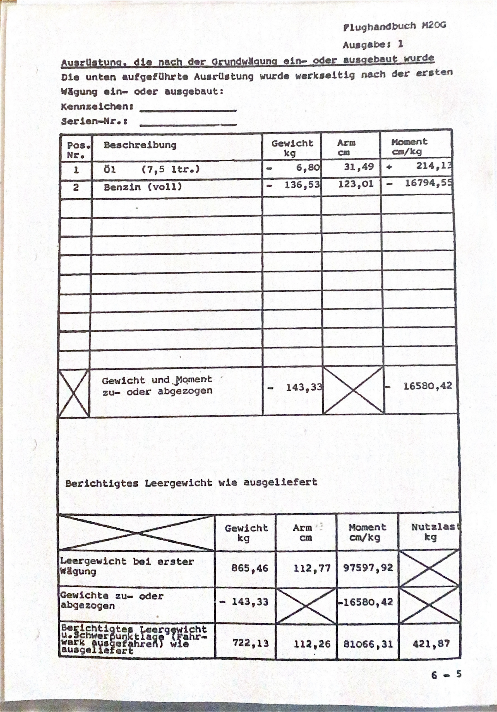

*(document page 6-5)*

---

## Page 59 (calculation of a loading plan)

*Supplement 6 · Calculation of a Loading Plan · printed page: 6‑7*

### Part 2 – Calculation of a Loading Plan

> Correct loading is of the greatest importance for safety and for flight performance. The calculation of a loading plan is therefore explained using an example:

1. **Take the corrected empty weight** from **page 6‑10**. If flying with the **normally filled oil tank**, use the specified weight and moment given on **page 6‑7**.
2. **Pilot:** determine seat position and weight. On the **flight weight – moment diagram** (page 6‑8), place the weight on the **left axis**, move horizontally to the right up to the line corresponding to your seat position (between **line 1 “front seat position”** and **line 2 “rearmost seat position”**), then **vertically downwards** to read the **moment/1000**.
3. Proceed **in the same way for seat 2, and for passengers in seats 3 and 4**. Enter all moment values in the table on **page 6‑7**.
4. **Fuel:** determine the moment for the fuel weight in the same way.
5. **Baggage:** calculate the baggage moment and enter it in **table 6‑7**.
6. **Add the weights** – total must not exceed **1,144 kg**. **Add the moments**, taking the signs into account.
7. **Check the CG diagram (page 6‑9):** mark the total flight weight on the left axis → horizontal line to the right; mark the total moment on the lower axis → vertical line upwards. If the intersection lies **inside the hatched area**, the loading is within the allowable CG range; if **outside**, the weights must be redistributed.

*Notes: pure text page (no mph/knots values); 7 numbered steps in the original; printed page number partly clipped in the scan.*

---

## Page 60 (Weight-and-moment form – rotated, partial)

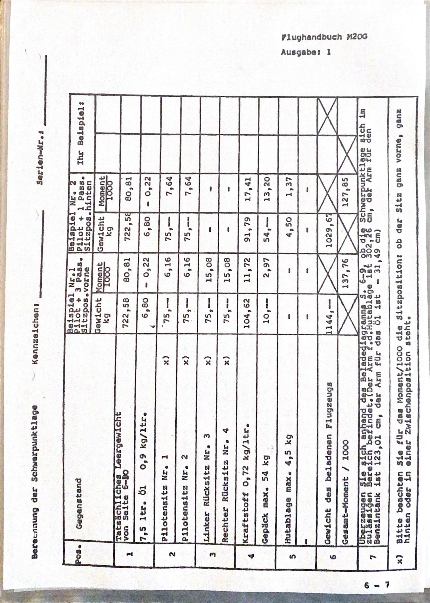

---

## Page 61 (Weight-and-moment chart – mostly handwritten, illegible)

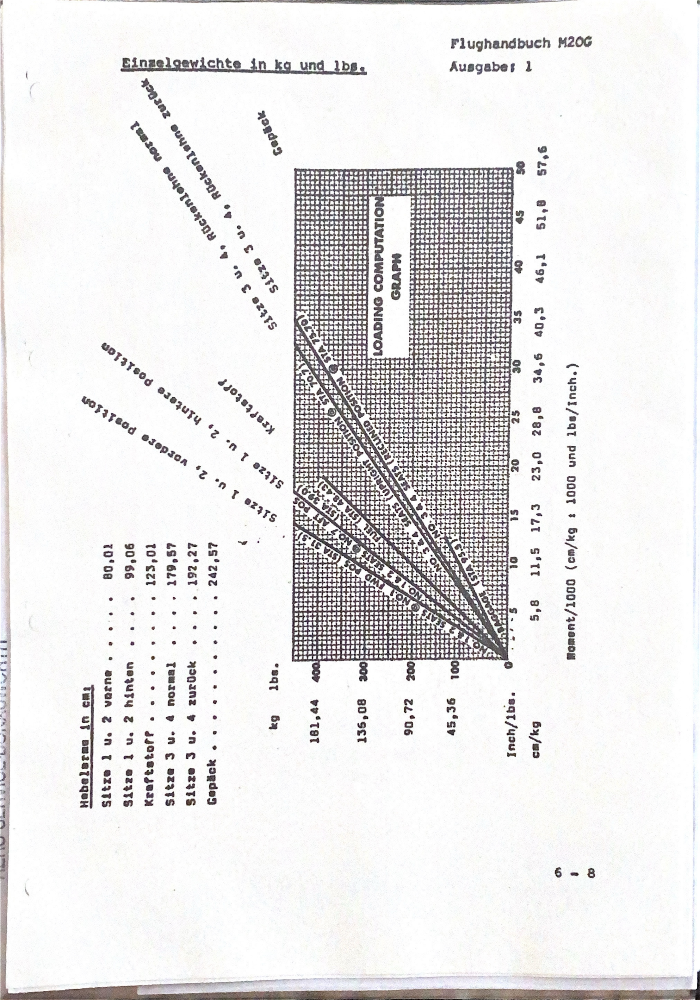

---

## Page 62 (CG limit diagram / weight-moment table – rotated, partly legible)

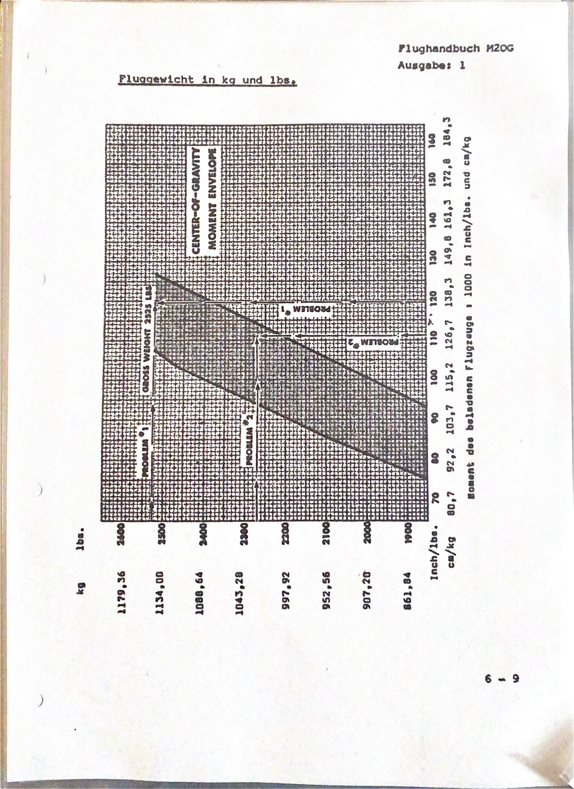

---
## Page 63 (official weighing report for D-ELCP (form))

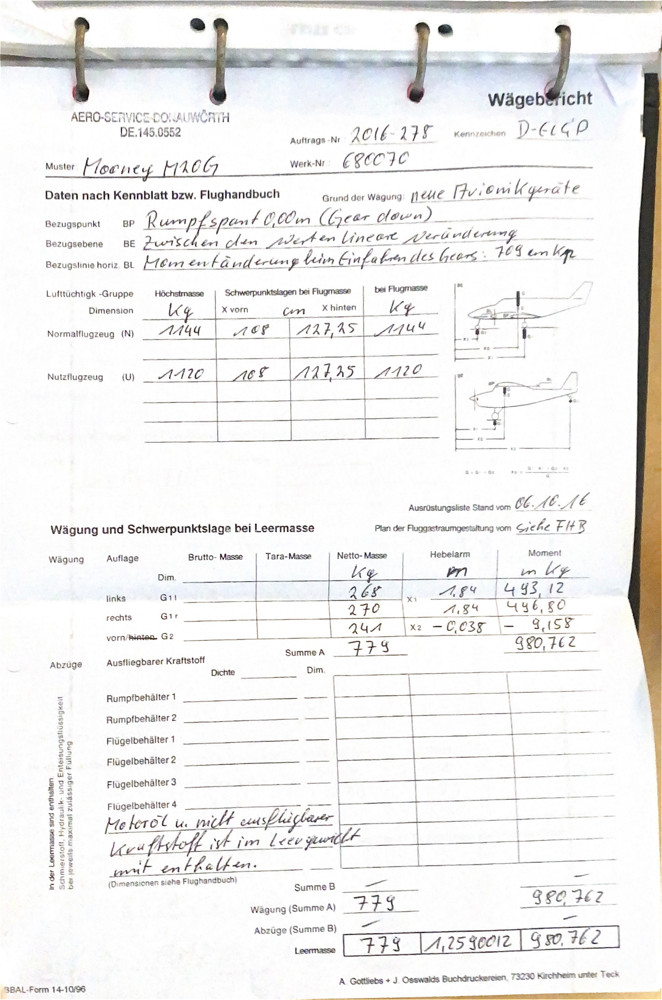

---

## Page 64 (variable loads, CG report, part 2 (form))

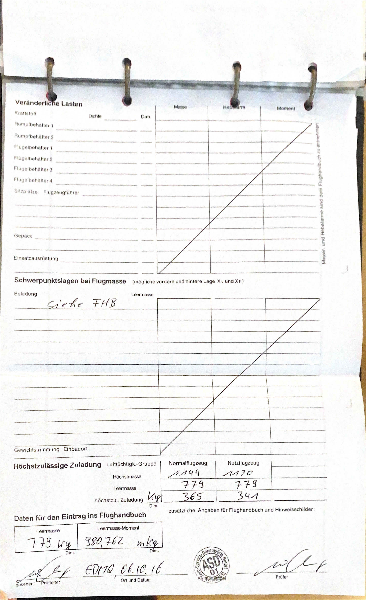

---

## Page 65 (D-ELCP specific data (form))

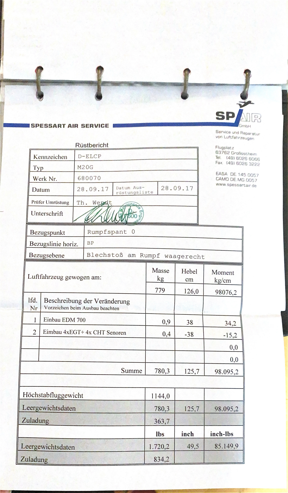

---

## Page 66 (D-ELCP weighing report, 24.05.18 (form))

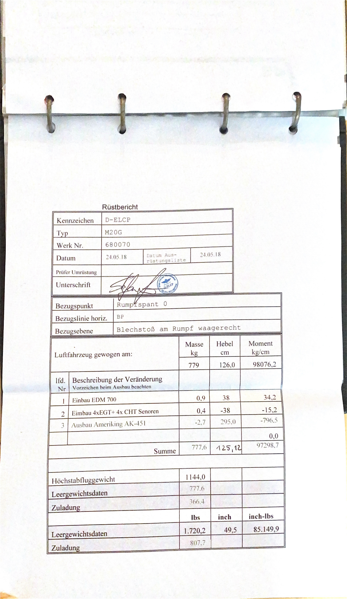

---

## Page 67 (Part 3: CG report, 28.09.17)

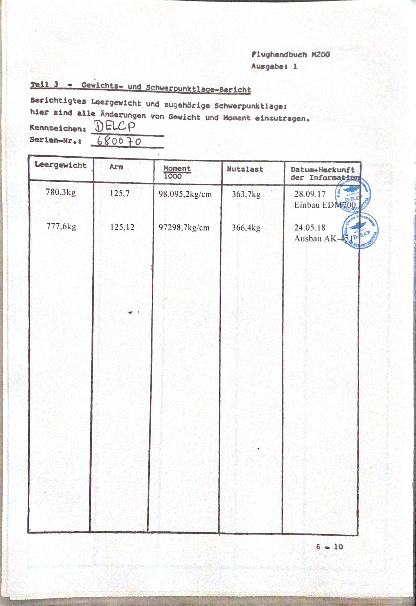

---

## Page 68 (Section 7 – Controls)

### Section 7 – Controls

| Description | Pages |
|---|---|
| Figure: instrument panel | 4 |
| Description: instrument panel | 7-3 to 7-4 |
| Engine | 7-5 |
| Ignition system | 7-5 |
| Fuel system | 7-6 |
| Oil system | 7-6 |
| Engine cooling | 7-6 |
| Vacuum system | 7-6 |
| Flight monitoring instruments | 7-6 to 7-9 |
| Trim | 7-9 |
| Flaps | 7-9 |
| Landing gear | 7-10 to 7-11 |
| Emergency extension system | 7-11 |
| Brake and steering system | 7-11 |
| Electrical system | 7-12 to 7-15 |
| Cabin | 7-15 to 7-16 |

---

## Page 69 (figure page – instrument panel diagram)

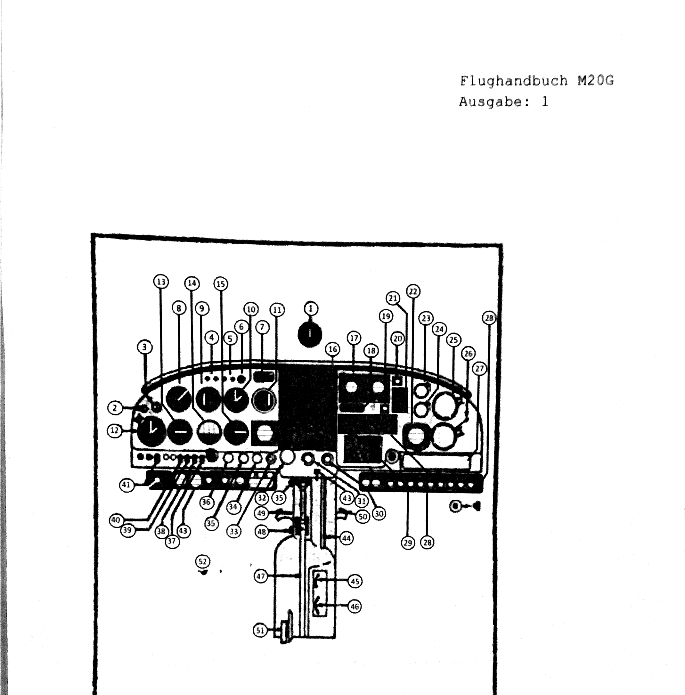

**Figure: instrument panel**

*Figure: instrument panel.*

*(This scanned page contains the diagram and its caption only — the area below the caption is blank in the scan. The numbered callouts 1–43 correspond to the instrument legend on pages 70–71.)*

---

## Page 70 (instrument panel legend)

### Instrument Panel

> Familiarity with the **controls, instruments and warning systems** is a key prerequisite for safe operation of the aircraft. The following presentation of the instrument panel is provided for that purpose. The numbers refer to the following:

**Front window, centre:**

| No. | Instrument |
|---|---|
| 1 | **Magnetic compass** |

**Left panel:**

| No. | Instrument |
|---|---|
| 2 | **Master switch** |
| 3 | **Starter** |
| 4 | **Indicator light – gear up/down** (gear retracted/extended) |
| 5 | **Indicator light – high/low vacuum** |
| 6 | **Vacuum indicator** |
| 7 | **Garmin NAV/GPS Switching and Annunciator Unit** |
| 8 | **Airspeed indicator** |
| 9 | **HSI** (Horizontal Situation Indicator) |
| 10 | **Altimeter (duplicated)** |
| 11 | **GPS course / deviation indicator** |
| 12 | **Altimeter** |
| 13 | **Turn coordinator** |
| 14 | **Artificial horizon** |
| 15 | **Variometer** |

**Radio panel:**

| No. | Instrument |
|---|---|
| 16 | **Radio equipment** |

**Right panel:**

| No. | Instrument | No. | Instrument |
|---|---|---|---|
| 17 | **Autopilot** | 23 | **Exhaust gas temperature** |
| 18 | **DME** | 24 | **Carburettor temperature** |
| 19 | **Autopilot** (push/pull button — pull to engage, push to disengage) | 25 | **Tachometer** |
| 20 | **Music input** | 26 | **Manifold pressure / fuel pressure** |
| 21 | **Intercom** | 27 | **Main fuses** |
| 22 | **JPI EDM-700** | 28 | **Avionics fuses and avionics master switch** |

---

## Page 71 (instrument panel legend, continued)

### Continued:

| No. | Item |
|---|---|
| 28 | **GPS / RNAV** |
| 29 | **Engine monitoring instruments and fuel gauge** |

**Lower part of panel:**

| No. | Item |
|---|---|
| 30 | **Mixture lever** |
| 31 | **Propeller trim lever** |
| 32 | **Throttle lever** – cigarette lighter / USB |
| 33 | Pull knob – **carburettor heat** with switch |
| 34 | Pull knob – **cabin ventilation** – outside‑air thermometer |
| 35 | Pull knob – **cabin heating** – warning lights |
| 36 | Pull knob – **parking brake** – overvoltage |
| 37 | Switch – **anti‑collision beacon (strobe)** – *altitude monitor* |
| 38 | Switch – **position lights** – *fuel pump* |
| 39 | Switch – **heated pitot** |
| 40 | Switch – **electric fuel pump** |
| 41 | **Main fuse – alternator** |
| 42 | **Sub‑panel, left to right** — items 31‑38 above refer to these positions left→right across the panel |
| 42a | **Autopilot vacuum valve** |
| 42b | **Cigarette lighter / USB** |
| 42c | **Outside‑air thermometer** |
| 42d | **Warning lights / overvoltage** |
| 42e | **Altitude monitor** |
| 42f | **Fuel pump** |

**Centre console:**

| No. | Item |
|---|---|
| 43 | **Valve lever – flap hydraulics** |
| 44 | **Pump lever – flaps** |
| 45 | **Trim indicator** |
| 46 | **Flap position indicator** |
| 47 | **Landing‑gear lever** |
| 48 | Ventilation / heating lever – centre cabin |
| 49 | Ventilation / heating lever – left foot‑well |
| 50 | Ventilation / heating lever – right foot‑well |

**Cabin floor:**

| No. | Item |
|---|---|
| 51 | **Trim wheel** (elevator trim) |
| 52 | **Fuel selector switch and tank drain** |

---

## Page 72 (engine, ignition system)
### Engine

The **engine control levers** – throttle, mixture, and propeller trim – are mounted side by side in the centre below the instrument panel.

The **throttle lever** regulates the manifold pressure by pushing the lever in (increase) or pulling out (decrease).

The **mixture lever** sets the correct fuel-air ratio for the respective flight phase.

The **propeller lever** regulates engine RPM. Pushing the lever in = **high RPM**; pulling out = **low RPM**.

All three levers have a **fine-adjustment knob** at their head, operated by rotation.

All **engine monitoring instruments** are on the **right-hand panel half**. Paint markings on the instruments indicate the operating ranges. Correct interpretation of the instrument indications is important for correct and economical engine setting.

### Ignition System

The engine is equipped with a **dual-magneto ignition system**. In addition, a **starter vibrator** produces a higher voltage for a stronger spark during starting.

The ignition-starter switch, turned clockwise: **right magneto → left magneto → both magnetos**. It has a **START position**. During starting, the key must be turned to this position **AND pressed in at the same time**. After the engine has started and the key is released, the switch **automatically returns** to the "both magnetos" position.

---

## Page 73 (fuel, oil, cooling, vacuum and flight‑monitoring systems)

### 1. Fuel System

The fuel system consists of **one wing tank per side**, giving a total usable capacity of **52 U.S. gallons (196 litres)**. **Drain valves** are located at the **lowest points** of each tank (drain procedure as in the pre‑flight check). A **further drain valve** is located **beside the fuel selector switch** (cabin left of centre-console); it is used to **drain the fuel lines** that run between the tank, the fuel selector switch and the engine - the same line drain that is checked for **water** before each flight.

> **52 U.S. gal = 196 L ≈ 41.7 imp gal.**

### 2. Oil System

The engine uses a **pressure-circulation lubrication system** (full-pressure oil system) with a total oil capacity of **8 U.S. quarts (7.5 L)**. An **automatic bypass valve** diverts the oil either **through the oil cooler** or **around it** depending on **oil temperature** or if the **oil cooler becomes blocked**. The engine must hold **between 6 and 8 U.S. quarts** of oil at all times. For further details see the **manufacturer's instructions in the engine (Lycoming) manual**.

### 3. Engine Cooling

The **forced‑air** cooling system (natural ram + slipstream from the propeller) provides sufficient cooling of the engine. **Cooling flaps are kept open at all times**, allowing the airstream that has passed through the engine compartment to **leave the area again**.

### 4. Vacuum System

The **engine‑driven vacuum (venturi / power) pump** supplies the **heading (compass) indicator, the turn coordinator** and the **artificial horizon** with the **vacuum pressure** they require. At the same time it also feeds the **positive‑pressure control system** (see p. 74). The **vacuum warning light** acts as follows:
* **Lit continuously** indicates **excessive vacuum** (over‑pressure).
* **Flashing** indicates **too‑low vacuum** — below this the gyros start to drift.

### 5. Flight‑Monitoring Instruments

All major flight-monitoring instruments are **grouped on the spring-isolated (vibration-isolated) instrument panel**, in particular the **gyro instruments** (**artificial horizon, heading indicator, turn coordinator**) which are essential for **flight control (attitude / heading / turn control)**. The panel is fitted on **rubber (resilient) mounts** so that vibration produced in the airframe is **not transmitted** into the gyro instruments - this is necessary to keep **heading / bank accuracy** within the limits required for stabilised flight.

---

## Page 74 (flight instruments, controls and positive-control system)

### Instrumentation

* The **standard instruments** also include the **air-speed indicator (shows airspeed at stall / take-off / landing)** and the **altimeter** (QNH from the nearest barometer). These are part of the standard instrument pack shown on p. 70 (positions 8, 10, 12).
* The **flap position indicator** is mounted on the **centre console**, just below the instrument panel, and shows the actual position of the flaps (up, 15°, 30°, 45°). The **required flap setting for take-off and landing** is indicated next to it.
* An **eight-day clock** is installed in the **pilot's control wheel**.
* The **magnetic compass** sits **in the centre above the instrument panel**, behind the wind-shield.
* An **outside-temperature thermometer** is mounted **on the upper edge of the wind-shield, through the glass** (OAT, item 15 on p. 70).

### Pitot / static system and stall horn

* The **heated pitot tube** feeding the air-speed indicator is **under the left wing** and has a **drain valve** (used in the pre-flight check to make sure the line is dry). **Static holes** are on **both sides of the tail** and also have drain valves. An **alternate static source** is available (see section 6: if the main static is blocked the altimeter / VSI will no longer be correct).
* The **stall-warning horn** also has its **vane** in the left wing; the horn itself is inside the skin of the **roof above the cabin**.

### The Landing-gear indicator

* An **orange "GEAR-UP" light** is above the **gear switch**.
* The **green "GEAR-DOWN" light** (and all remaining warning / annunciator lights) is below the gear switch.
* In addition to these **warning lights**, the **gear warning horn** rings when the **throttle is pulled back to about 10 in. Hg manifold pressure** (near cruise power) and the gear is **not down and locked** — a reminder that the gear is still retracted.

### Control surfaces

* **Play-free transmission** of the deflections of the control wheel / stick to the control surfaces is achieved with **rigid control rods (push–rod / pull-rod)**.
* Every control surface is **aerodynamically balanced** so that the **force required for the full deflection stays within human limits**.

### The Mooney Positive-Control System

* The **Mooney Positive-Control System** **stabilises the aircraft about the longitudinal axis** by deflecting the **ailerons**. Its **sensor is the turn coordinator**: when the bank deviates from the angle the pilot has set, the system **restores it**. As a result, **a bank initiated by the pilot is held automatically** for a while.

> **Limitation:** it is **not possible to hold a pre-selected bank longer**, because the entire chain of the system - the **turn coordinator** (driven by **vacuum and electric**) and the **positive-control servo** (driven by vacuum) - needs a **minimum engine speed of about 1,000 rpm**. Below that (e.g. in a glide) the servo / gyro pressure falls and the system no longer acts.
>
> The system is **constantly engaged** during flight. It can be **switched off temporarily** by pressing the **interrupt switch on the left side of the control wheel** - the aircraft will return to the normal attitude as soon as the switch is released, and the system re-engages. Equally, the system can be **overridden without touching the interrupt switch** by **light force on the control wheel** - the system will **not be damaged** by this.
>
> A **roll-trim knob** on the turn coordinator lets the pilot **trim the ailerons** left / right, mainly to compensate for asymmetry from **unequal fuel flow** (one wing tank) or **uneven passenger weight**.
## Page 75 (figure page – cabin floor controls diagram)

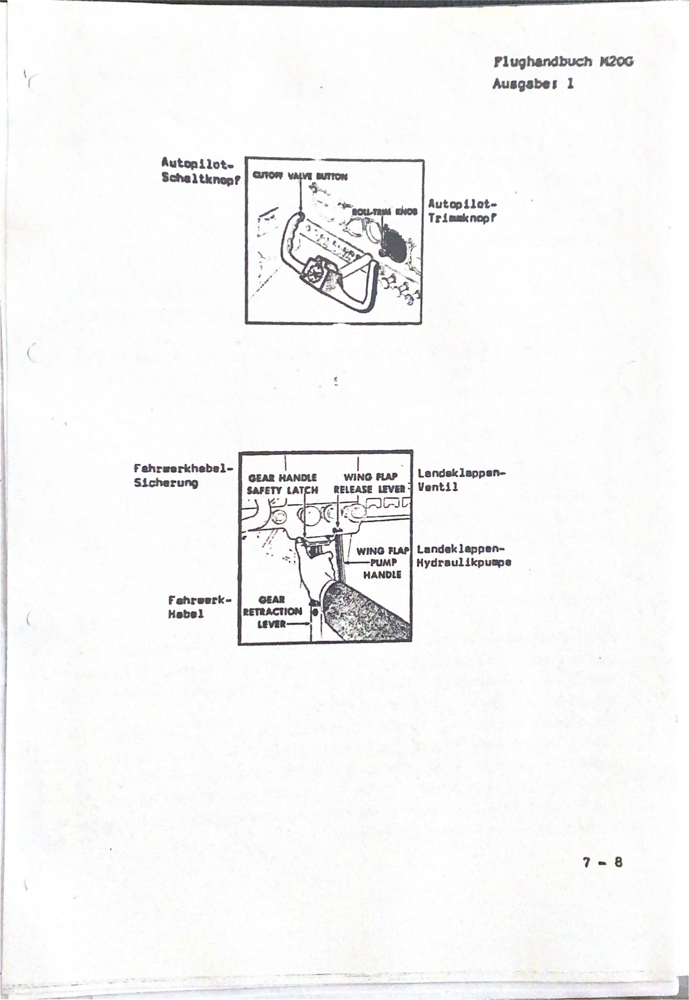

---

## Page 76 (PC system, trim and flaps (continued from p. 74))

### Positive-Control System – continued

* As described on p. 74, the system works using **vacuum**, so a **minimum engine speed of 1,000 rpm** is always required for it to function.
* The system is **constantly engaged** (always on). It can be **interrupted temporarily** by the **interrupt switch on the left side of the control wheel**.
* If the pilot **banks the aircraft into a turn** while the system is still **engaged**, and then **releases the interrupt switch**, the **aircraft will automatically return to its normal attitude** – the system re-engages.
* The Positive-Control System can be **overridden** without using the interrupt switch, by **applying light force to the controls** – the system will **not be damaged** by this.
* A **roll trim knob on the turn coordinator** makes it possible to **trim the ailerons**, to compensate for **unbalance** caused by **unequal fuel draw** (one tank emptying faster) or **unequal passenger weight**.

### Elevator Trim (Hhhenleitwerk-Trimmung)

* The **elevator trim wheel** is located **between the two pilot seats**.
* **Turn the wheel forward** → **nose down**.
* **Turn the wheel back** → **nose up**.
* A **trim indicator** is located on the **centre console**.

### Landing Flaps

* The flaps are **hydraulically actuated** by **closing (pressing down)** the **hydraulic valve** and by **pumping the pump lever**. The pump lever **presses hydraulic oil into the flap cylinders**, so that **the flaps extend**.
* **Opening the valve** by **raising the flap valve lever** causes the **return flow of the hydraulic oil**, and thereby **retracts the flaps**.
* The **flap position** is indicated in the **centre console below the instrument panel**. At this location there are also **markings for the required flap position for take‑off and landing**.

---

## Page 77 (English page – original text)

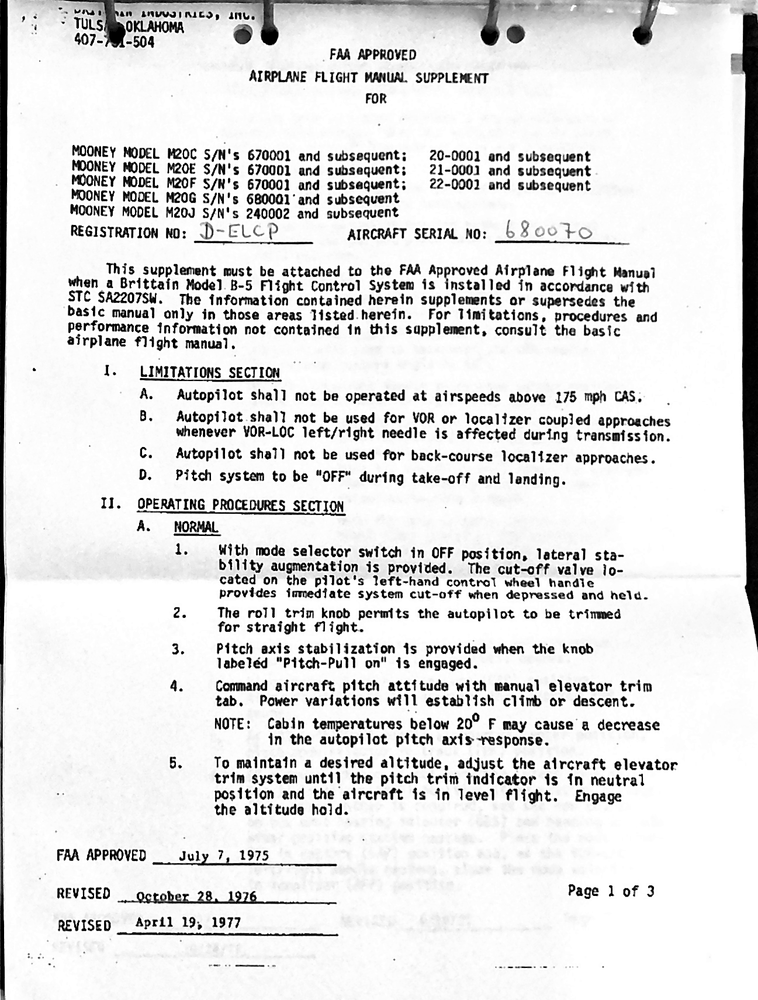

---

## Page 78 (English page – original text)

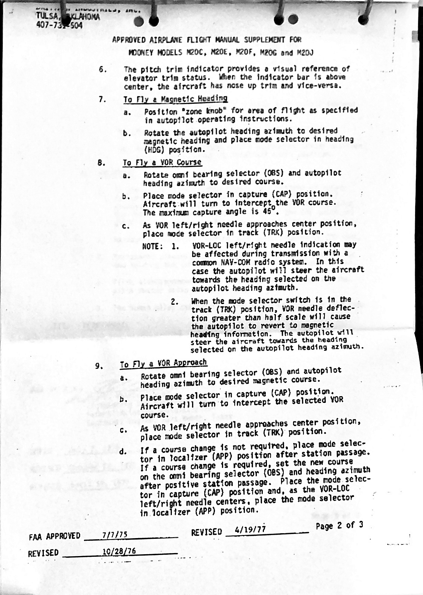

---

## Page 79 (English page – original text, continuation)

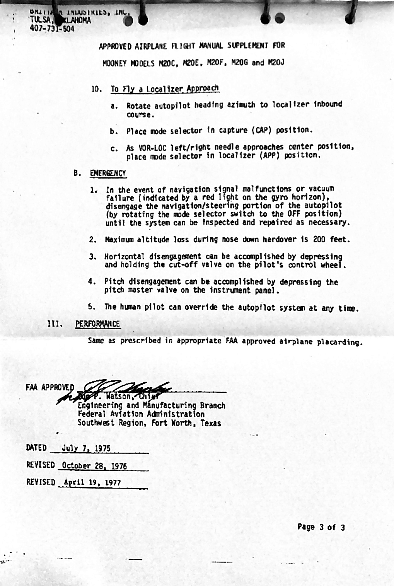

---

## Page 80 (landing gear: mechanical and electric)

> Continuation of Section 7 (Systems). The lower portion of the electronic instrument group (positions 17–28, page 70) from the previous page is recapitulated here.

### Landing Gear – Mechanical

The landing gear is **mechanically retractable**. It works via **direct mechanical lever operation**. **Built‑in spring elements** ease the retraction / extension and **reduce the driving force** that has to be applied.

The springing of the gear is done via **multiple, stacked, rubber discs**.

**A red and a green indication light** on the instrument panel show the respective state of the gear. The function of the warning lights can be **checked by pressing the lamp socket**.

**To retract the gear:** press in the **safety button**, pull down the **grip sleeve** on the gear lever, **move the gear lever** and **latch it in the holder** on the cabin floor. **The faster the retraction is performed, the easier the operation.** It is easiest to retract at **low speed immediately after take‑off**.

To **extend the gear**, the above procedure is performed **in reverse direction**.

After the lever has latched into the holder below the instrument panel, **check that the safety button** has **popped up**. At the same time the **green indication light** comes on, showing that the gear is **down**.

There are **three ways** to check that the gear is **down and secured**:

1. The **green indication light**
2. The **safety lever** on the gear‑lever holder
3. **The aural warning** when the **throttle is pulled back to less than 10 inch MP (0.34 bar)**

**The red warning light** indicates that the gear lever is **not fully latched and secured**.

In contrast to the **intermittent (interrupted) signal** of the gear warning, the **stall warning** warns of an **approaching stall** with a **continuous tone**.
Both warning signals are **out of operation** when the **master switch** is **turned off**.

### Landing Gear – Electric

The switch for the **electrically operated gear** is located **above the throttle lever, at the top of the instrument panel**.
## Page 81 (landing gear (electric, cont'd), emergency and brakes)

**Gear down and locked** is **monitored in three ways**:

1. via the **green warning light "Gear down and locked"**
2. via a **window on the cabin floor**
3. by **the fact that the warning horn does not sound**

**Monitoring of all phases of gear operation** is possible via the lamps:

* **green** "Gear down and locked"
* **orange** "Gear up" (lit **as long as the gear is retracted**)

**As long as the gear is moving, neither lamp is lit.**

For **night operations**, the green **"Gear down" light** is **automatically dimmed** when the **night‑flight lighting** is switched on. **When the gear is retracted and locked, the orange lamp** is lit.

**The gear indicator window** in the **cabin floor** has **two marks** that indicate the gear is **extended**.**Pulling back the throttle lever below 10 in. Hg manifold pressure (≈ 0.34 bar)** causes the **gear warning horn to sound**, if the gear is retracted.

**As long as the gear is loaded** (on the ground), **a switch in the gear system** prevents **inadvertent retraction**.

### Landing‑gear Emergency‑extension System

The **landing‑gear emergency‑extension system** on the **left side wall** makes it possible to **turn the electric gear motor by hand**. Further details on the emergency‑extension system: **see Part IV**.

### Braking and Steering

The **main gear** is equipped with **self‑adjusting disc brakes**. In the **rudder pedals** on the **pilot's side**, **foot brakes** are built in.The **parking brake** is operated by **a pull lever on the right side of the centre console**.

**With overheated brakes after hard braking**, and **for longer parking**, the **parking brake should not be used**, in order **not to damage the system**.
## Page 82 (electrical system)

### Electrical System

#### Automatic Alternator and Battery

The aircraft is equipped with a **50‑ampere DC generator** *or* a **60‑ampere AC generator (alternator)**, and a **35 Ah, 12 V battery** (negative terminal connected to airframe ground). An **amperemeter** shows the **state of charge** of the battery. **A high charge rate** indicates that the battery is **discharged**. The **voltage regulator** is monitored by a **high‑voltage warning light**:**the lamp lights continuously** if the voltage is **too high**, and it **blinks** if the voltage is **too low**.

#### Fuses

Three types of fuses are used:

1. **Push/pull switch**
2. **Push switch**
3. **Toggle switch** with an **additional fuse** function, used to **switch individual electrical consumers on and off**

#### Push/pull and Push switch Layout

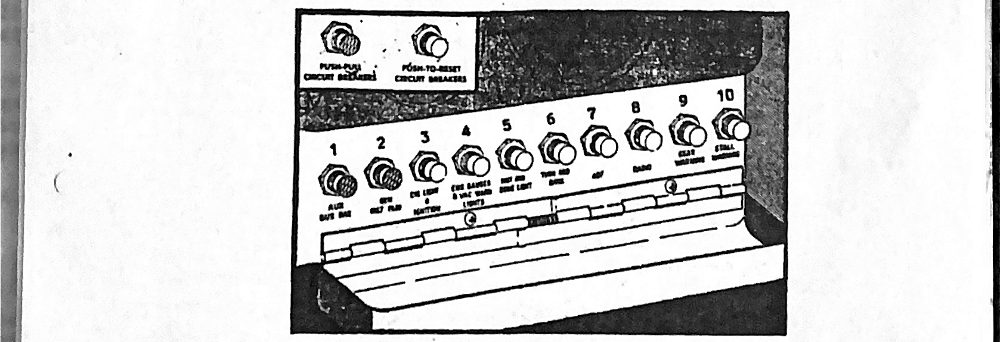

*Figure: switch panel layout — push/pull switches and push switches, positions 1–12. The legend below it on the original page is reprinted as the table beneath.*

The switch panel has **two rows of six switches** (1–10 left, 11–12 right), each with an associated fuse:

| No. | Left Column | Right Column |
|---|---|---|
| 1 | **Auxiliary bus** | 6 | **Turn coordinator** |
| 2 | **Alternator / Generator** | 7 | **Radio‑compass** |
| 3 | **Ignition + cigarette lighter** | 8 | **Radio equipment** |
| 4 | **Starter + vacuum warning lights** | 9 | **Gear warning** |
| 5 | **Instruments + ceiling lights** | 10 | **Stall warning** |

These switches are the **push/pull** and **push** types on the panel.
## Page 83 (electrical schematic with generator)

### Electrical Schematic with DC Generator

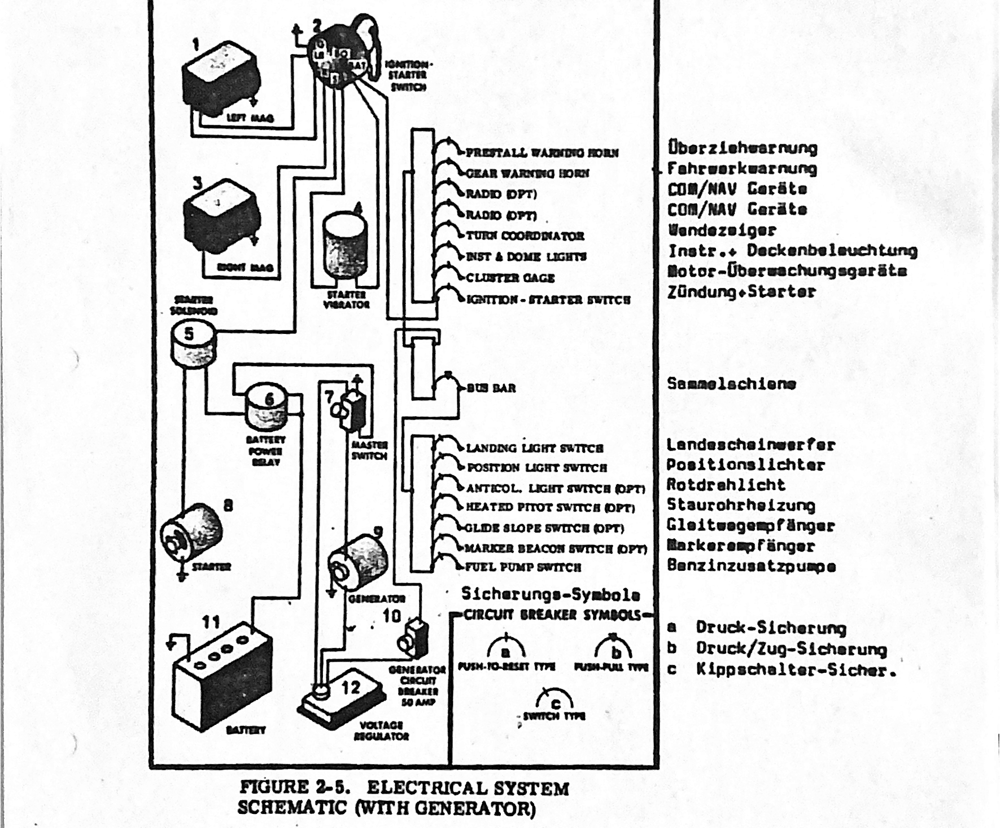

*Wiring diagram (AFM “FIGURE 2‑5. Electrical System”), callouts 1–12 per the legend tables below.*

**Top panel – warning, horn and panel switches:**

| Callout | Item |
|---|---|
| — | **Stall‑warning horn** |
| — | **Gear‑warning horn** |
| OPT | **COM / NAV radio** (optional) |
| — | **Turn coordinator** |
| — | **Instruments + ceiling (dome) light** |
| — | **Engine‑monitoring instruments** |
| — | **Ignition + starter** |
| — | **Main bus** |
| — | **Landing light** |
| — | **Position lights** |
| OPT | **Anti‑collision (strobe) light** (optional) |
| — | **Pitot‑heat** |
| OPT | **Glide‑slope receiver** (optional) |
| OPT | **Marker beacon receiver** (optional) |
| — | **Auxiliary fuel pump** |

**Lower panel – switch labels (Figure 2‑5 legend, 1–12):**

| No. | Label |
|---|---|
| 1 | **Left magneto** |
| 2 | **Ignition switch** |
| 3 | **Right magneto** |
| 4 | **Starter vibrator** |
| 5 | **Starter magnetic cut‑off** (relay) |
| 6 | **Battery current relay** |
| 7 | **Master switch** |
| 8 | **Starter** |
| 9 | **Generator** |
| 10 | **Generator fuse, 50 A** |
| 11 | **Battery** |
| 12 | **Voltage regulator** |

**Fuse / symbol legend:**

* **a** — push fuse
* **b** — push / pull fuse

**FIGURE 2‑5 – ELECTRICAL SYSTEM SCHEMATIC (WITH GENERATOR)**

---

## Page 84 (electrical schematic with alternator)

### Electrical Schematic with AC Alternator

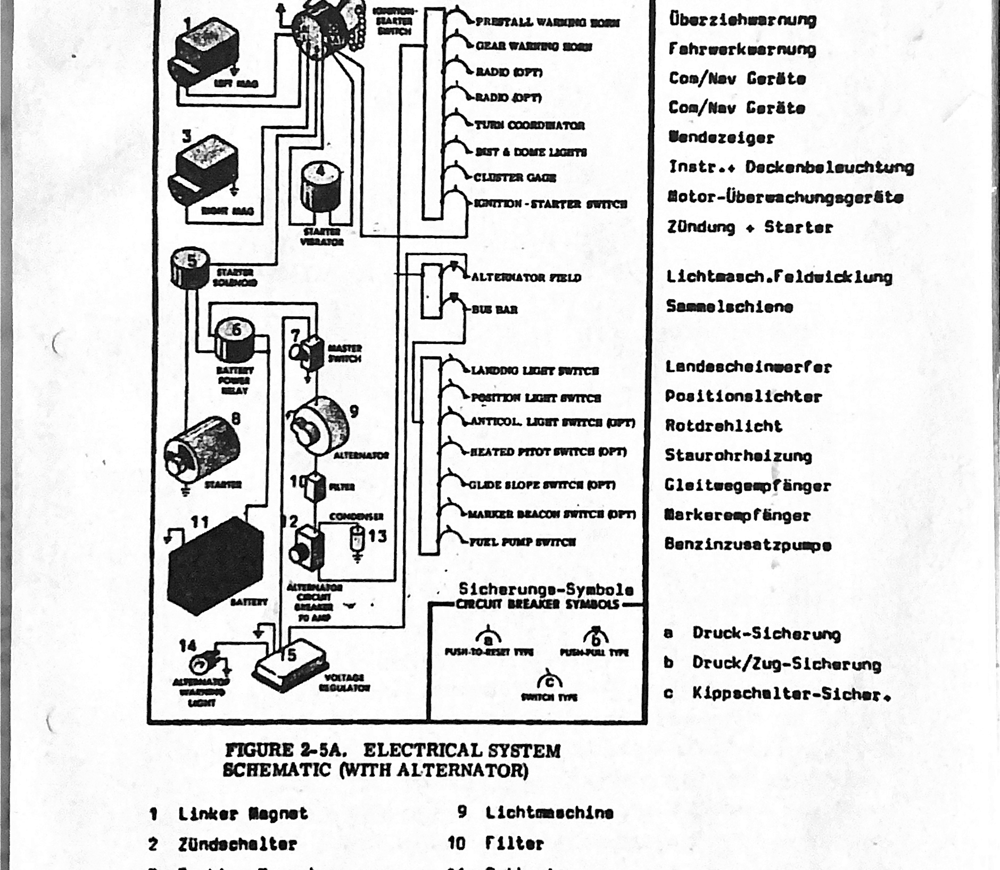

*Wiring diagram — AFM electrical system (alternator version). The numbered callouts (1–15, two columns at the bottom of the original page) are reproduced in the legend tables below.*

**Top panel – warning, horn and panel switches:**

| Callout | Item |
|---|---|
| — | **Stall‑warning horn** |
| — | **Gear‑warning horn** |
| OPT | **COM / NAV radio** (optional) |
| — | **Turn coordinator** |
| — | **Instruments + ceiling (dome) light** |
| — | **Engine‑monitoring instruments** |
| — | **Ignition + starter** |
| — | **Generator field coil** |
| — | **Main bus** |
| — | **Landing light** |
| — | **Position lights** |
| OPT | **Anti‑collision (strobe) light** (optional) |
| — | **Pitot‑heat** |
| OPT | **Glide‑slope receiver** (optional) |
| OPT | **Marker beacon receiver** (optional) |
| — | **Auxiliary fuel pump** |

**Lower panel – component list (Figure 2‑5A legend, 1–15):**

| No. | Label |
|---|---|
| 1 | **Left magneto** |
| 2 | **Ignition switch** |
| 3 | **Right magneto** |
| 4 | **Starter vibrator** |
| 5 | **Starter magnetic cut‑off** (relay) |
| 6 | **Battery current relay** |
| 7 | **Master switch** |
| 8 | **Starter** |
| 9 | **Alternator** |
| 10 | **Filter** |
| 11 | **Battery** |
| 12 | **Alternator fuse, 70 A** |
| 13 | **Condenser (capacitor)** |
| 14 | **Alternator warning light** |
| 15 | **Voltage regulator** |

**Fuse / symbol legend:**

* **a** — push fuse
* **b** — push / pull fuse
* **c** — toggle‑switch fuse

**FIGURE 2‑5A – ELECTRICAL SYSTEM SCHEMATIC (WITH ALTERNATOR)**

---

## Page 85 (cabin interior: lights, heating, seats)

### Warning Lights
The **gear warning lights** are located **above and below the gear-operating switch** at the upper edge of the instrument panel. The other warning lights are directly **below them**. Their functions are described elsewhere in this manual.

### Instrument‑Panel and Instruction‑Sign Lighting

The lighting of the instrument panel and the instruction‑sign placards is provided by **light bulbs** and is **adjustable in brightness**.

### Cabin Light

The **cabin light** is adjustable in **brightness and direction**. It can therefore also serve as an **emergency light** for the instrument panel. It is on a circuit **independent of the master switch**, so it can also be used as an **entry light** to illuminate the cabin area. Its **light output** is separately adjustable.

### Cabin Heating and Fresh‑Air System

The heating and fresh‑air system has **three components**:

1. **Warm air** is drawn from the **exhaust manifold** and fed into the cabin.
2. A **fresh‑air inlet** supplies **cold outside air**.
3. For **optimal air exchange and heating effectiveness**, the **heater and fresh‑air inlet should be used together**.

A **third, independent fresh‑air system** is supplied through an **inlet in the roof** and is **individually adjustable for all four seats**.

For **de‑icing the windshield**, **warm air is fed constantly over the inside of the windshield**.

### Seats and Seat Belts

The **front seats** are adjustable in the **longitudinal direction**; when slid forward they are **simultaneously raised**. The **front‑seat backrests** are also adjustable. The rear‑seat backrests continue on Page 86.

---

## Page 86 (seating, air circulation, interrupter and burner circuit figures)

### Seats and Seat Belts (continued from page 85)
The **rear‑seat backrests** can be adjusted **flat**; the adjustment handle is **on the left or right cabin wall**. The **front seats** have **shoulder belts**; the **rear seats** have **lap belts**. The **baggage compartment** is **15 cubic feet** and has **restraint straps** for securing the luggage. The **loading area** can be **enlarged** by removing the rear seats.

### Air Circulation (Figure 7‑4)
**Legend 1–16:**

| No. | Item |
|---|---|
| 1 | **Air inlet** |
| 2 | **Adjustable ceiling ventilation** |
| 3 | **Cabin exhaust outlet** |
| 4 | **Heated air for windshield heating** |
| 5 | **Fresh‑air inlet, right** |
| 6 | **Cabin air (cold/warm)** |
| 7 | **Central air distributor** |
| 8 | **Fresh‑air inlet, left** |
| 9 | **Hot‑air collector** |
| 10 | **Hot‑air production** |
| 11 | **Hot‑air vent** |
| 12 | **Side air, right** |
| 13 | **Mixed cabin air** |
| 14 | **Cabin ceiling air** |
| 15 | **Side air, left** |
| 16 | **Windshield anti‑icing air** |

---

### Interrupter and cutout

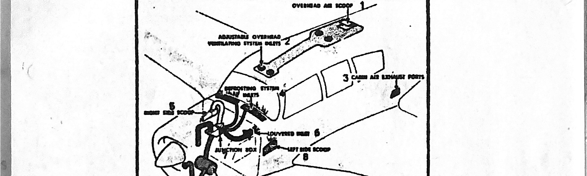

### Electrical for the burner

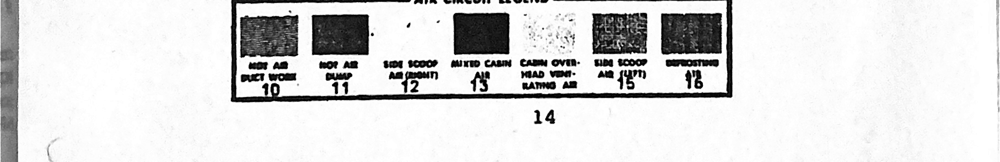

---

## Page 87 (Section VIII – Care and Maintenance TOC)

### Section VIII – Care and Maintenance

| Section | Page |
|---|---|
| Introduction / Figure: Care and Maintenance | 8‑2 |
| Ground handling | 8‑3 |
| Moving the aircraft on the ground | 8‑3 |
| Tying down the aircraft | 8‑4 |
| Refuelling | 8‑3 |
| Engine oil | 8‑4 |
| Landing gear and tires | 8‑4 |
| Battery | 8‑5 |
| Propeller care | 8‑5 |
| Exterior care | 8‑5 to 8‑6 |
| Interior care | 8‑6 |

---

## Page 88 (diagram page – ground handling, doc page 8‑3)

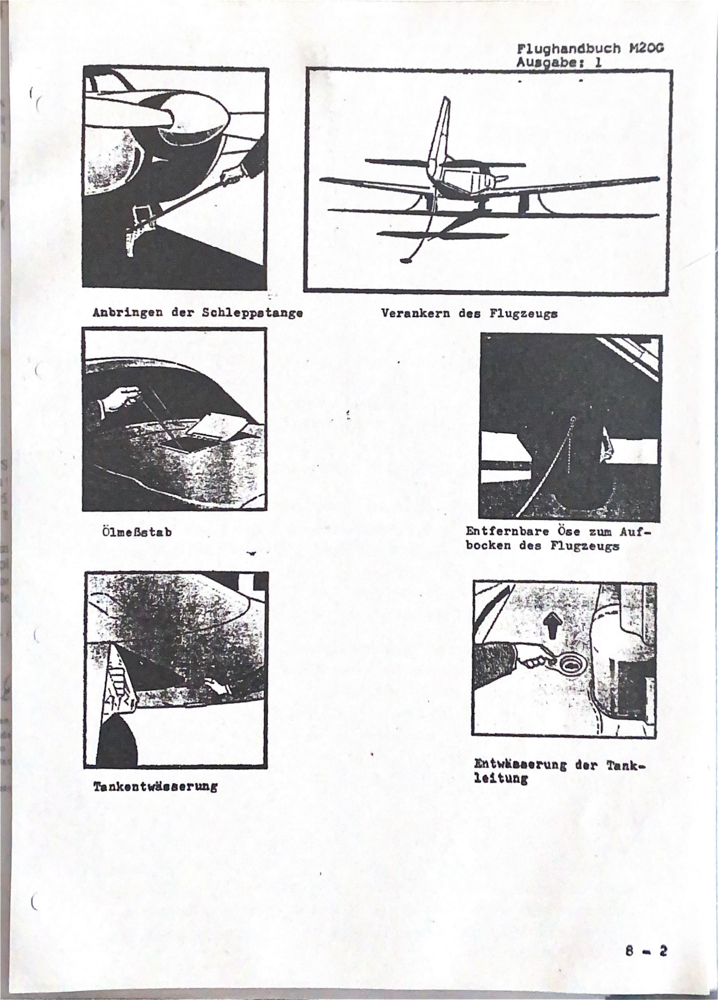

**Figure captions (top to bottom, left → right):**

| Caption |
|---|
| Attaching the tow bar |
| Tying down the aircraft |
| Oil dipstick |
| Removable eyebolt for jacking the aircraft |
| Draining the fuel tanks |
| Draining the fuel lines |

---

## Page 89 (ground handling)

### Ground Handling

The **daily maintenance notes** in this section do **not replace** the recommended **50‑ and 100‑hour inspections**. They are only there to allow you to **monitor** these tasks and keep the aircraft **continuously in a maintained, ready‑for‑operation condition** between inspections.

### Moving the Aircraft on the Ground

For moving the aircraft on the ground, use the **tow bar**. Make sure the **nose‑wheel steering angle is not exceeded**. **Towing with a vehicle is not recommended**, as the **turning circle** of the aircraft will easily be exceeded, which can damage the **nose wheel**.

### Tying Down the Aircraft

To tie down the aircraft, **screw the tie‑down anchors** into the **jacking points used for the gear check** and secure the aircraft to the corresponding **ground anchors** (see figure, Page 7‑2).

### Refuelling

When refuelling, the aircraft should be **level**. Only **100‑LL avgas** is permitted — do **not use a higher or lower octane rating**.

**Before the first flight of the day**, **drain any water** from the tanks. Insert the **supplied plastic cup** into the drain valves on the **right and left wings** (see figure 7‑2).

The lines from the **tank‑selector valve** to the **tanks** and from the tanks to the **engine** are drained at the **drain valve next to the tank‑selector valve** — this can be reached **from the cabin side** or **from outside, in the centre under the engine cowling**. After draining these lines, **verify that the valve is closed again and functioning properly**.

---

## Page 90 (engine oil, landing gear and tires)

### Engine Oil

The **oil dipstick** is located under a **flap in the right rear engine cowl**. The oil level should normally be **between 6 and 8 quarts**.

* During the **first 50 hours** of operation, only **un‑doped oil** (oil without lead additive) may be used.
* The oil is to be **changed after the first 25 hours**, and then **topped up again with un‑doped oil** for the **following 25 hours**.
* After **50 hours** of total running, **doped (lead‑additive) oil** may then be used; the oil is then to be **changed every 50 hours** — as is the **filter**.
* For the approved oil specifications, also refer to the **Lycoming engine handbook**.
* Normally **80‑weight oil** in **winter** and **100‑weight oil** in **summer**.
* Please note: if the aircraft is flown at **extremely unfavourable temperatures** or in **extremely dusty regions**, the oil is to be **changed every 25 hours**.
* If after a long period of operation on un‑doped oil you wish to switch to **doped oil**, bear in mind that the oil must then be **changed more frequently at first**, until the dissolving of the oil residues in the doped oil has **stabilised**. The **first oil change** under such conditions is to be carried out after approximately **5 – 10 hours**.

### Landing Gear and Tires

The landing gear is equipped with normal **tubed aircraft tires**. **Tire pressure, main gear and nose gear: 2.07 bar.**

* Avoid **fast taxiing and hard braking**.
* **Remove stones** that may have worked into the tread.
* To ensure faultless retraction, keep the **outer parts of the landing gear free of dirt and ice**.
* The **gear warning horn** can be checked **on the ground** by pressing the **warning‑light test button**, and **in flight** by **retarding the throttle to below 12 in. Hg manifold pressure**.

---

## Page 91 (battery, propeller care, exterior care)

### Battery

The **12 V / 35 Ah battery** is accessible through the **rear-left fuselage access door**. Make sure the battery **always has enough water**, so that its life is not shortened unnecessarily. If the battery needs to be re-charged, **begin charging with 4 A and finish with 2 A**. In particular, **keep the battery fully charged in winter** to prevent freezing. Watch the **correct polarity** (**minus at the ground**). **Corrosion on the battery box** is most easily removed with a **carbonated-water (soda) solution**.

### Propeller Care

Due to the **high centrifugal forces** acting on the **propeller**, it is essential to give the propeller some attention. Inspect the **propeller blades** for **cracks or nicks (chips)**. Nicks of **more than 2 mm depth should be filed out immediately**, with care that **the same amount of material is removed from the blade opposite the nick**, in order to avoid **imbalance**. This work should therefore be performed by an **authorized maintenance facility**. If the propeller blades have **a certain amount of radial play**, that is nothing serious — it is due to **manufacturing tolerances**. When the propeller is **pushed outwards by the centrifugal force**, this play is gone.

### Exterior Care

The same rules apply to the care of the **exterior paint of the aircraft** as for cars: washing with **lots of water** and at most **mild cleansing agents** is recommended. The **same care waxes** as for cars can also be applied. Please pay special attention to the fact that the **windshield panels** are **not made of glass, but of Plexiglas**, which **scratches more easily**. Use, therefore, **plenty of water**, and **turn the sponge or cloth frequently** to avoid scratches from **dust particles**.

---

## Page 92 (exterior care continued, interior care)

### Exterior Care (continued from page 91)

*[End of sentence begun on page 91: "Use, therefore, **plenty of water**, and **turn the sponge or cloth frequently** to avoid scratches from **dust particles**."]*

### Interior Care

For the **interior**, there may be applied the same **normal cleaning agents** as used in the **household**, or **special cleaners for plastic headliners**, as are used for cars.

*(document page 8‑6; scan of the page is badly faded — text recovered from partial lines)*

---

## Page 93 (English page – original text – AVGAS UL91 supplement)

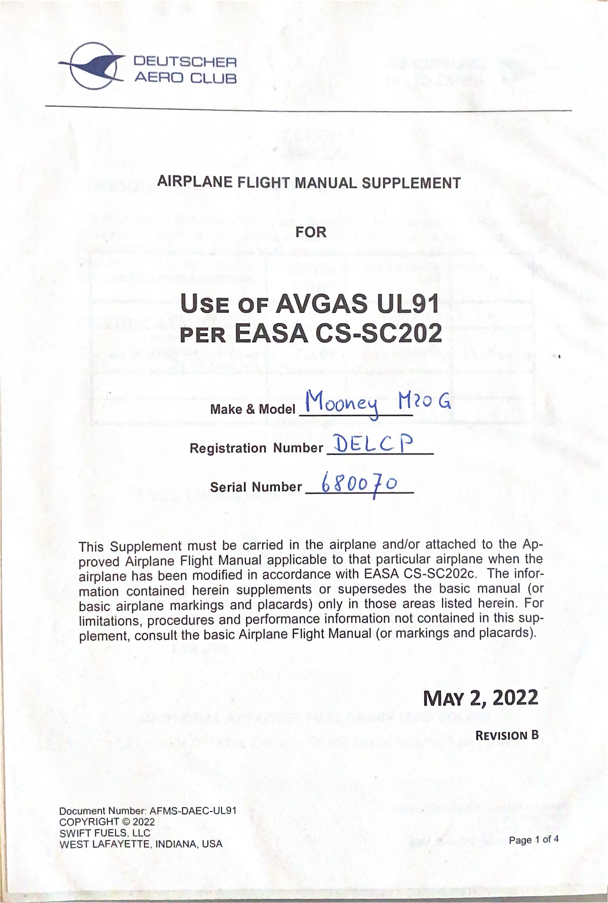

---

## Page 94 (English page – original text – JPI EGT-701 AFM Supplement, page 1 of 4)

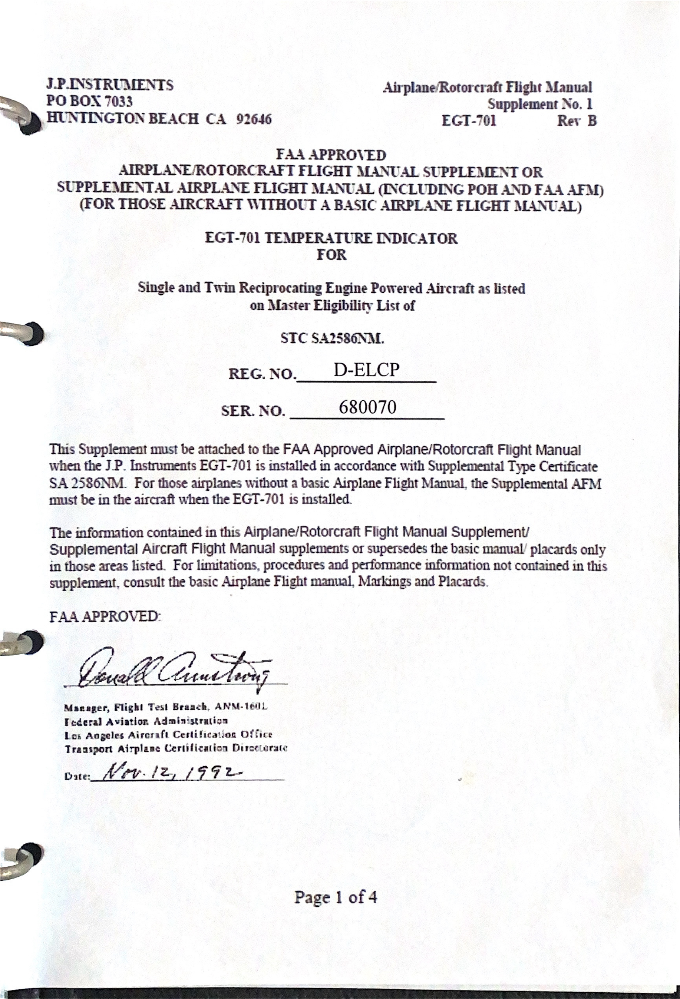

---

## Page 95 (English page – original text – JPI EGT-701 AFM Supplement – page 2 of 4)

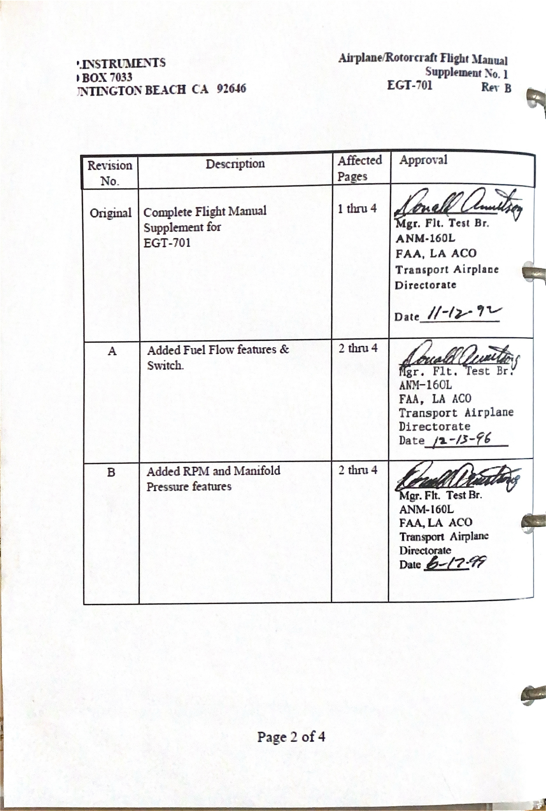

---

## Page 96 (English page – original text – JPI EGT‑701 General description – page 3 of 4)

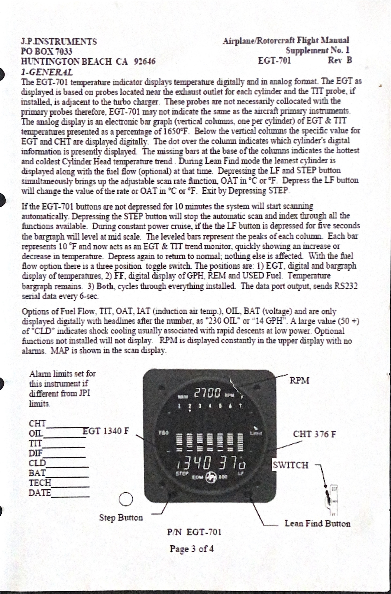

---

## Page 97 (English page – original text – JPI EGT‑701 – pages 4 of 4)

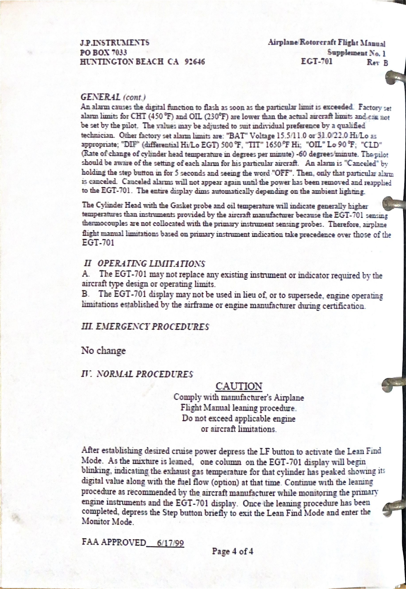

---
