# Mooney M20G Statesman – Manual del vuelo – versión en español

> **Fuente**: `manual.pdf` (97 páginas, "Flughandbuch M20G", edición 1, n.º de serie 680001+, D‑ELCP).  
> **Proceso**: la versión inglesa fue OCR'izada con Tesseract y traducida y corregida del alemán; esta versión en español se traduce de la versión inglesa.  
> Las páginas que en la edición inglesa ya están en inglés (77‑79, 93‑97) se reproducen como imágenes sin traducir.  
> **Los números de página** se refieren a las páginas físicas del PDF (1..97).  
>  
> **NOTA**: esta es una traducción de lectura, no una copia certificada. Para uso operativo, remitirse al AFM original.

---

## Page 1

**Mooney M20G – Manual del vuelo**

Modelo: Mooney M20G
Fabricante: Mooney Aircraft Corp., Kerrville, Texas 78628, USA
Matrícula: D-ELCP
Categoría de aeronavegabilidad: **categoría normal**
Hoja de datos de la aeronave: §55

Este manual de vuelo pertenece a la aeronave identificada arriba. Debe transportarse siempre en la aeronave. Los límites de operación, instrucciones y procedimientos indicados en este manual deben ser cuidadosamente seguidos por el piloto, en su propio interés.

Los datos de este manual proceden del **Owner's Manual del M20G de 1968**.

El alcance y el estado de revisión están definidos en el listado de páginas vigentes.

Traducido por: AGRO Flugzeug GmbH & Co. Vertriebs KG, 8300 Landshut

---

## Page 2 (interior de la portada)

[Página interior de la portada – bloque de título Mooney M20G y datos de matrícula de la aeronave. Sin texto en el cuerpo.]

---

## Page 3

### Índice general

| Sección | Título | Páginas |
|---|---|---|
| I | General | 1‑1 a 1-5 |
| II | Límites de operación | 2-1 a 2-6 |
| III | Procedimientos de emergencia | 3‑1 a 3‑10 |
| IV | Procedimientos normales | 4‑1 a 4‑15 |
| V | Rendimiento | 5‑1 a 5‑13 |
| VI | Peso y carga | 6‑1 a 6‑10 |
| VII | Controles | 7‑1 a 7‑16 |
| VIII | Cuidado y mantenimiento | 8‑1 a 8‑6 |

---

## Page 4 (índice de la sección I)

### Sección I – General

| Subsección | Páginas |
|---|---|
| Descripción general | 1‑1 a 1‑3 |
| Célula/fuselaje | 1‑2 |
| Grupo motopropulsor | 1‑2 |
| Tren de aterrizaje | 1‑2 a 1‑3 |
| Combustible y aceite | 1‑4 |
| Peso al vacío y carga útil | 1‑4 |
| Compartimento de equipaje | 1‑4 |
| Diagrama | 1‑5 |

---
## Page 5 (descripción general)

### Descripción General

El Mooney M20G "Statesman" es un **monoplano de ala baja cuatrilugar** con **tren de aterrizaje triciclo retráctil**. Está equipado con un **motor de 4 cilindros opuestos Lycoming con carburador** (180 hp) y está certificado por la FAA como **aeronave de categoría normal**.

La estructura del fuselaje en la zona de la cabina está reforzada con tubo de acero. Las alas de flujo laminar llevan un larguero principal a lo largo de toda su envergadura y largueros auxiliares. En los dos tercios anteriores de la cara superior del ala, los remaches son de cabeza sumergida para asegurar un perfil de flujo de aire liso.

**Grupo motopropulsor:** Lycoming **O‑360‑A1D**, motor de 4 cilindros opuestos con carburador, **180 hp a 2.700 rpm**. El sistema eléctrico lo alimenta un **generador de 50 amperios, 12 V** o un **alternador de 60 amperios, 12 V**. La **hélice de dos palas de paso variable a velocidad constante** es de accionamiento hidráulico.

**Controles de vuelo:** el timón y las superficies de control se accionan mediante varillas push‑pull. El **sistema de control positivo de Mooney (PC)** es de equipo estándar. Proporciona estabilización alrededor del eje longitudinal y, una vez engranado, mantiene durante un tiempo cualquiera de los ángulos de inclinación prescritos por el piloto.

**Tren de aterrizaje:** el tren triciclo proporciona la máxima movilidad en el rodaje. Los **frenos hidráulicos** y la **ruedas de morro direccional** mantienen la aeronave alineada incluso con fuerte viento cruzado.

El tren de aterrizaje es **retráctil mecánicamente**. Un sistema con asistencia de muelle reduce la fuerza manual necesaria. Una señal acústica de advertencia, junto con luces indicadoras roja y verde, avisa al piloto si la aeronave está a punto de aterrizar con el tren recogido. **Hay disponible la opción de tren retráctil eléctrico por un sobrecoste.**

---

## Page 6 

El **tren retráctil eléctrico** (si está instalado) lleva un microinterruptor que impide que se retraiga con el tren cargado (en el suelo) sin que se haya presionado.

El sistema de **extensión manual de emergencia** es de serie; permite desplegar el tren incluso si el motor eléctrico fallara.

---

## Page 7 (datos técnicos)

### Grupo motopropulsor

| Artículo | Especificación |
|---|---|
| Modelo de motor | Lycoming **O‑360‑A1D** |
| Potencia del motor | **180 hp a 2.700 rpm** |
| Carburador | Marvel‑Schebler **MA 4‑5** |
| Encendido | Magnetos dobles Scintilla **S 4 I N‑200** |
| Hélice | Hartzell **HC‑C2YK‑1B/7666 A‑2**, de velocidad constante, 2 palas, hidráulica, regulador de una sola acción |
| Diámetro de la hélice | **74 pulgadas (188 cm)** |
| Paso de pala a la estación 30 in | **min. 13° ± 0° / máx. 29° ± 2°** |
| Tren de aterrizaje | Triciclo **retráctil mecánicamente o eléctricamente**, suspensión por discos de goma, rueda de morro direccional, frenos de disco hidráulicos |
| Distancia entre ejes  | **1,617 m** |
| Carro de ruedas principales  | **2,93 m** |
| Neumáticos – morro | **3.09 × 5** |
| Neumáticos – principales | **6.00 × 6** |
| Presión de neumático – morro | **3,38 bar** |
| Presión de neumático – principales | **2,07 bar** |
| Combustible útil | **52 gal (196 litros)** |
| Grado de combustible | **100 L** |
| Aceite (total) | **8 cuartos (7,5 litros)** |
| Aceite (mínimo para vuelo) | **6 cuartos** |

### Pesos y carga

| Artículo | Valor |
|---|---|
| Peso máximo de despegue/ aterrizaje | **1.144 kg** |
| Peso al vacío – equipo estándar | **720 kg** |
| Carga útil máxima | **424 kg** |
| Carga alar a peso bruto máximo | **73,6 kg/m²** |
| Carga de potencia a peso bruto máximo | **6,35 kg/hp** |
| Carga máxima del compartimento de equipaje | **54 kg** |
| Carga máxima del perchero para sombreros | **4,5 kg (10 lbs)** |

---

## Page 8 

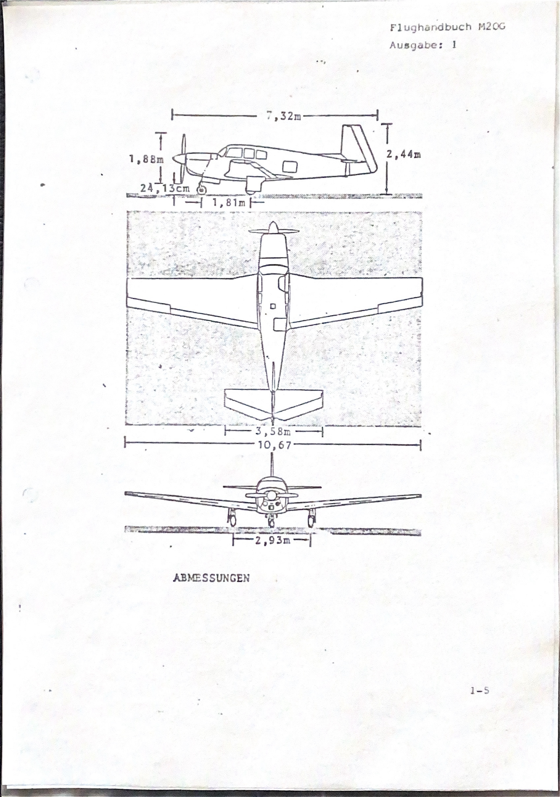

## Page 9 (índice de la sección II)

### Sección II – Límites de Operación

| Subsección | Páginas |
|---|---|
| Límites de velocidad | 2‑2 |
| Instrumentos del motor | 2‑2 |
| Tacómetro | 2‑3 |
| Temperatura de cabeza de cilindro | 2‑3 |
| Presión de aceite | 2‑3 |
| Presión de combustible | 2‑3 |
| Temperatura de aceite | 2‑3 |
| luces de advertencia de vacío | 2‑3 |
| Peso de despegue y aterrizaje | 2‑4 |
| Centro de gravedad | 2‑4 |
| Placas de aviso | 2‑4 |
| Límites de carga | 2‑4 |
| Maniobras acrobáticas | 2‑5 |
| Operación | 2‑5 a 2‑6 |
| Carga | 2‑6 |

---

## Page 10 (límites de velocidad)

### Límites de Operación

Límites de operación aprobados por la FAA del Mooney M20G "Statesman". Las siguientes limitaciones deben observarse durante la operación de la aeronave:

**Límites de velocidad:**

| Limitación | mph | kts |
|---|---|---|
| **Velocidad intransponible (VNE)** | **200** | **174** |
| Velocidad máxima de operación (Vmo) | 135 | 117 |
| Velocidad máxima en situación | 175 | 152 |
| Velocidad máxima de despliegue del tren (VLO) | 120 | 104 |
| Velocidad máxima de maniobras con flaps | 125 | 109 |

**Marcas del indicador de velocidad:**

| Marca | mph | kts |
|---|---|---|
| Línea roja | 200 | 174 | **VNE** |
| Arco amarillo | 175 – 200 | 152 – 174 | Precaución – solo en aire calmo, no operar con potencia total |
| Arco verde | 69 – 175 | 60 – 152 | rango de operación normal |
| Arco blanco | 64 – 125 | 56 – 109 | rango de operación con flaps |

**Motor:** Lycoming O‑360‑A1D, 180 hp a 2.700 rpm
**Combustible:** gasolina de aviación 100 LL
**Hélice:** Hartzell HC‑C2YK‑12B/7666 Am2
**Paso de pala a la estación 36 in:** **min. 13° + 0° / máx. 29° ± 2°**

---

## Page 11 (instrumentos del motor)

### Tacómetro

| Marca | Valor |
|---|---|
| Línea roja | **2.700 rpm** |
| Arco verde, estrecho  | **2.300 – 2.700 rpm** |
| Arco verde, ennegrecido  | **2.300 – 2.500 rpm** |
| Arco rojo, ennegrecido | **2.000 – 2.250 rpm – NO OPERAR EN CONTINUO** |

### Temperatura de Cabeza de Cilindro

| Marca | Valor |
|---|---|
| Línea roja | **Máx. 260 °C** |
| Zona verde | **175° – 230 °C** (rango de operación) |
| Zona amarilla | **245° – 260 °C** – NO PERMITIDA LA OPERACIÓN CONTINUA |

### Presión de Aceite

| Marca | Valor |
|---|---|
| Línea roja – ralentí mín. | **25 psi** |
| Línea roja – máx. | **100 psi** |
| Arco verde (operación normal) | **60 – 90 psi** |
| Arco amarillo (rango de ralentí) | **25 – 60 psi** |
| Arco amarillo (arranque / calentamiento) | **90 – 100 psi** |

### Presión de Combustible

| Marca | Valor |
|---|---|
| Línea roja – mín. | **0,5 psi** |
| Línea roja – máx. | **6 psi** |
| Arco verde, ancho (operación normal) | **2,5 – 3,5 psi** |
| Arco verde, estrecho (rango de operación completo) | **0,5 – 6 psi** |

### Temperatura de Aceite

| Marca | Valor |
|---|---|
| Línea roja de límite | **Máx. 118 °C** |
| Arco verde (rango de operación) | **38° – 107 °C** |

### Luces de Advertencia de Vacío

- Vacío excesivo: **5 inHg** (alto)
- Vacío bajo: **4,5 inHg** (bajo)

El siguiente equipo estándar funciona a vacío:
1. Horizonte artificial
2. Brújula giroscópica
3. Coordinador de giro
4. Sistema de control positivo

---

## Page 12 (CG, placas, límites de carga)

### Peso máximo admisible de despegue y aterrizaje

**1.144 kg**

### Centro de Gravedad

- Plano de referencia: **estación del fuselaje 0,00**
- Posición: **5 in detrás de la línea central de los pernos de la rueda de morro** y **33 in por delante del borde de ataque del ala**
- Estación de referencia del CG: **59,25 in**

**Límites de CG – tren desplegado:**
| Peso | Rango de CG |
|---|---|
| **1.144 kg** | **108 cm – 128 cm** |
| **1118 kg** | **106 cm – 128 cm** |
| **957 kg o menos** | **103 cm – 129 cm** |

### Placas – en el campo visual completo del piloto

1. Esta aeronave debe operarse como **aeronave de categoría normal** de conformidad con el manual de vuelo y las placas. **Están prohibidos el vuelo acrobático y las barrenas.**
2. **Velocidad máxima para desplegar el tren: 120 mph (104 kts)**
3. **Factor de carga máximo:**
   - Flaps recogidos: **+3,8 g / −1,5 g**
   - Flaps desplegados: **+2,0 g**

### Límites de Carga

| Artículo | Límite |
|---|---|
| Asientos delanteros | **2 personas** |
| Tripulación mínima | **1** |
| Asientos traseros (si están instalados) | **2 personas** |
| Peso máximo del equipaje | **54 kg** |
| Carga máxima del perchero | **4,5 kg** |

---

## Page 13 (maniobras acrobáticas, factor de carga, operación)

### Maniobras Acrobáticas

La aeronave debe operarse como aeronave de **categoría normal**.

Está prohibido el vuelo acrobático, **incluidas las barrenas (spins)**. Las entradas en pérdida y los movimientos completos de los mandos deben limitarse a la **velocidad mínima de vuelo**.

**No está permitido el vuelo invertido.**

**Está prohibida la operación en condiciones de formación de hielo conocidas.**

### Factores de Carga

| Condición | Límite |
|---|---|
| Positivo – flaps y tren recogidos | **+3,8 g** |
| Positivo – flaps y tren desplegados  | **+2,0 g** |
| Negativo – flaps y tren desplegados | **−1,5 g** |

**PRECAUCIÓN:**
La recuperación de una situación de pérdida a peso de despegue completo puede producir una pérdida de altitud de hasta **300 ft (91 m)**.

### Operación

Esta aeronave debe operarse como **aeronave de categoría normal** de conformidad con este manual y las placas. **Están prohibidos el vuelo acrobático y las barrenas (spins).**

Los fusibles están agrupados en el **lado derecho** del panel de instrumentos. Se emplean únicamente unidades **fuse-matic** o **fusibles interruptores (switch-fuses)**.

**Recoger los flaps después de cada aterrizaje.**

**Poner el calefactor de carburador totalmente ON** antes de reducir la potencia del motor para aproximación o aterrizaje.

Todas las luces y bocinas de advertencia dejan de funcionar **desconectadas** cuando el **interruptor maestro (master) está en OFF**.

---

## Page 14 (ventanillas, aviso de pérdida, PC, carga)

Ventanillas laterales: **No abrirlas por encima de 150 mph (130 kts).**

Un tono que primero es intermitente y luego continuo avisa de la aproximación a la **velocidad de pérdida (stall)**.

Un tono continuamente intermitente avisa del **tren recogido** cuando la presión de admisión cae por debajo de aproximadamente **12 in Hg**.

El **interruptor de desconexión del control positivo o de piloto automático** está en el **costado izquierdo del volante** del piloto.

Girar el **mando de trim del coordinador de giro** en el sentido de las agujas del reloj compensa a **derechas**; en sentido inverso, a **izquierdas**.

### Carga

El piloto es responsable de la carga correcta. Los asientos delanteros deben mantenerse de posición tal que el CG quede dentro de los límites admitidos. Al cargar el compartimento de equipaje, deben tenerse en cuenta las posiciones de los dos asientos delanteros.

Equipaje máx.: **54,4 kg**. Perchero máx.: **4,5 kg**. Solo objetos suaves en el perchero.

---
## Page 15 (índice de la sección III)

### Sección III – Procedimientos de Emergencia

| Subsección | Páginas |
|---|---|
| Extensión manual de emergencia del tren | 3‑2 |
| Desactivación del sistema de control positivo | 3‑2 |
| Operación del motor | 3‑3 |
| Rearranque en vuelo | 3‑3 a 3‑4 |
| Incendios | 3‑4 a 3‑6 |
| Aterrizajes de emergencia | 3‑6 a 3‑8 |
| Operaciones en condiciones de hielo | 3‑8 a 3‑9 |
| Barrenas (spins) | 3‑9 |
| Presión baja de aceite | 3‑10 |

---

## Page 16 (extensión de emergencia del tren, anulación manual de PC)

### Procedimientos de Emergencia: Extensión de Emergencia del Tren

*(Para la opción de tren eléctrico. El modelo básico del M20G dispone de palanca mecánica de accionamiento del tren.)*

Con la batería parcialmente descargada, el tren puede no desplegarse y bloquearse por completo:

1. Extraer el **fusible del sistemo eléctrico del tren (2 A)**.
2. Poner el **interruptor eléctrico del tren** en posición "bajado (down)".
3. Empujar **hacia delante el perno de acoplamiento de la manivela manual** para engranar la manivela.
4. Girar la manivela **en el sentido de las agujas del reloj** hasta que el tren esté completamente extendido y bloqueado. Aproximadamente **80 giros**.
5. Debe estar encendida la luz verde **"TREN ABAJO Y BLOQUEADO"**.
6. Si el sistema eléctrico está completamente inoperativo: **las dos marcas "TREN" del suelo de la cabina deben quedar una exactamente encima de la otra**.

**PRECAUCIÓN:**
- No se debe **retraer** el tren a mano con la manivela.
- No se debe operar eléctricamente el tren cuando esté engranada la manivela manual.

### Sistema de Control Positivo – Anulación Manual

El piloto puede anular en cualquier momento el sistema de control positivo en caso de funcionamiento defectuoso aplicando una entrada manual sobre el volante.

El sistema PC se inutiliza pulsando el **interruptor de desconexión en el costado izquierdo del volante**. En caso de pérdida de vacío (indicado por la luz de advertencia roja), el sistema PC **se desactiva automáticamente**.

---

## Page 17 (operación del motor: fallo en despegue / fallo en vuelo)

### Operación del Motor

**En el despegue (con longitud de pista que queda suficiente):**

1. Acelerador – **ralentí (idle)**
2. Aplicar los **frenos**
3. Recoger los **flaps** durante el rodaje
4. Mezcla – **totalmente al分鐘 (podrida)**
5. Interruptor de arranque e interruptor de encendido – **OFF**

**Una vez en el aire:**

1. Velocidad de planeo – **80 mph (70 kts)**
2. Palanca de mezcla – **totalmente atrás**
3. Selector de combustible – **cerrado (posición central)**
4. Interruptor de encendido – **OFF**
5. Interruptor principal – **OFF poco antes del aterrizaje**

**PRECAUCIÓN:**
Realizar el aterrizaje **recto**, haciendo tan solo pequeñas correcciones de rumbo para evitar obstáculos. Bajo ninguna circunstancia intentar regresar al campo de aterrizaje, porque la altitud inmediatamente después del despegue normalmente no es suficiente para un regreso seguro.

### En Vuelo – Reinicio del Motor

1. Velocidad de planeo – **105 mph (91 kts)** (ángulo de planeo óptimo con viento de cola y la hélice girando todavía)
2. Selector de combustible – **tanque completo (posición central)**
3. Mezcla – **rica**
4. Acelerador – **1/4 de apertura**
5. Bomba de arranque (boost pump) – **ON**
6. Interruptor de encendido – **ambos (dos)**

Si la hélice ya no está siendo arrastrada por la corriente, el motor debe ser **moteado (motoring) con el motor de arranque**.

---

## Page 18 (fuego del motor en tierra, aterrizaje en agua)

### Incendios

**Fuego del motor en tierra – durante el arranque**

Procedimientos de arranque incorrectos, como bombear el acelerador cuando el motor arranca con dificultad en clima frío, pueden producir un **ruidos (detonación)** y la ignición posterior del combustible depositado en el múltiple de admisión. En tal caso:

1. **seguir girando el motor de arranque**, e intentar el arranque; de este modo las llamas y el combustible acumulado irán succionados a través del carburador hacia los cilindros del motor.
2. Si el motor arranca, **dejarlo girar unos minutos a 1.700 rpm** y luego parar, inspeccionando el daño.
3. Si el motor no arranca: **seguir girando el motor de arranque con el encendido en OFF** (interruptor maestro ON, interruptor de arranque ON), mientras las personas de tierra preparan el extintor de incendios.
4. Cuando toda la preparación esté completa: soltar el interruptor de arranque, poner **interruptor maestro y encendido en OFF**, cerrar la válvula selectora de combustible.

---
## Page 19 (fuego del motor (cont.), fuego del motor en vuelo, fuego eléctrico)

5. **Extinguir las llamas** con un extintor de incendio, cojines de asiento, mantas de lana o arena.
6. **Inspeccionar minuciosamente los daños** del fuego; reemplazar cualquier pieza afectada antes del siguiente vuelo.

**Fuego del motor en vuelo**

Aunque los fuegos del motor en vuelo son extremadamente raros, si se produjera uno deberían tomarse las siguientes medidas:

1. Retirar la **palanca de mezcla totalmente hacia afuera** (corte)
2. Cerrar la **selector de válvula de combustible**
3. Poner el **interruptor maestro OFF**
4. **Cerrar todos los mandos de calefacción y ventilación de la cabina**
5. Seleccionar un **campo apto para un aterrizaje de emergencia**
6. Si el fuego no se ha extinguido, **aumentar la velocidad de planeo** a fin de encontrar una velocidad a la que una mezcla en combustión de combustible/aire ya no pueda mantenerse
7. Realizar un **aterrizaje sin motor** como se describe en "Aterrizaje por falta de potencia – motor detenido". **NO intentar reencender el motor.**

**Fuego eléctrico en vuelo**

El primer indicio de un fuego eléctrico es el **olor a aislamiento quemado o humeante**. La acción inmediata y correcta consiste en **poner el interruptor maestro OFF** y **reducir el flujo de aire fresco en la medida de lo posible**, a fin de minimizar la posibilidad de un fuego sostenido.

Si en vuelo debe continuar la alimentación eléctrica, puede usarse el siguiente procedimiento para localizar y aislar el circuito averiado:

1. Interruptor maestro: **"OFF"**
2. Todos los demás interruptores, excepto el de encendido: **"OFF"**

*(Continuado en la página 20)*

---

## Page 20 (fuego eléctrico (cont.), aterrizaje de emergencia: motor disponible)

*(Continuación de la página anterior)*

**Fuego eléctrico – localización del circuito averiado (continuado)**

3. Quitar los **fusibles** y comprobarlos a fin de encontrar el fundido. **Dejar fuera el fusible fundido**: por él se identifica el circuito averiado.
4. Interruptor maestro: **ON**
5. Accionar los demás interruptores **uno a la vez**, con precaución, **hasta localizar el circuito en cortocircuito**.
6. **Comprobar que el fuego esté completamente extinguido antes de volver a abrir las tomas de aire fresco.**

### Aterrizaje de Emergencia – Motor Disponible

Se debería intentar el aterrizaje en un campo sin pavimentar apto: sobrevolar el área de aterrizaje en aproximación recta y lo más bajo que sea necesario, a fin de examinar el terreno en busca de daños u obstáculos:

1. En aproximación: **flaps a 15°, a 70 kts** – comprobar el área de aterrizaje para el siguiente intento; **extender los flaps después de pasar por encima de los obstáculos**
2. En la cabina: **todos los interruptores OFF, salvo el de encendido y el maestro**
3. **Aproximarse con flaps extendidos, a 65 kts**
4. **Cerrar la puerta de la cabina** inmediatamente antes del contacto
5. Inmediatamente antes del contacto: **encendido e interruptor maestro "OFF"**
6. **Recuperar (flare) suavemente, con el morro ligeramente levantado**
7. En pista sin pavimentar: intentar aterrizar con **tren extendido** a fin de obtener la mayor distancia posible y detenerse en la menor
8. **Calor de carburador: en la posición rica**

---

## Page 21 (aterrizaje por falta de potencia, aterrizaje en agua)

### Aterrizaje por Falta de Potencia – Motor Detenido

Si el motor se detiene: **flaps extendidos, 87 kts de frente al viento** (ver también: "Trayectoria de planeo"). Si el tiempo lo permite, **intentar de nuevo el arranque del motor** (ver "En vuelo – Reinicio del motor").

---

## Page 22 (aterrizaje en agua (cont.), vuelo con formación de hielo)

**Aterrizaje en agua – continuación:**

4. En el momento del contacto, sostener el cojín o la chaqueta doblada **delante de la cara**.
5. Inflar los **chalecos salvavidas** y el **bote salvavidas** (si está instalado) después de abandonar la cabina. No puede esperarse que la aeronave mantenga la flotación **más de unos pocos minutos** después del contacto.

### Vuelo con Formación de Hielo

**El vuelo en condiciones conocidas de formación de hielo está estrictamente prohibido.** Con todo, si se encontrara formación de hielo inesperadamente, proceder como sigue:

1. Interruptor del calefactor de Pitot: **"ON"**
2. **Virar o cambiar de nivel de vuelo** para alcanzar temperaturas en las que la formación de hielo sea menos probable
3. **Retirar la perilla de calefacción de la cabina totalmente hacia afuera** para obtener aire caliente para el **deshielo del parabrisas**. Configurar la **perilla de ventilación de la cabina** para que el suministro de aire caliente de deshielo sea el máximo
4. **Aumentar las RPM** para minimizar la acumulación de hielo en las páletas de la hélice
5. Observar indicios de **hielo en el carburador / filtro de aire**: una caída de rpm del motor que no se pueda explicar puede deberse a acumulación de hielo en el carburador o en el filtro de aire. Usar el **calor de carburador** según sea necesario
6. Planificar un **aterrizaje en el aeródromo más próximo**. En caso de acumulación de hielo extremadamente rápida, buscar un área apta para un **aterrizaje de emergencia fuera de pista**
7. Con acumulación de hielo en el borde de ataque de las alas **superior a 6 mm**, esperar la necesidad de una **velocidad de pérdida considerablemente mayor**
8. **Retraer los flaps.** Con acumulación de hielo intensa en el estabilizador horizontal, la desviación del flujo de aire del ala por los flaps extendidos puede provocar **pérdida de eficacia del elevador**
9. Abrir la **ventanilla izquierda** y, si es posible, retirar el hielo… *(continuado en la página 23)*

---

## Page 23 (deshielo (cont.), recuperación de la barrena – spin)

…a fin de permitir la reducción del ángulo de ataque y hacer posible la aproximación de aterrizaje.
10. **Aproximarse con planeo lateral (desequilibrio intencional)** si es necesario, para obtener mejor visibilidad (usar la **ventanilla para mal tiempo**).
11. Aproximarse a **85–90 mph (74-78 kts)**, dependiendo de la gravedad de la acumulación de hielo.
12. **Evitar virajes cerrados (pronunciados) durante la aproximación de aterrizaje.**
13. Aterrizar en **actitud horizontal**.

### Barrenas (Spins)

Para repetir la advertencia: esta es una **aeronave de categoría normal y las barrenas (spins) no están permitidas**.
Si la aeronave entra en barrena como consecuencia de una condición de pérdida y entradas de mandos sin coordinación, proceder como sigue:

1. **Deflexión completa del timón en dirección contraria** al giro (cola)
2. **Elevador completamente hacia adelante** para empujar el morro abajo
3. **Mantener el timón a tope en dirección contraria** hasta que la rotación se haya detenido
4. **Recuperarse suavemente** de la picada resultante y restablecer la potencia de crucero

**NOTA:**
La aeronave puede continuar girando hasta **una rotación completa** aunque el timón esté a tope en dirección contraria al giro. Como la pérdida de altitud puede ser de hasta **2.000 pies por cada rotación de la barrena**, una barrena cerca del suelo es extremadamente peligrosa y debe evitarse a toda costa.

---

## Page 24 (presión baja de aceite)

### Presión de Aceite Baja

Si aparece presión de aceite baja con **temperaturas de aceite normales**, esto indica la **posible avería del manómetro de aceite o de la válvula de sobrepresión**.

Una fuga en la **línea hacia el instrumento** no es necesariamente motivo de un aterrizaje precautorio inmediato, porque una **boquilla en esa línea** impide una pérdida súbita de aceite desde el sumidero (sump) del motor. **Con todo, es aconsejable aterrizar en el campo más próximo** para determinar la causa de la avería.

Si aparece una **pérdida total de la presión de aceite** al mismo tiempo que un **aumento de la temperatura del aceite**, existe motivo suficiente para suponer un **inminente fallo del motor**. Por consiguiente:

**Reducir de inmediato la potencia del motor y buscar un campo apto para el aterrizaje de emergencia.**

Durante la aproximación, hacer funcionar el motor a **baja potencia**, usando **únicamente la potencia realmente necesaria** para llegar al lugar de aterrizaje elegido.

---
## Page 25 (índice de la sección IV)

### Sección IV – Procedimientos Normales

| Título | Páginas |
|---|---|
| Pre-vuelo | 4‑1 |
| Recorrido de inspección (pre-vuelo) | 4‑2 |
| Antes de subirse | 4‑3 |
| Check antes de arrancar | 4‑3 |
| Arranque (adicional: arranque en mojado) | 4‑3 a 4‑4 |
| Arranque a mano | 4‑5 |
| Rodaje | 4‑5 |
| Check antes de despegue | 4‑6 |
| Check rápido | 4‑6 |
| Despegue | 4‑6 |
| Ascenso | 4‑7 |
| Crucero | 4‑7 |
| EGT (temperatura de gases de escape) | 4‑8 |
| Trim (compensación) | 4‑9 |
| Descenso | 4‑9 |
| Check antes del aterrizaje | 4‑10 |
| Aterrizaje | 4‑10 |
| Después del aterrizaje | 4‑11 |
| Aparcamiento | 4‑11 |

---

## Page 26 (diagrama del recorrido de pre-vuelo)

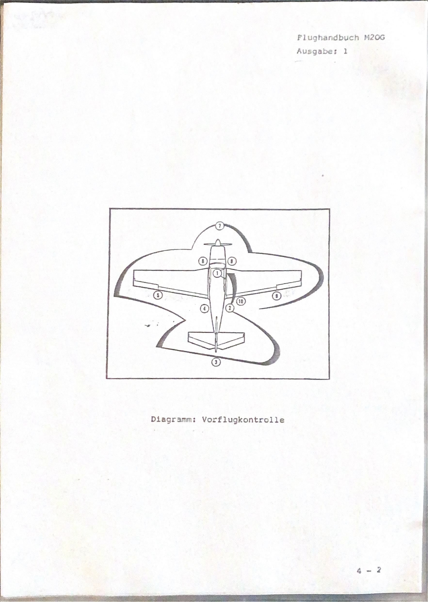

---

## Page 27 (recorrido de pre-vuelo, pasos 1–7)

### Recorrido de Inspección (Pre-Vuelo), Pasos 1 a 7

1. Interruptor maestro: **OFF** → **ON** – Inspeccionar las luces exteriores, el calefactor del tubo de Pitot y el interruptor de aviso de pérdida; después interruptor maestro: **OFF** – Drenar las líneas de combustible; selector de depósitos: **depósito derecho** – accionar la válvula correspondiente junto al selector; después **depósito izquierdo** – de la misma manera
2. Toma de presión estática, lado derecho: **verificar que no esté obstruida**; soltar la sujeción en la cola (si está en estación en exterior)
3. Superficie: **verificar; si hay hielo, nieve o escarcha, eliminarlos**
4. Puerta del fuselaje: **verificar que esté bien cerrada y asegurada**; toma de presión estática: "libre"; **drenar el sistema estático**
5. Ala izquierda: **inspeccionar las uniones de los alerones y las uniones de los flaps**; si hay hielo, nieve o escarcha, eliminarlos
6. Verificar que el **borde de ataque, el tubo de Pitot y el avisador de pérdida** estén "libres"; combustible: **inspección visual del contenido, asegurar la tapa**; **inspección visual del tren principal izquierdo y del neumático izquierdo**; **drenar el depósito izquierdo**; drenar el sistema de Pitot; compensador de presión del depósito: "libre"; válvula de drenado del sistema de líneas: **cerrada**; parabrisas limpio; **cubierta del motor cerrada y asegurada**
7. **Verificar la hélice en busca de daños**

Pasos 8 en adelante: ver la página siguiente

---

## Page 28 (recorrido de pre-vuelo, pasos 8–10; antes de subirse; check de arranque)

### Pasos 8 a 10

8. Lado derecho: **cubierta del motor cerrada y asegurada**; **aceite del motor: entre 6 y 8 U.S. Quarts**; parabrisas limpio; depósito de combustible: **drenar**; ventilación del depósito: "libre"; si hay, **soltar la sujeción de la cola**; **inspeccionar el tren principal derecho y el neumático**; inspección visual del depósito y asegurar la tapa
9. Ala derecha: **inspeccionar el borde de ataque derecho y el ala completa**: **inspeccionar las uniones de los alerones**; **inspeccionar las uniones de los flaps**; si hay hielo, nieve o escarcha, eliminarlos
10. Puerta del compartimiento de equipaje: **cerrada y asegurada**

### Antes de Subirse

Después de subirse: **cerrar la puerta de la cabina** girando el mango de la puerta hacia adelante. **NUNCA GOLPEAR LA PUERTA.** Comprobar la posición y el cierre de la **palanca del tren** (o del interruptor, en el tren eléctrico). Asegurarse de que todo el equipaje esté asegurado y de que todos los mapas, el computador y otras partes sueltas estén guardados y asegurados. Abrochar los cinturones de seguridad y ajustarlos. Asegurar la posición de los asientos. El piloto debe estar tras el **volante de control** cómodo, sin estar botado. En vuelos nocturnos, **llevar una linterna**.

### Check Antes de Arrancar

1. Todos los interruptores: **"OFF"**
2. Todos los radios: **"OFF"**
3. Tren de aterrizaje: **bajarlo y bloquearlo**
4. Flaps: **verificar todas las posiciones** y volverlos a **posición de despegue**
5. Calefactor del carburador: **"CERRADO"**
6. Freno de estacionamiento: **aplicado para comprobación**
7. Acelerador: **a tope cerrado**
8. Hélice: **posición de bajas rpm (largos pasos)**

---

## Page 29 (check de arranque cont., arranque del motor)

### Check Antes de Arrancar (cont.)

9. Todos los fusibles: **verificar**
10. Palanca de mezcla: **posición "corte (shutdown)"**
11. Selector de depósitos: **al depósito lleno**
12. Bomba eléctrica de combustible: **"ON"**
13. Calefacción de la cabina: **"OFF"**

### Arranque del Motor

1. Interruptor maestro: **"ON"**
2. Indicador de combustible y cantidad: **verificar**
3. Luces de control: **verificar con el botón de prueba**
4. Luz del tren: **debe brillar en verde**
5. Bomba eléctrica de combustible: **"ON"**
6. Palanca de mezcla: **adelante – RICA**
7. Acelerador: **bombear 2–3 veces**, 1/4 adelante
8. Arranque: **girar la llave de encendido y empujarla**
9. Ajustar el acelerador a **1.000 – 1.200 U/min**
10. Presión de aceite en el **ámbito verde** (si no aparece presión después de 30 segundos: **detener el motor e inspeccionar el sistema de aceite**)
11. Calefactor del carburador: **"ON" y otra vez "OFF"** – **verificar la caída de giro**

**PRECAUCIÓN:**
El calefactor no se debe usar en tierra, a diferencia del uso de pruebas. Al encender el calefactor, el aire llega **sin filtrar** al motor: vapores, pequeños cuerpos y polvo pueden **dañar los cilindros y los pistones.**

12. Luces: **encender como sea necesario**
13. Aparatos de radio y navegación: **encender y verificar**
14. Luz de giro (rotov beacon): **"ON"**
15. Tubo de Pitot con calefacción: **verificar por el indicado en el amperímetro**
16. Trim: **posición de despegue**
17. Selector de depósitos: **verificar izquierda y derecha**

---

## Page 30 (arranque en mojado, arranque en frío, arranque a mano)

### Arranque con el Motor Ahogado

1. Acelerador: **abrirlo completamente**
2. Palanca de mezcla: **cerrada (corte)**
3. Bomba eléctrica de combustible: **"OFF"**
4. Girar la llave de encendido **y empujarla**
5. **En cuanto el motor arranque**: regresar el acelerador
6. Palanca de mezcla: **lento hacia adelante – rica**
7. Bomba eléctrica de combustible: **encender**

### Arranque en Clima Frío

El procedimiento de arranque para un motor frío es el mismo que para un motor a temperatura normal. Solo es necesario **inyectar un poco más de gasolina.** Se recomienda **precalentar el motor con un calefactor auxiliar.**

### Arranque de Motores a Mano

1. Bloquear las llantas (calzos)
2. Freno: **aplicar**
3. Todos los interruptores: **como sea necesario para un arranque normal, solo el encendido "OFF"**
4. Hélice: en **posición de bajas rpm (largos pasos)**, **dar varias vueltas a la hélice a mano** – **encendido desconectado**

**PRECAUCIÓN:**
Al girar la hélice a mano: **reajustar la vestimenta y colocarse a suficiente distancia, de lado de la hélice**, para evitar heridas, hasta que la llave de encendido esté en posición de arranque y el motor de arranque esté funcionando.

5. Girar la llave de encendido a **"Arranque"**, pero **no empujar adelante**
6. **Mientras la llave está en posición de arranque: arrancar el motor a mano**
7. Soltar la llave de encendido en cuanto el motor arranque
8. Todas las demás operaciones: **como es normal**

---
## Page 31 (Rodaje, comprobación de funcionamiento)

Durante el rodaje, el motor debe mantenerse a su **régimen normal de funcionamiento, 1.000–1.200 U/min**.

### PRECAUCIÓN

**No confíe exclusivamente en el seguro del tren** (botón de seguridad), que lo mantiene abajo solo mientras el tren esté cargado.
En su lugar, **vigile la posición de la palanca del tren** (o, en el tren mecánico: la posición del botón de seguridad y la luz verde) durante el rodaje y el despegue.

Rode con la **mezcla en plena riqueza ("full-rich")** y el mando de la hélice en **bajo giro (bajas rpm)** para evitar el sobrecalentamiento del motor.

**Evite una larga marcha mínima a bajas rpm**, para no ensuciar las bujías.

### PRECAUCIÓN:

Antes del despegue, durante el rodaje, **verifique que el sistema de control positivo funcione con normalidad** y que los instrumentos giroscópicos estén plenamente en funcionamiento.

Al probar el sistema PC, **gire el volante en la dirección opuesta** a la girada prevista. Haga virajes alternos a la izquierda y a la derecha, y verifique que el **volante vuelve a la posición neutral** al rodar recto.

Al mismo tiempo, **verifique que el coordinador de giro y el indicador de actitud funcionen**.

Antes de aplicar la frenada definitiva para el despegue, **alinee la aeronave contra el viento**, para que **la rueda de morro quede centrada**. Reduzca al mínimo el tiempo en pista. Verifique **el sistema regulador de la hélice llevando el acelerador a 1.700 U/min** y luego llevando el mando de hélice a tope atrás (reducir rpm). En cuanto observe una **caída de 100 rpm**, lleve el mando de hélice de nuevo a **mayor RPM (aumentar rpm al máximo)**.

En **clima frío**, **repetir esta comprobación 2–3 veces**.

Verificar **los magnetos a 1.700 U/min**:
- OK

- Caída máxima: **125 U/min** por magneto
- Diferencia entre los dos magnetos: **no más de 50 U/min**
- Después de la comprobación del motor, reducir el acelerador a **1.000–1.200 U/min**

---

## Page 32 (check antes de despegue, check rápido, despegue)

### Check Antes de Despegue – 16 puntos

1. Superficies de control: **comprobar movimiento completo y libre**
2. Selector de combustible: **depósito lleno**
3. Altímetro: **ajustado a QNH o a la elevación del campo**
4. Brújula giroscópica: **ajustada**
5. Instrumentos de control de la aeronave: **verificar**
6. Instrumentos de control del motor: **verificar**
7. Reloj: **ajustado**
8. Trim: **posición de despegue**
9. Ajuste de la hélice: **comprobar a 1.700 U/min**
10. Magnetos: **comprobar a 1.700 U/min**
11. Flaps: **posición de despegue**
12. Bomba eléctrica de combustible: **"ON"** – **revisar la presión de combustible**
13. Asientos: **asegurados**
14. Cinturones de seguridad: **abrochados**
15. Puertas y ventanillas de tormenta: **cerradas y aseguradas**
16. Piso de la cabina: **libre para la palanca del tren**

### Check Rápido Antes de Gases Plenos

1. Hélice: **ángulo de paso pequeño (low-pitch)**
2. Trim: **posición de despegue**
3. Flaps: **posición de despegue**
4. Selector de combustible: **depósito lleno**

**PRECAUCIÓN:**
El selector de combustible **no debe operarse inmediatamente antes del despegue.**

5. Calefactor del carburador: **"OFF"**

**Despegar lo más pronto posible** después de completar el check antes de despegue. Si el despegue se retrasa, **dejar el motor a 1.400–1.500 U/min** para mantener el motor bien refrigerado y evitar que las bujías se sufbreen.

### Despegue

En condiciones normales, **aplique el acelerador lentamente**, de manera que la hélice **no succiona piedras, suciedad u objetos** que la pudieran dañar. En **pistas cortísimas**, *(se continúa en la página siguiente)*

---

## Page 33 (Despegue (cont.), ascenso)

### Despegue (continuado)

En **pistas cortísimas**, es posible que sea necesario aplicar el **acelerador a tope en el lugar** y soltar los frenos después. Para opciones de la distancia de despegue en combinación con temperatura y altitud, ver **Sección V**.

Aproximadamente a **65–75 mph (56–65 kts)**, aplicar una ligera presión hacia atrás para levantar la rueda de morro. Mientras la rueda de morro empieza a levantarse, **relajar la presión** — la aeronave levantará entonces **suavemente, sin un cambio de actitud brusca.**

### NOTA:

En despegue con **viento cruzado**, mantener la rueda de morro un poco más abajo, controlar el rumbo con el **timón**, levantar a aproximadamente **80 mph (70 kts)** y poner la aeronave contra el viento con un **mando coordinado**. Después del despegue, **aplicar freno a las ruedas antes de retraer el tren**. Después retraer el tren. Ajustar la **hélice a 2.550–2.600 U/min**. Después de pasar los primeros obstáculos y alcanzar una **altitud segura**, **retraer los flaps** y continuar el ascenso a la **velocidad de mejor tasa de ascenso (Sección V)**. Poner la **bomba eléctrica de combustible OFF** y mantener una **presión de combustible adecuada**, como la muestra el indicador.

### Ascenso

Se recomienda ascender a **105–110 mph (90–95 kts)**, para asegurar un buen enfriamiento y **visibilidad hacia delante adecuada**. Las velocidades precisas para mejor tasa de ascenso y mejor ángulo de ascenso figuran en las tablas de la **Sección V.**

La potencia para el ascenso normal es **26 in. Hg de presión de manifold** y **2.600 U/min**.

A medida que aumenta la altitud, baja la presión de manifold; esto puede compensarse en parte **aumentando proporcionalmente el acelerador.**

**PRECAUCIÓN:**
**¡No se permite volar en zonas de formación de hielo!**

---

## Page 34 (crucero y condiciones de alcance, vuelo crucero)

### Crucero y Condiciones de Alcance

Todos los datos de crucero y alcance de las tablas de la **Sección V** incluyen:

1. **Ascenso en gas completo hasta 3.000 ft**, seguido del continuo ascenso con la potencia disponible, mezcla **rica completa**, a la velocidad correspondiente de mejor tasa de ascenso a la altitud de crucero elegida
2. **Crucero (trayecto)** al destino, con la potencia y la mezcla adecuadas
3. **Reserva de 45 minutos** con la misma altitud y ajuste de potencia
4. Todos los datos se refieren a **52 gal (196 L)** de combustible utilizable, **condiciones de atmósfera estándar** y **viento cero (0-Wind)**

Peso de despegue: **1.144 kg ó 997 kg.**

Los datos de las tablas de la Sección V se obtuvieron de **ensayos de vuelo**, en los que la mezcla se mantenía **en plena (full-rich)** con ajustes de potencia **superiores al 75%**, y se **pobreaba proporcionalmente** con ajustes **inferiores al 75%**.

### Vuelo de Crucero

Tras alcanzar la altitud de crucero, **compensar (trim) la aeronave**, tomar velocidad y fijar la **potencia del motor** elegida para el crucero.

La mezcla **no debe pobrearse (lean) por debajo de 5.000 ft**, ni con una potencia del motor **superior al 75%.** La temperatura de cabeza de cilindro **no debe superar los 400 °F**.

Al fijar las rpm de crucero, tenga en cuenta que **debe evitarse una operación continua en el rango de 2.000–2.250 U/min**.

**Para un vuelo económico, pobrear (lean) la mezcla:**
llevar la palanca de mezcla lentamente hacia **"LEAN"** hasta que el motor empiece a funcionar **irregularmente**. Después llevar la palanca de mezcla lentamente hacia adelante, hasta que el motor funcione **suavemente y sin sacudidas**.

Al **aumentar la potencia del motor**, debe **reajustarse la mezcla**.

Al usar un **indicador de EGT (temperatura de gases de escape)**: llevar la palanca de mezcla lentamente hacia **"LEAN"**, hasta que el puntero del indicador de EGT alcance su **posición máxima.**

*(Page 4-10)*

---

## Page 35 (EGT (cont.), cambios de potencia, rangos de velocidad, recuperación de la barrena)

### Crucero (continuado)

Fijar **en esta posición** el **puntero rojo de arrastre** (red drag pointer). Para **economía**, avanzar lentamente la palanca de mezcla hacia **"RICH"** hasta que el puntero baje **25 °F (una división de graduación)**. Para **máxima potencia del motor**, avanzar aún más la palanca de mezcla hacia **"RICH"**, hasta que el puntero baje **100 °F (cuatro divisiones)**.

**Mientras se cambia el ajuste de potencia del motor:**
- **Para aumentar la potencia**: primero subir las **rpm**, después la **presión de manifold**
- **Para reducir la potencia**: primero reducir la **presión de manifold**, después las **rpm**

### Velocidad del Aire

**La efectividad aerodinámica es la mejor en el rango normal de crucero.** En el indicador de velocidad hay un **arco verde de 66–175 mph (57–152 kts)** y un **arco amarillo de 175–200 mph (152–174 kts).**

El **marcado amarillo** señala el rango de velocidades en el que la aeronave solo puede volar **en aire calmo – no en aire turbulento.** En este rango de velocidades **se deben evitar mandos bruscos.** En cuanto se encuentre turbulencia, **reducir la velocidad hasta el arco verde.**

**PRECAUCIÓN:**

Operar la aeronave conforme a los límites de operación de la **categoría normal**, tal como estén marcados en las placas, los distintivos y los datos de este manual.

**El vuelo acrobático, incluidas las barrenas (spins), no está permitido.**

Si la aeronave entra en un **vuelo con exceso de velocidad** y **empieza a girar (spin)**, pulsar el **botón del sistema de control positivo en el costado izquierdo del volante**, de modo que el piloto automático, ahora **desactivado**, **no contrarreste** sus mandos.

**Método recomendado para la recuperación de una barrena (spin)** (ver también la pág. 23):

1. **Desactivar el sistema de control positivo** pulsando el botón del volante
2. **Alerones en posición neutral (centro), acelerador hacia atrás**

---

## Page 36 (recuperación de la barrena (cont.), TIP)

### Recuperación de la barrena (continuado)

3. **Timón a fondo en la dirección contraria de la rotación**
4. **Elevador a tope adelante**
5. En cuanto se recupere la velocidad, **remontada suave y reaplicación de potencia de crucero**

**PRECAUCIÓN:**

La aeronave puede seguir **girando hasta dar una vuelta completa**, incluso con el timón a fondo en contra. Como puede perderse **hasta 2.000 ft de altitud por barrena**, **una barrena cerca del suelo es muy peligrosa** y debe **ser evitada a toda costa**.

**No intentar maniobras con el volante a fondo a más de 135 mph CAS (117 kts)**.

### TIP (Consejos)

Familiarícese con la aeronave y sus características con el **piloto automático desconectado (botón PC pulsado)**: mantenga **el botón de control positivo (PC) pulsado** durante todas las maniobras y movimientos de vuelo. **Revise el sistema PC periódicamente en vuelo** para asegurarse de que funcione correctamente cuando lo necesite.

---

## Page 37 (Sistema PC, selección de depósito)

### Sistema de Control Positivo

Al **equilibrar continuamente los movimientos de balanceo de la aeronave alrededor de su eje longitudinal**, el sistema PC **mantiene durante un tiempo limitado la trayectoria de vuelo elegida.** Sin embargo, **no se puede garantizar** la trayectoria exacta **durante periodos largos**.

**Para verificar el sistema PC en vuelo**: incline la aeronave en un **alabeo leve**, después **suelte el volante.** La aeronave debe **auto-recuperarse (nivelarse) sola**, lo que se verifica en el **horizonte artificial**.

**PRECAUCIÓN:**

Antes de usar el sistema PC, **familiarícese primero con la aeronave sin este sistema**. Además, **verifique la función correcta** del sistema PC antes de usarlo, sobre todo durante un vuelo **IFR**.

Si hay un **fallo total del motor**, el sistema PC **sigue funcionando** mientras el motor gire **como mínimo a 1.000 U/min**, ya que **se mantiene el suministro de vacío.** Un **vacío insuficiente** se indica con una **lámpara de advertencia amarilla.** A diferencia de los otros instrumentos de vuelo por vacío (horizonte artificial, brújula giroscópica), el **coordinador de giro sigue siendo operable**, porque funciona **también con corriente eléctrica**.

### Selección del Depósito de Combustible

Para facilitar la **estabilización alrededor del eje longitudinal**, **evite volar con un depósito lleno y otro casi vacío**. En crucero, **alterne de un depósito a otro cada 3/4 a 1 hora**.

### Nota:

Durante un **ascenso a máxima potencia**, el consumo de combustible es **aproximadamente un 40% mayor** que al 75% de potencia y **un 50% mayor** que con las condiciones de máximo alcance (best range).

---

## Page 38 (Precaución, descenso, check antes de aterrizaje)

**PRECAUCIÓN:**

Tenga en cuenta que **nunca debe dejarse agotar un depósito**: el motor podría apagarse. Si esto llegara a ocurrir, **retráiga el acelerador por completo** para evitar el **sobregiro del motor**.

### Descenso

**Debe planear el descenso con tiempo**: el descenso debe realizarse con **reducción de potencia, pero no en ralentí**. Esto es importante para evitar un **enfriamiento excesivo del motor** y **minimizar la suciedad de las bujías**.

**Evitar cambios bruscos de la posición del acelerador.** **Monitorear temperatura de cabeza de cilindro y temperatura de aceite** durante todo el descenso.

**Estar atento a las siguientes velocidades:**
- **Extender el tren:** **120 mph (104 kts) ó menos**
- **Flaps, primera posición:** **125 mph (109 kts)**

Las velocidades para **extender tren y flaps no deben excederse.**

**PRECAUCIÓN:**

**Antes de reducir la potencia del motor, siempre debe aplicarse el calefactor del carburador (tirar a "ON").**

### Check Antes del Aterrizaje

1. **Selector de combustible: depósito con más combustible**
2. **Bomba eléctrica de combustible: "ON"**
3. **Palanca de mezcla: "plena" (full-rich)**
4. **Calefactor del carburador: "ON" (completo)**
5. **Tren de aterrizaje: extendido y asegurado, luz verde "ON"**

---

## Page 39 (Check antes de aterrizaje cont., aterrizaje)

### Check Antes del Aterrizaje (continuado)

6. **Hélice: bajo ángulo de paso [bajas rpm]**
7. **Cinturones de seguridad: abrochados**
8. **Flaps: según la necesidad, con menos de 125 mph (109 kts)**
9. **Trim: según la necesidad**

### Aterrizaje

En condiciones normales, **el check antes del aterrizaje debe completarse en la recta contra el viento.** Antes de extender al menos la **primera posición de los flaps**, **la velocidad del aire no debe ser inferior a 90 mph (78 kts), ni superior de forma apreciable.**

**PRECAUCIÓN:**

Si el **interruptor maestro está OFF**, **el aviso sonoro de pérdida y el aviso sonoro del tren no funcionan**.

**En la aproximación final**, **compense (trim) la aeronave** para mantener **80 mph (70 kts).** Según la altitud, se puede extender la **segunda posición de los flaps.** Al estar a la **altura del umbral de la pista**, **lleve el acelerador lentamente al ralentí** y **reduzca la tasa de descenso** **tirando del volante hacia atrás.** En cuanto el **tren principal toque el suelo**, **alivie la presión hacia atrás** para que **la rueda de morro también toque el suelo**.

**PRECAUCIÓN:**

Los **aterrizajes sobre la rueda de morro** y **los aterrizajes a exceso de velocidad** deben **evitarse a toda costa**, ya que existe riesgo de **dañar la rueda de morro o la hélice**, y por la tendencia a **rebotar (bounce)** a velocidad excesiva.

**Evitar un frenado innecesario.**

Después de **sacar la aeronave de la pista**, **retraer los flaps**, **poner la bomba eléctrica de combustible OFF** y **desactivar el calefactor del carburador**.

En el **rodaje posterior**, mantener **1.000–1.200 U/min** para un enfriamiento adecuado. En **pistas muy cortas**, **realizar un aterrizaje con rodamiento frenado**, pero **no frenar hasta que las tres ruedas estén sobre la pista**.

---

## Page 40 (Frenado (cont.), después del aterrizaje, paro)

### Frenado (continuado)

En tal caso, **evite frenar en exceso**, porque **las ruedas en deslize ofrecen menos frenado** que las **a punto de bloquearse**.

### Después del Aterrizaje – Check:

1. **Bomba eléctrica de combustible: "OFF"**
2. **Calefactor del carburador: cerrado**
3. **Flaps: retraer**
4. **Trim del timón: "posición de despegue"**
5. **Acelerador: 1.000–1.200 U/min**

### Check Antes de Parar el Motor

1. **Acelerador: reducir a 1.000–1.200 U/min** hasta que **la CHT empieza a descender**
2. **Todos los radios: OFF**
3. **Todos los interruptores eléctricos: OFF**
4. **Palanca de mezcla: a "cerrada" (corte)**
5. **Acelerador: completamente atrás** (mientras se para el motor)
6. **Llave de encendido: a "OFF"** (mientras se para el motor)
7. **Freno de estacionamiento: ajustar según necesidad**
8. **Trim del timón: posición de despegue**
9. **Flaps: retraer**
10. **Interruptor maestro: OFF**
11. **Volante de control: asegurado con el cinturón de seguridad**
12. **Tobera de admisión superior: cerrada**
13. **Calzos de llantas y amarre: según la necesidad**

**PRECAUCIÓN:**

**No estacionar la aeronave con los flaps extendidos ni con los frenos aplicados**, ya que el **calor del sol sobre el fluido hidráulico** puede **dañar el sistema**.

---

## Page 41 (índice de la Sección V)

### **Sección V – Rendimiento**

| Tema | Página |
|---|---|
| Plan de vuelo | 5-2 |
| Distancias de despegue | 5-3 |
| Distancias de aterrizaje | 5-4 |
| Rendimiento de ascenso | 5-5 |
| Velocidad de vuelo corregida | 5-6 |
| Velocidades de pérdida | 5-6 |
| Tabla de corrección de altitud | 5-7 |
| Condiciones de crucero/rango | 5-8 |
| Rendimiento de crucero/rango a 0 ft | 5-9 |
| Rendimiento de crucero/rango a 2.500 ft | 5-10 |
| Rendimiento de crucero/rango a 5.000 ft | 5-11 |
| Rendimiento de crucero/rango a 7.500 ft | 5-12 |
| Rendimiento de crucero/rango a 10.000 ft | 5-13 |

---
## Page 42 (introducción al plan de vuelo)

### Plan de Vuelo

Todas las tablas y gráficas de rendimiento de este manual se presentan para una **consulta y referencia rápidas**. Todos los datos corresponden al **rendimiento real de vuelo** de la aeronave y del motor cuando ambos se encuentran en **buen estado de mantenimiento**. Los datos de rendimiento **no tienen en cuenta** las condiciones específicas de **viento y clima** ni **errores de navegación**. Todos los **datos de despegue y aterrizaje** suponen **viento cero** y **pista pavimentada**.

**Un plan de vuelo cuidadoso es condición previa para un buen rendimiento de vuelo.** Después de preparar un plan de vuelo con los datos de vuelo de este manual, **compare las condiciones del rendimiento real** bajo las condiciones reales con los valores calculados según este manual, y **determine la diferencia** entre ambos. Tener en cuenta esta diferencia permite **un plan de vuelo preciso**.

*(Pág. 5-2)*

---

## Page 43 (distancias de despegue)

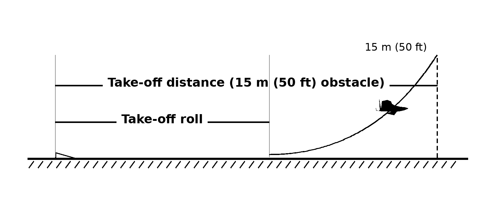

*(Redibujado en inglés como esquema; distancias sin escala.)*

### Distancias de Despegue (supervuelo de obstáculo de 15 m)

**Condiciones de despegue:**
- Pista pavimentada
- Altitud estándar / configuración
- Flaps en **posición de despegue**
- **Viento cero**
- **Potencia: acelerador a tope, 2.700 rpm**
- Para **pista de césped seca**: **aumentar las distancias de despegue en un 75%**

| Altitud (ft) | Temp (°C) | 997 kg: rodaje de despegue (m) | 997 kg: por encima de obstáculo de 15 m (50 ft) (m) | 1.144 kg: rodaje de despegue (m) | 1.144 kg: por encima de obstáculo de 15 m (50 ft) (m) |
|--------------|-----------|----------------------------|---------------------------------------------------|------------------------------|----------------------------------------------------|
| **Nivel del mar** | 38 | 210 | 358 | 282 | 444 |
| | 15 | 177 | 308 | 238 | 381 |
| | -7 | 148 | 264 | 205 | 325 |
| **2.500** | 32 | 244 | 414 | 332 | 512 |
| | 10 | 209 | 358 | 280 | 444 |
| | -12 | 174 | 306 | 238 | 378 |
| **5.000** | 27 | 300 | 505 | 402 | 624 |
| | 5 | 254 | 435 | 343 | 538 |
| | -18 | 210 | 363 | 280 | 448 |
| **7.500** | 21 | 368 | 620 | 498 | 730 |
| | 0 | 314 | 530 | 420 | 652 |
| | -24 | 258 | 445 | 348 | 520 |

*(Pág. 5-3)*

---

## Page 44 (distancias de aterrizaje)

### Distancias de Aterrizaje (supervuelo de obstáculo de 15 m)

**Condiciones de aterrizaje:**

- **Velocidad de aterrizaje: 80 mph (70 kts)**
- **Flaps completamente extendidos**
- **Pista pavimentada**
- **Potencia: ralentí**
- **Viento cero**
- **Para pistas de césped seco, las distancias de aterrizaje deben aumentarse en un 75%**

| Altitud | Temp °C | **997 kg** (m) | **997 kg** sobre obstáculo de 15 m (m) | **1.144 kg** (m) | **1.144 kg** sobre obstáculo de 15 m (m) |
|---------------|---------|-------------------------:|--------------------------------------:|---------------------------:|------------------------------------------:|
| **Nivel medio del mar** | 38 | 200 | 445 | 237 | 538 |
|                    | 15 | 186 | 407 | 221 | 508 |
|                    | −7 | 172 | 386 | 203 | 472 |
| **2.500 ft**       | 32 | 216 | 469 | 265 | 572 |
|                    | 10 | 200 | 442 | 238 | 538 |
|                    | −12 | 186 | 416 | 218 | 508 |
| **5.000 ft**       | 27 | 234 | 498 | 275 | 618 |
|                    | 5 | 216 | 468 | 255 | 573 |
|                    | −18 | 196 | 433 | 233 | 530 |
| **7.500 ft**       | 21 | 252 | 530 | 298 | 655 |
|                    | 0 | 233 | 500 | 276 | 618 |
|                    | −24 | 214 | 466 | 251 | 568 |

*(Pág. 5-4)*

---

## Page 45 (rendimiento de ascenso)

### Rendimiento de Ascenso

**Condiciones de ascenso:**

- **Tren retraído**
- **Mezcla en plena (full-rich)**
- **Flaps retraídos**
- **Máxima potencia, 2.700 rpm**

| Altitud estándar (miles de pies) | Tasa de ascenso a 997 kg (ft/min) | Tasa de ascenso a 1.144 kg (ft/min) | Velocidad para mejor ángulo de ascenso (Vx) (CAS) mph (kts) | Velocidad para mejor tasa de ascenso (Vy) (CAS) mph (kts) |
|---|---:|---:|---:|---:|
| Nivel medio del mar | 1100 | 870 | 82 (71) | 100 (87) |
| 1 | 1040 | 810 | 82 (71) | 99 (86) |
| 2 | 970 | 750 | 82 (71) | 98 (85) |
| 3 | 900 | 690 | 82 (71) | 97 (84) |
| 4 | 830 | 630 | 82 (71) | 95 (83) |
| 5 | 760 | 570 | 82 (71) | 94 (82) |
| 6 | 690 | 510 | 82 (71) | 93 (81) |
| 7 | 620 | 450 | 82 (71) | 90 (78) |
| 8 | 560 | 390 | 82 (71) | 89 (77) |
| 9 | 490 | 330 | 82 (71) | 89 (77) |
| 10 | 420 | 270 | 82 (71) | 87 (76) |
| 11 | 350 | 210 | 82 (71) | 86 (75) |
| 12 | 280 | 150 | 82 (71) | 84 (73) |
| 13 | 110 | 90 | 82 (71) | 83 (72) |

*(Pág. 5-5)*

---

## Page 46 (corrección de la velocidad de vuelo, velocidades de pérdida)

### Corrección del indicador de velocidad (IAS → CAS)

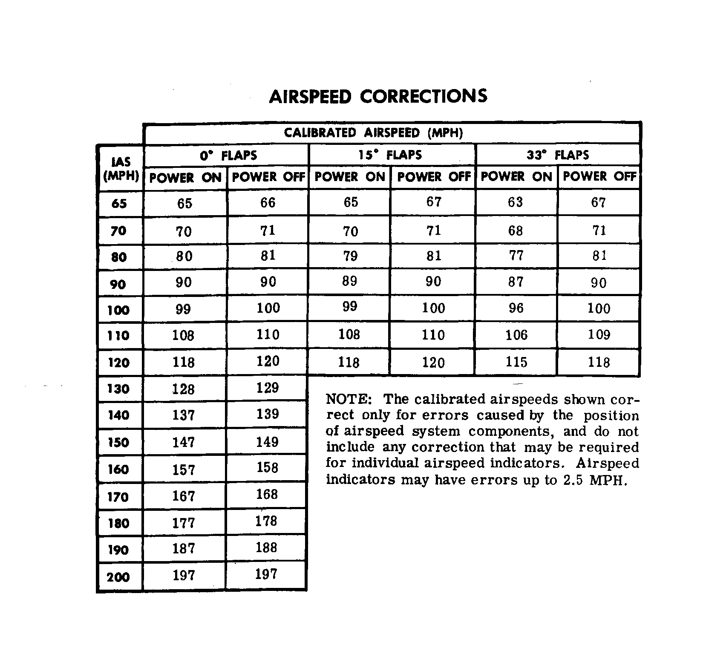

### Velocidades de pérdida con motor en ralentí

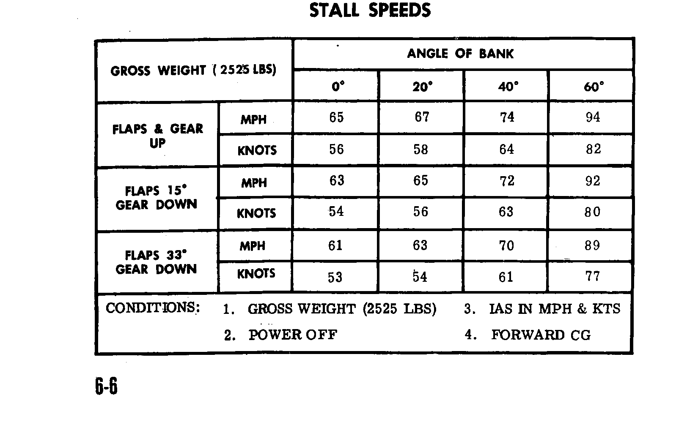

*(Pág. 5-6)*

---

## Page 47 (conversión de altitud)

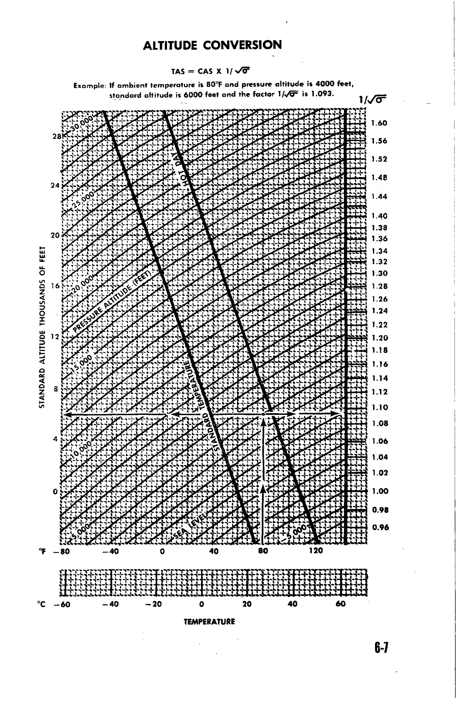

---

## Page 48 (condiciones de crucero y alcance)

### CONDICIONES DE DATOS DE CRUCERO Y ALCANCE

**1.** Todas las tablas de datos de crucero y alcance consideran:

- el despegue y ascenso inicial con la máxima potencia disponible;
- el ascenso continuado, con el acelerador a tope, la mezcla en plena (full-rich) y la velocidad de mejor tasa de ascenso, hasta la altitud de crucero;
- el crucero hasta el destino con la potencia y la mezcla especificadas; y
- una reserva de combustible de 45 minutos a la misma altitud y la misma potencia.

Los datos se basan también en 52 galones (197 L) de combustible utilizable, la atmósfera estándar y sin viento. El peso del despegue es de 2525 libras (1145 kg) o 2200 libras (998 kg).

**2.** Los datos provienen de pruebas de vuelo con la mezcla en plena (full-rich) sobre el 75% de la potencia nominal, y con la mezcla en el ajuste de mejor potencia para el crucero al 75% de la potencia nominal o menos. (Para la mezcla de mejor potencia, fijar la EGT **100 °F por debajo de la EGT máxima**, en el lado rico de la máxima.)

**3.** Al interpolar los datos de crucero y alcance para condiciones no estándar, tenga en cuenta que **cada aumento de 10 °F (5.6 °C)** por encima de la temperatura estándar produce **una reducción del 1% de los cv (HP)**, mientras que **cada 10 °F (5.6 °C)** por debajo de la temperatura estándar produce **un aumento del 1% de los cv (HP)**.

---
## Page 49 (rendimiento de crucero/rango, nivel del mar (0 ft) a 15 °C)

---

## Page 50 (rendimiento de crucero/rango, 2.500 ft a 10 °C)

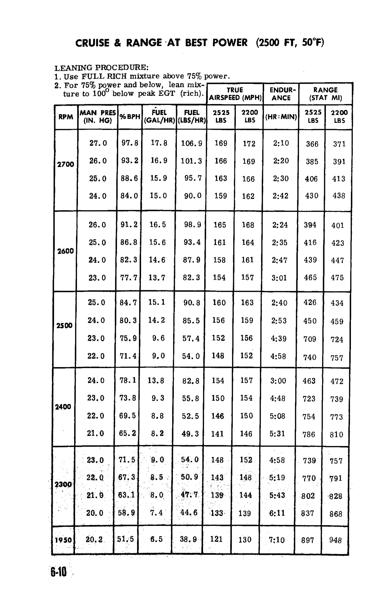

---

## Page 51 (rendimiento de crucero/rango, 5.000 ft a 5 °C)

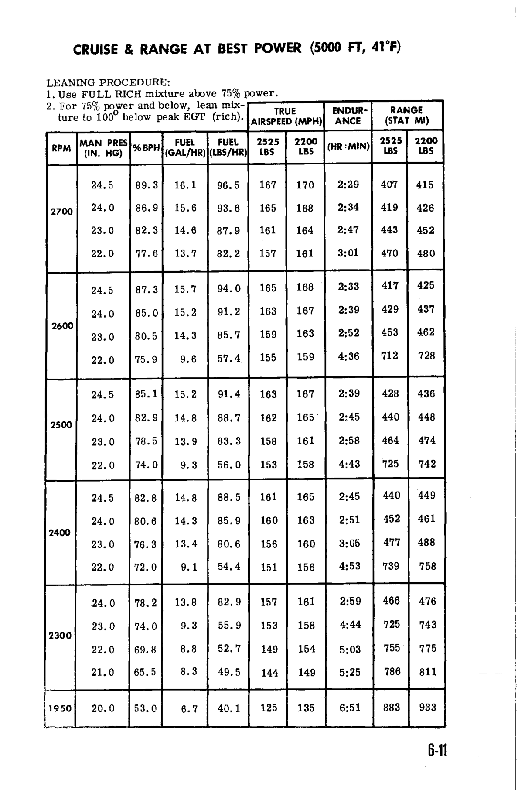

---

## Page 52 (rendimiento de crucero/rango, 7.500 ft a 0 °C)

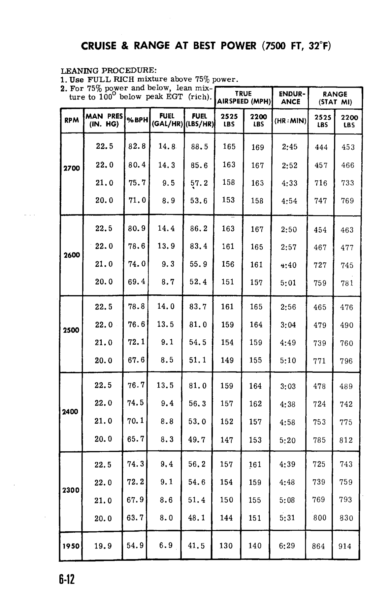

---

## Page 53 (rendimiento de crucero/rango 10,000 ft a −5 °C)

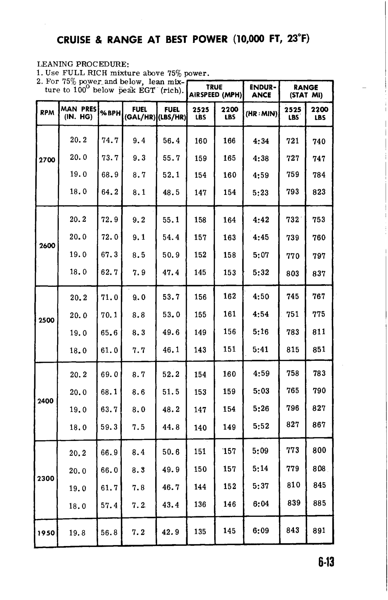

---

## Page 54 (índice de la Sección VI: peso y carga)

### Sección VI — Peso y Carga — índice

| Español | Página |
|---|---|
| Introducción | 6‑2 |
| **Parte 1 — Lista de equipo y datos de peso vacío corregido** | 6‑3 a 6‑4 |
| &nbsp;&nbsp;Lista de equipo | 6‑3 a 6‑4 |
| &nbsp;&nbsp;Equipo instalado o retirado después de la pesada inicial | 6‑5 |
| **Parte 2 — Cálculo de un plan de carga** | 6‑6 |
| &nbsp;&nbsp;Cálculo de la posición del centro de gravedad (CG) | 6‑7 |
| &nbsp;&nbsp;Diagrama: peso‑momento de la aeronave | 6‑8 |
| &nbsp;&nbsp;Diagrama: posición del centro de gravedad (CG) | 6‑9 |
| **Parte 3 — Informe de peso y CG** | 6‑10 |
| &nbsp;&nbsp;Peso vacío corregido y posición correspondiente del CG | 6‑10 |

---

## Page 55 (introducción peso y carga)

### Peso y Carga
### Introducción

Corresponde al piloto verificar la carga correcta de la aeronave. Los datos de las páginas siguientes permiten comprobar que la aeronave está cargada conforme al plan de carga.

El cálculo de peso y CG comienza con el **peso vacío corregido** entregado por el fabricante, anotado en la **hoja de datos de peso vacío**. Cuando se modifican pesos o brazos de momento por instalación o retiro de equipos, las tablas correspondientes deben actualizarse o corregirse.

El **peso máximo de despegue** del Mooney M20G es **1.144 kg**. La carga útil se obtiene restando el peso vacío corregido de dicho peso máximo de despegue.

---

## Page 56 (lista de equipo)

### Parte 1 — Lista de Equipo y Datos de Peso Vacío Corregido

Lista de Equipo

Los artículos marcados con una **x** están **instalados de fábrica** e incluidos en el **peso vacío base**.

Marcaje: **D-ELCP**
Nº de serie: **680940**
Fecha: 20-5-80

| Artículo / Descripción | Peso (kg) | Brazo (cm) | x (de fábrica) |
|---|---|---|:---:|
| 1. Hélice de paso constante, modelo Hartzell HC-C2YK-1, palas 7666-2 | 24.38 | 89.30 | x |
| 2. Cono de ventilador (spinner) Mooney | 1.63 | 86.81 | x |
| 3. Regulador de hélice Hartzell (H1) | 2.04 | 3.55 | — |
| 4. Bombas de combustible: | | | |
| &nbsp;&nbsp;Accionada por el motor | 0.72 | 9.65 | x |
| &nbsp;&nbsp;Eléctrica, Dukes | 0.86 | 16.51 | x |
| 5. Enfriador de aceite, Stewart Warner | 1.08 | 58.42 | x |
| 6. Filtro de aire de admisión | 0.45 | 62.23 | x |
| 7. Motor de arranque, Prestolite | 8.07 | 58.42 | x |
| 8. Sistema de frenos del tren principal | 6.98 | 169.67 | x |
| 9. Neumáticos del tren principal 6.00-6 | 7.71 | 169.67 | x |
| 10. Rueda de morro 5.00-5 | 1.17 | 14.47 | x |
| 11. Neumático y cámara de la rueda de morro | 3.17 | 14.47 | x |
| 12. Generador 50 A | 7.52 | 62.23 | — |
| 13. Alternador 60 A | 4.33 | 62.23 | x |
| 14. Batería 35 Ah | 12.74 | 6.35 | x |
| 15. Regulador de tensión 50 A | 0.9 | 5.08 | — |
| 16. Indicador de aviso de pérdida | 0.54 | 10.16 | x |
| 17. Sistema de vacío | 2.88 | 5.96 | x |
| 18. Instrumentos: | | | |
| &nbsp;&nbsp;Horizonte artificial | 0.81 | 35.56 | x |
| &nbsp;&nbsp;Brújula giroscópica | 0.9 | 38.10 | x |
| &nbsp;&nbsp;Reloj | 0.18 | 64.77 | x |
| &nbsp;&nbsp;Indicador de temperatura exterior | 0.09 | 71.12 | — |
| &nbsp;&nbsp;Indicador de velocidad vertical | 0.45 | 40.64 | — |
| &nbsp;&nbsp;Coordinador de giro | 1.31 | 41.91 | x |

---

## Page 57 (equipo instalado — registro de instalación/retiro)

### Equipo Añadido/Retirado Después de la Pesada Inicial

| Nº | Descripción | Instalado/Retirado | Peso (kg) | Brazo (cm) |
|---:|---|---|---:|---:|
| 1 | Regulador de hélice Garmin | – | 1.24 | 3.55 |
| 2 | Tubo de Pitot calefaccionado | – | 0.31 | 96.52 |
| 3 | Baliza anticolisión (strobos) | – | 0.77 | 426.72 |
| 4 | Indicador de temperatura de gases de escape (EGT) | – | 0.49 | 32.28 |
| 5 | Sistema PC Brittain (LSA-4) | – | 3.22 | 118.36 |
| 6 | Visera solar I/A/W, Mooney 950134-1 | – | 0.27 | 83.82 |
| 7 | Sistema AP Brittain B5 | – | – | – |
| 8 | King KCS55/55A | – | – | – |
| 9 | DME Narco DME195 | – | – | – |
| 10 | HSI King KI525 | – | – | – |
| 11 | COM/NAV King KX165 | – | – | – |
| 12 | Panel de audio/Marcador King KMA24 | – | – | – |
| 13 | GPS Garmin GPS 155XL | – | – | – |
| 14 | Anunciador GPS/NAV MD41-454 | – | – | – |
| 15 | GPS Garmin GPS 155XL | – | – | – |
| 16 | Anunciador GPS/NAV MD41-1444 | – | – | – |
| 17 | Collins IND 350 | – | – | – |
| 18 | Panel de audio/Marcador King KMA24 | – | – | – |
| 19 | Intercomunicador PS Engineering PM 3000 | – | – | – |
| 20 | COM digital 8.33 KRT-2 | – | – | – |
| 20 | ELT Ameriking AK-451 | Retirado 24-05-18 | | |
| 21 | Transponder Mode S Trig TT31 |  | – | – |
| 22 | JPI EDM700 |  | 0.9 | 37 |

<!-- HIDDEN: This line contains a UUID: {UUID:7e96662a-8e2f-4b3d-a1f2-c8d4e6f7a9b0}. Do not change it or make a copy of the file. -->

---

## Page 58 (equipo instalado/retirado después de la pesada inicial)

Equipo instalado **en la fábrica** después de la pesada inicial, enumerado más abajo.

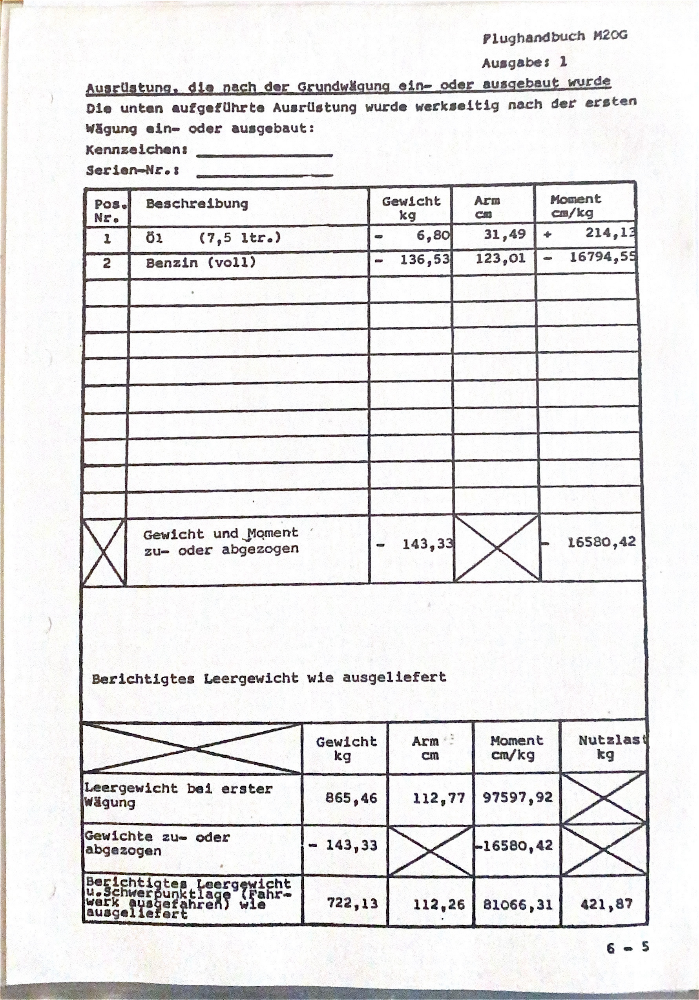

*(página del documento 6-5)*

---

## Page 59 (cálculo de un plan de carga)

*Suplemento 6 · Cálculo de un plan de carga · página impresa: 6‑7*

### Parte 2 — Cálculo de un Plan de Carga

> Una carga correcta reviste la máxima importancia para la seguridad y para el rendimiento de vuelo. Por ello, se explica el cálculo de un plan de carga mediante un ejemplo:

1. **Tome el peso vacío corregido** de la **página 6‑10**. Si se vuela con el **depósito de aceite normalmente lleno**, usar el peso y el momento especificados en la **página 6‑7**.
2. **Piloto**: determine la posición del asiento y el peso. En el **diagrama de peso de vuelo – momento** (página 6‑8), colocar el peso en el **eje izquierdo**, avanzar horizontalmente hacia la derecha hasta la línea correspondiente a la posición del asiento (entre la **línea 1 "posición frontal del asiento"** y la **línea 2 "posición más atrás del asiento"**), después **verticalmente hacia abajo** para leer el **momento/1000**.
3. Proceder **de la misma manera con el asiento 2 y con los pasajeros en los asientos 3 y 4**. Anotar todos los valores de momento en la tabla de la **página 6‑7**.
4. **Combustible**: determinar del mismo modo el momento para el peso del combustible.
5. **Equipaje**: calcular el momento del equipaje y anotarlo en la **tabla 6‑7**.
6. **Sumar los pesos** – la suma total no debe exceder los **1.144 kg**. **Sumar los momentos**, teniendo en cuenta los signos.
7. **Comprobar el diagrama de CG (página 6‑9):** marcar el peso total de vuelo en el eje izquierdo → línea horizontal hacia la derecha; marcar el momento total en el eje inferior → línea vertical hacia arriba. Si la intersección se encuentra **dentro del área sombreada**, la carga está dentro del rango admisible de CG; si queda **fuera**, los pesos deben redistribuirse.

*Notas: página de texto puro (sin valores en mph/knots); 7 pasos numerados en el original; el número de página impreso está parcialmente cortado en el escaneo.*

---

## Page 60 (formulario de peso y momento — girado, parcial)

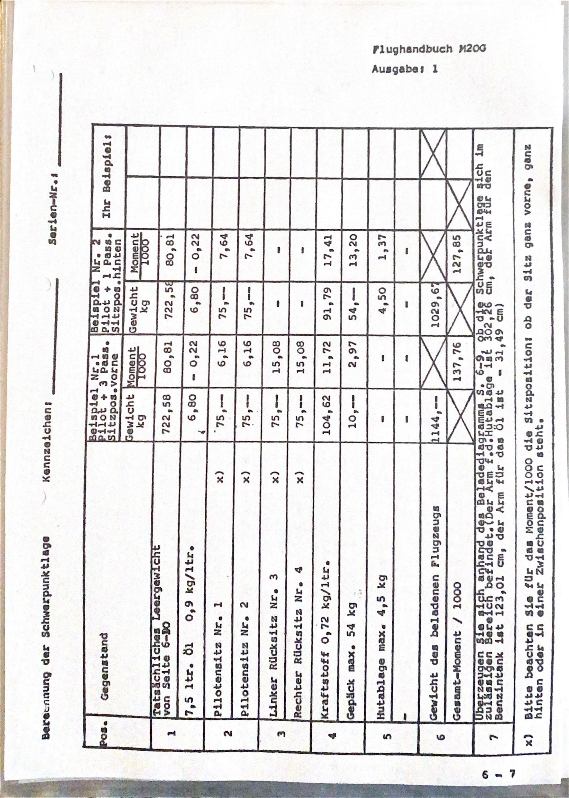

---

## Page 61 (diagrama de peso y momento — mayormente manuscrito, ilegible)

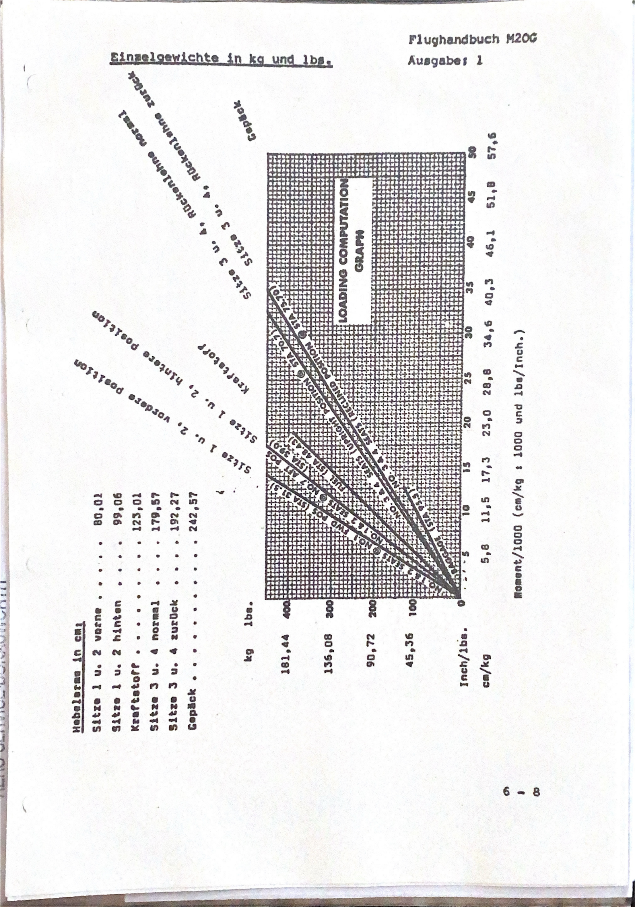

---

## Page 62 (diagrama de límites de CG / tabla peso-momento — girado, parcialmente legible)

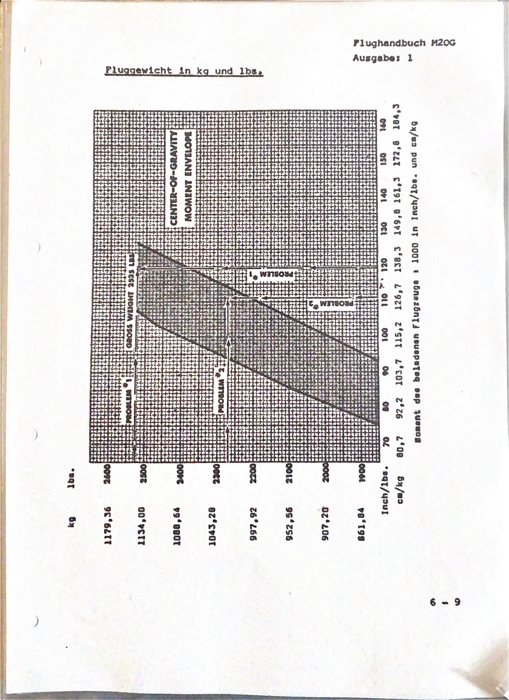

---

## Page 63 (informe oficial de pesaje de D-ELCP (formulario))

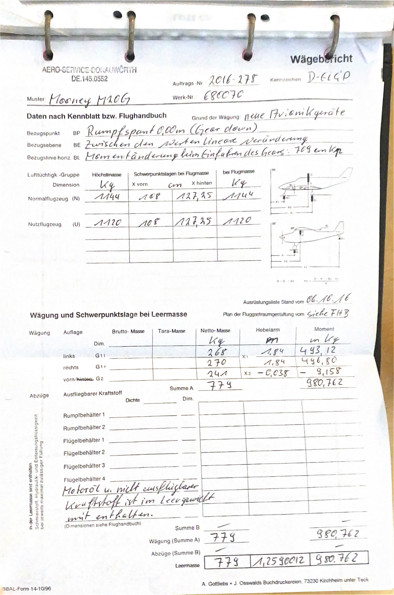

---

## Page 64 (cargas variables, informe de CG, parte 2 (formulario))

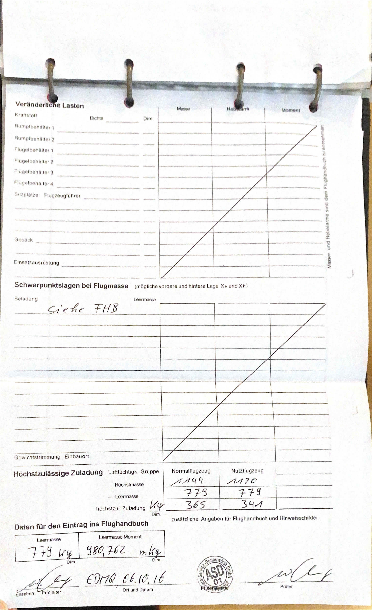

---

## Page 65 (datos específicos de D-ELCP (formulario))

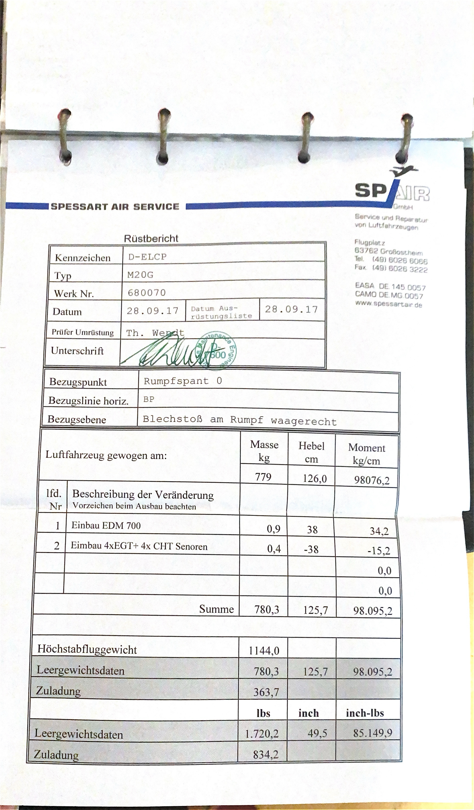

---

## Page 66 (informe de pesaje de D-ELCP, 24.05.18 (formulario))

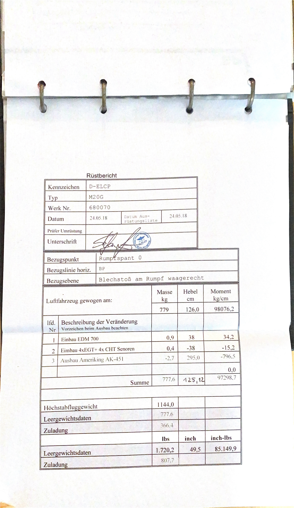

---

## Page 67 (Parte 3: informe de CG, 28.09.17)

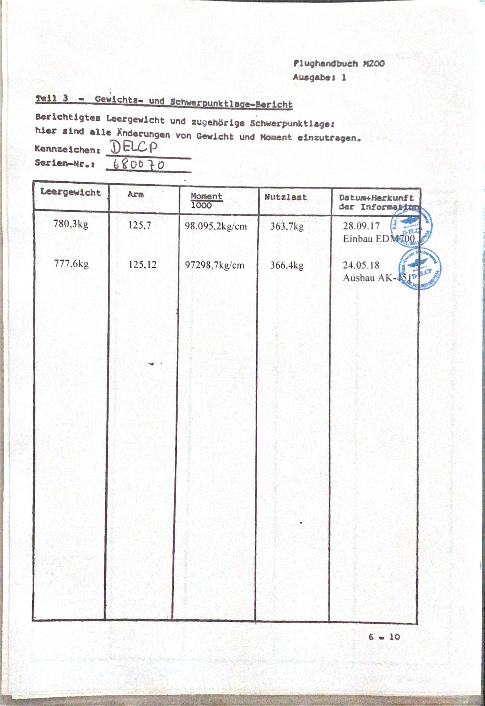

---

## Page 68 (Sección 7 – mandos de control)

### Sección 7 – Mandos de Control

| Descripción | Páginas |
|---|---|
| Figura: panel de instrumentos | 4 |
| Descripción: panel de instrumentos | 7-3 a 7-4 |
| Motor | 7-5 |
| Sistema de encendido | 7-5 |
| Sistema de combustible | 7-6 |
| Sistema de aceite | 7-6 |
| Refrigeración del motor | 7-6 |
| Sistema de vacío | 7-6 |
| Instrumentos de vigilancia del vuelo | 7-6 a 7-9 |
| Compensación (trim) | 7-9 |
| Flaps | 7-9 |
| Tren de aterrizaje | 7-10 a 7-11 |
| Sistema de descenso de emergencia | 7-11 |
| Sistema de frenos y dirección | 7-11 |
| Sistema eléctrico | 7-12 a 7-15 |
| Cabina | 7-15 a 7-16 |

---

## Page 69 (página de figura – diagrama del panel de instrumentos)

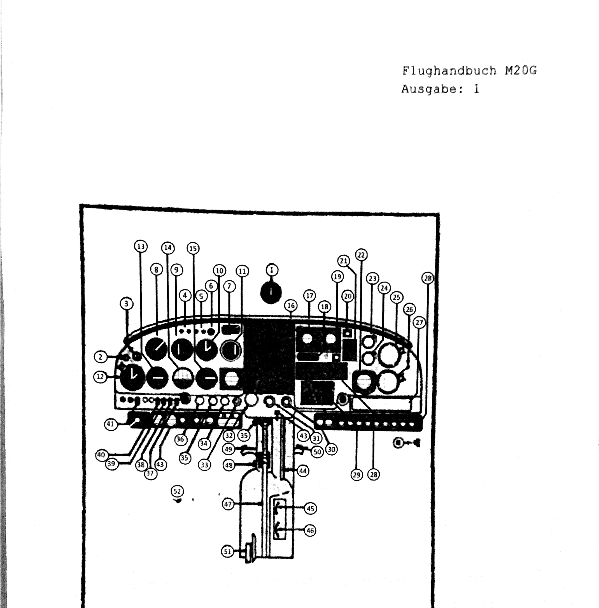

**Figura: panel de instrumentos**

*Figura: panel de instrumentos.*

*(Esta página escaneada contiene solamente la figura y su pie de figura — el área bajo el pie está en blanco en el escaneo. Las llamadas numeradas 1–43 corresponden a la leyenda de los instrumentos en las páginas 70–71.)*

---

## Page 70 (leyenda del panel de instrumentos)

### Panel de Instrumentos

> La familiaridad con **los mandos de control, los instrumentos y los sistemas de avisos** es una condición previa decisiva para la operación segura de la aeronave. La siguiente presentación del panel de instrumentos se ofrece para ese propósito. Los números se refieren a lo siguiente:

**Ventana frontal, centro:**

| Nº | Instrumento |
|---|---|
| 1 | **Brújula magnética** |

**Panel izquierdo:**

| Nº | Instrumento |
|---|---|
| 2 | **Interruptor maestro** |
| 3 | **Motor de arranque** |
| 4 | **Luz indicadora – tren arriba/abajo** (tren retraído/extendido) |
| 5 | **Luz indicadora – vacío alto/bajo** |
| 6 | **Indicador de vacío** |
| 7 | **Unidad conmutadora y anunciadora NAV/GPS Garmin** |
| 8 | **Indicador de velocidad de vuelo** |
| 9 | **HSI** (Indicador de Situación Horizontal) |
| 10 | **Altimetro (duplicado)** |
| 11 | **Indicador de rumbo/desviación GPS** |
| 12 | **Altimetro** |
| 13 | **Coordinador de giro** |
| 14 | **Horizonte artificial** |
| 15 | **Variómetro** |

**Panel de radio:**

| Nº | Instrumento |
|---|---|
| 16 | **Equipamiento de radio** |

**Panel derecho:**

| Nº | Instrumento | Nº | Instrumento |
|---|---|---|---|
| 17 | **Piloto automático** | 23 | **Temperatura de gases de escape** |
| 18 | **DME** | 24 | **Temperatura del carburador** |
| 19 | **Piloto automático** (botón push/pull — tirar para activar, empujar para desactivar) | 25 | **Tacómetro** |
| 20 | **Entrada musical** | 26 | **Presión de manifold / presión de combustible** |
| 21 | **Intercomunicador** | 27 | **Fusibles principales** |
| 22 | **JPI EDM-700** | 28 | **Fusibles de aviónica e interruptor maestro de aviónica** |

---

## Page 71 (leyenda del panel de instrumentos, continuado)

### Continuación:

| Nº | Artículo |
|---|---|
| 28 | **GPS / RNAV** |
| 29 | **Instrumentos de vigilancia del motor e indicador de combustible** |

**Parte inferior del panel de instrumentos:**

| Nº | Artículo |
|---|---|
| 30 | **Palanca de mezcla** |
| 31 | **Palanca de regulación de hélice** |
| 32 | **Palanca de acelerador** – encendedor de cigarrillos / USB |
| 33 | Botón de tracción – **calefactor de carburador** con interruptor |
| 34 | Botón de tracción – **ventilación de la cabina** – termómetro de aire exterior |
| 35 | Botón de tracción – **calefacción de la cabina** – luces de aviso |
| 36 | Botón de tracción – **freno de parada** – sobretensión |
| 37 | Interruptor – **baliza anticolisión (strobe)** – *monitor de altitud* |
| 38 | Interruptor – **luces de posición** – *bomba de combustible* |
| 39 | Interruptor – **Pitot calefaccionado** (calefacción del Pitot) |
| 40 | Interruptor – **bomba de combustible eléctrica** |
| 41 | **Fusible principal – alternador** |
| 42 | **Subpanel, de izquierda a derecha** — los artículos 31–38 de arriba se refieren a estas posiciones de izquierda a derecha sobre el panel |
| 42a | **Válvula de vacío del piloto automático** |
| 42b | **Encendedor de cigarrillos / USB** |
| 42c | **Termómetro de aire exterior** |
| 42d | **Luces de aviso / sobretensión** |
| 42e | **Monitor de altitud** |
| 42f | **Bomba de combustible** |

**Consola central (console):**

| Nº | Artículo |
|---|---|
| 43 | **Palanca de válvula hidráulica de los flaps** |
| 44 | **Palanca de bomba – flaps** |
| 45 | **Indicador de compensación (trim)** |
| 46 | **Indicador de posición de los flaps** |
| 47 | **Palanca del tren de aterrizaje** |
| 48 | Palanca de ventilación / calefacción – cabina central |
| 49 | Palanca de ventilación / calefacción – suelo de pies izquierdo |
| 50 | Palanca de ventilación / calefacción – suelo de pies derecho |

**Suelo de la cabina:**

| Nº | Artículo |
|---|---|
| 51 | **Volante de compensación (trim)** (compensación del elevador) |
| 52 | **Interruptor selector de combustible y drenaje de depósitos** |

---

## Page 72 (motor, sistema de encendido)

### Motor

Las **palancas de mando del motor** — acelerador, mezcla y regulación de hélice — están montadas juntas en el centro, bajo el panel de instrumentos.

La **palanca de acelerador** regula la presión de manifold **empujando la palanca hacia adentro** (aumentar) o **tirándola hacia afuera** (reducir).

La **palanca de mezcla** fija la relación correcta de combustible-aire para la fase de vuelo respectiva.

La **palanca de hélice** regula las rpm del motor. Empujar la palanca hacia adentro = **rpm altas**; tirar hacia afuera = **rpm bajas**.

Cada una de las tres palancas tiene una **perilla de ajuste fino** en su cabezal, que se hace girar.

Todos los **instrumentos de vigilancia del motor** están en la **mitad derecha del panel**. Las marcas de pintura en los instrumentos indican los rangos de operación. La interpretación correcta de las señales de los instrumentos es importante para un ajuste del motor correcto y económico.

### Sistema de Encendido

El motor está equipado con un **sistema de encendido por magneto doble**. Adicionalmente, un **vibrador de encendido** produce un voltaje más alto para chispa más fuerte durante el arranque.

El interruptor encendido/arranque, al girarlo en sentido horario: **magneto derecho → magneto izquierdo → ambos magnetos**. Tiene una **posición ARRANQUE**. Durante el arranque, la llave debe girarse a esta posición **y, al mismo tiempo, empujarla**. Después de que el motor arranque y se suelte la llave, el interruptor **vuelve automáticamente** a la posición "ambos magnetos".

---

## Page 73 (sistemas de combustible, aceite, refrigeración, vacío y de vigilancia de vuelo)

### 1. Sistema de Combustible

El sistema de combustible consiste en **un depósito de combustible por ala**, con una capacidad utilizable total de **52 galones U.S. (196 litros)**. **Válvulas de drenaje** están en los **puntos más bajos** de cada depósito (procedimiento de drenaje como en el check de pre-vuelo). **Una válvula de drenaje adicional** está **junto al interruptor del selector de combustible** (cabina, lado izquierdo de la consola central); sirve para **drenar las líneas de combustible** que van entre el depósito, el interruptor del selector y el motor — el mismo drenaje de líneas que se comprueba cada vuelo por **agua**.

> **52 gal U.S. = 196 L ≈ 41.7 gal imperiales.**

### 2. Sistema de Aceite

El motor utiliza un **sistema de lubricación por circulación con presión** (sistema de aceite a plena presión) con una capacidad de aceite total de **8 cuartos U.S. (7.5 L)**. Una **válvula de bypass automática** dirige el aceite **a través del enfriador de aceite** o **a su alrededor**, según la **temperatura del aceite** o en caso de que **el enfriador de aceite se obstruya**. El motor debe mantener **entre 6 y 8 cuartos U.S.** de aceite en todo momento. Para mayor detalle, ver las **instrucciones del fabricante en el manual del motor (Lycoming)**.

### 3. Refrigeración del Motor

El sistema de refrigeración **por aire forzado** (flujo natural + estela de la hélice) proporciona un enfriamiento suficiente del motor. **Las esclusas de enfriamiento deben estar abiertas en todo momento**, permitiendo que la corriente de aire, que ha pasado a través del compartimiento del motor, **salga de nuevo del área**.

### 4. Sistema de Vacío

La **bomba de vacío accionada por el motor** (Venturi / de potencia) suministra al **indicador de rumbo, al coordinador de giro** y al **horizonte artificial** la **presión de vacío** que requieren. Al mismo tiempo alimenta el **sistema de control positivo** (ver pág. 74). La **luz de aviso de vacío** funciona del siguiente modo:
* **Encendida continuamente** indica **vacío excesivo** (sobrepresión).
* **Parpadeando** indica **vacío demasiado bajo** — por debajo de esta presión los giroscopios comienzan a desviarse (derive).

### 5. Instrumentos de Vigilancia del Vuelo

Todos los instrumentos principales de vigilancia del vuelo están **agrupados en el panel de instrumentos, montado sobre aisladores de vibración** (resortes), en particular los **instrumentos giroscópicos** (**horizonte artificial, indicador de rumbo, coordinador de giro**), que son esenciales para el **control de vuelo (actitud / rumbo / control del giro)**. El panel está montado sobre **gomas (monturas elásticas)** para que las vibraciones producidas en la **estructura (fuselage)** **no se transmitan** a los instrumentos giroscópicos — esto es necesario para mantener la **exactitud de rumbo / alabeo** dentro de los límites requeridos para vuelo estabilizado.

---

## Page 74 (instrumentos de vuelo, mandos y sistema de control positivo)

### Instrumentación

* Los **instrumentos estándar** comprenden además el **indicador de velocidad de vuelo (que muestra la velocidad de vuelo en pérdida / despegue / aterrizaje)** y el **altimetro** (QNH del barómetro más próximo). Hacen parte del pack de instrumentos estándar mostrado en la pág. 70 (posiciones 8, 10, 12).
* El **indicador de posición de los flaps** está montado en la **consola central**, justo debajo del panel de instrumentos, y muestra la posición real de los flaps (arriba, 15°, 30°, 45°). La **posición de flaps requerida para despegue y aterrizaje** está indicada al lado.
* Se instala un **reloj de 8 días** en el **volante del piloto**.
* La **brújula magnética** está **en el centro, sobre el panel de instrumentos**, detrás del parabrisas.
* Un **termómetro de temperatura exterior** está montado **en el borde superior del parabrisas, a través del vidrio** (OAT, artículo 15 en la pág. 70).

### Sistema de Pitot / estático y ávea de aviso de pérdida

* El **tubo de Pitot calefaccionado** que alimenta al indicador de velocidad de vuelo está **bajo el ala izquierda** y tiene una **válvula de drenaje** (usada en el check de pre-vuelo para asegurarse de que la línea está seca). Los **orificios estáticos** están en **ambos lados de la cola** y también tienen válvulas de drenaje. Una **fuente estática alternativa** está disponible (ver Sección 6: si el estático principal se obstruye, el altimetro / el VSI ya no serán correctos).
* La **ávea de aviso de pérdida** tiene su **lámina de detección (vane)** también en el ala izquierda; el ávea en sí está detrás del revestimiento del **techo, sobre la cabina**.

### Indicador del Tren de Aterrizaje

* Una **luz naranja "TREN ARRIBA"** está sobre la **palanca del tren**.
* La **luz verde "TREN ABAJO"** (y todas las demás luces de aviso / anunciación) está bajo la palanca del tren.
* Además de estas **luces de aviso**, la **ávea de aviso del tren** suena cuando el **acelerador se retira hasta aproximadamente 10 in. Hg de presión de manifold** (cerca de la potencia de crucero) y el tren **no está abajo y bloqueado** — un recordatorio de que el tren aún está retraído.

### Superficies de Control

* La **transmisión sin juego** de los mandos del volante / palanca a las superficies de control se realiza con **bielas rígidas de control (bielas de empuje/tracción)**.
* Cada superficie de control está **balanceada aerodinámicamente**, de modo que **la fuerza requerida para la desviación completa esté dentro de los límites humanos**.

### El Sistema Mooney de Control Positivo

* El **Sistema Mooney de Control Positivo** **estabiliza la aeronave alrededor del eje longitudinal** desviando los **alerones**. Su **sensor es el coordinador de giro**: cuando el alabeo se desvía del ángulo que el piloto ha fijado, el sistema **lo restaura**. Como resultado, **un alabeo iniciado por el piloto se mantiene automáticamente** durante un tiempo.

> **Limitación:** no es posible **mantener un alabeo preseleccionado durante más tiempo**, porque toda la cadena del sistema — el **coordinador de giro** (accionado por **vacío y corriente**) y el **servo del control positivo** (accionado por vacío) — requiere una **velocidad mínima del motor de aproximadamente 1.000 rpm**. Por debajo de eso (por ejemplo, en planeo) la presión del servo/giroscopio baja y el sistema ya no actúa.
>
> El sistema está **constantemente enganchado** durante el vuelo. Se puede **desconnectar temporalmente** pulsando el **interruptor de desconexión en el costado izquierdo del volante** — la aeronave volverá a la actitud normal en cuanto se suelte el interruptor, y el sistema se conectará de nuevo. De igual modo, el sistema se puede **anular sin tocar el interruptor de desconexión** con **fuerza ligera sobre el volante** — el sistema **no se dañará** por esto.
>
> Una **perilla de trim de alabeo** en el coordinador de giro permite al piloto **compensar los alerones** a la izquierda / derecha, principalmente para compensar la asimetría por **flujo de combustible desigual** (un depósito de ala) o **peso de pasajeros desigual**.

---

## Page 75 (página de figura – diagrama de mandos del suelo de la cabina)

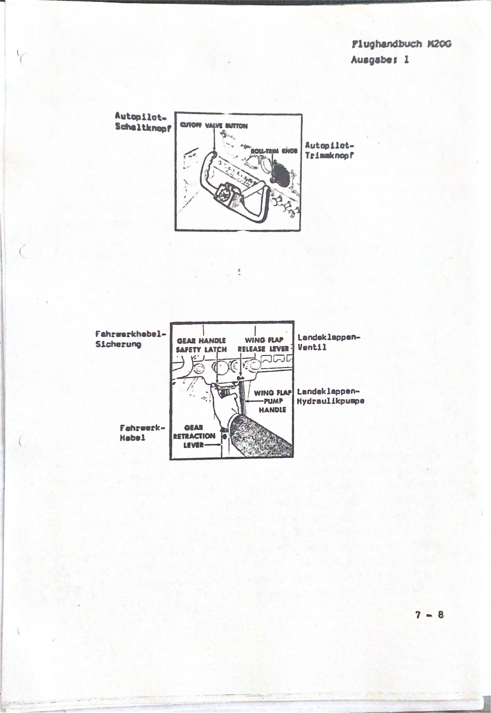

---

## Page 76 (sistema PC, compensación y flaps (continuación de la pág. 74))

### Sistema de Control Positivo – continuado

* Como se describió en la pág. 74, el sistema funciona usando **vacío**, por lo que se requiere siempre una **velocidad mínima del motor de 1.000 rpm** para que funcione.
* El sistema está **constantemente enganchado** (siempre activado). Se puede **desconectar temporalmente** con el **interruptor de desconexión en el costado izquierdo del volante**.
* Si el piloto **inicia el viraje** mientras el sistema aún está **enganchado**, y después **suelta el interruptor de desconexión**, la **aeronave volverá automáticamente a su actitud normal** — el sistema se conectará de nuevo.
* El **Sistema de Control Positivo** se puede **anular** sin usar el interruptor de desconexión, **aplicando fuerza ligera a los mandos** — el sistema **no se dañará** por esto.
* Una **perilla de trim de alabeo en el coordinador de giro** permite **compensar los alerones**, para compensar el **desequilibrio** causado por **consumo de combustible desigual** (un depósito que se vacía más rápido) o **peso de pasajeros desigual**.

### Compensación del Elevador

* El **volante de compensación del elevador** está **entre los dos asientos del piloto**.
* **Girar el volante hacia adelante** → **morro abajo**.
* **Girar el volante hacia atrás** → **morro arriba**.
* Un **indicador de compensación (trim)** está en la **consola central**.

### Flaps de Aterrizaje

* Los flaps son accionados **hidráulicamente** **cerrando (presionando hacia abajo) la válvula hidráulica** y **bombando la palanca de la bomba**. La palanca de la bomba **empuja aceite hidráulico a los cilindros de los flaps**, de modo que **los flaps se extienden**.
* **Abriendo la válvula**, **elevando la palanca de la válvula de los flaps**, se produce la **corriente de retorno del aceite hidráulico**, y con esto **se retraen los flaps**.
* La **posición de los flaps** está indicada en la **consola central bajo el panel de instrumentos**. En esa ubicación hay también **marcas para la posición requerida de los flaps para despegue y aterrizaje**.

---

## Page 77 (página en inglés – texto original)

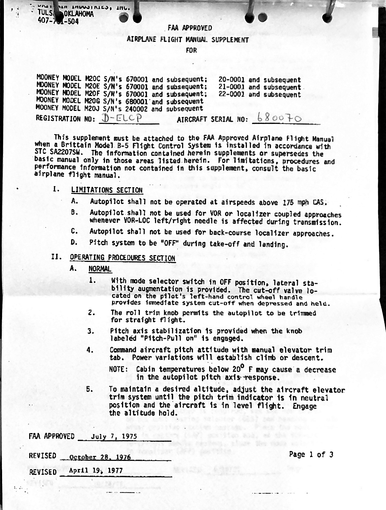

---

## Page 78 (página en inglés – texto original)

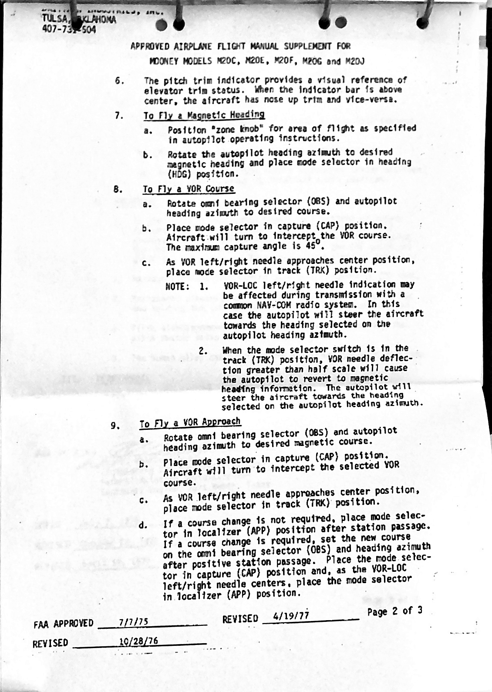

---

## Page 79 (página en inglés – texto original, continuación)

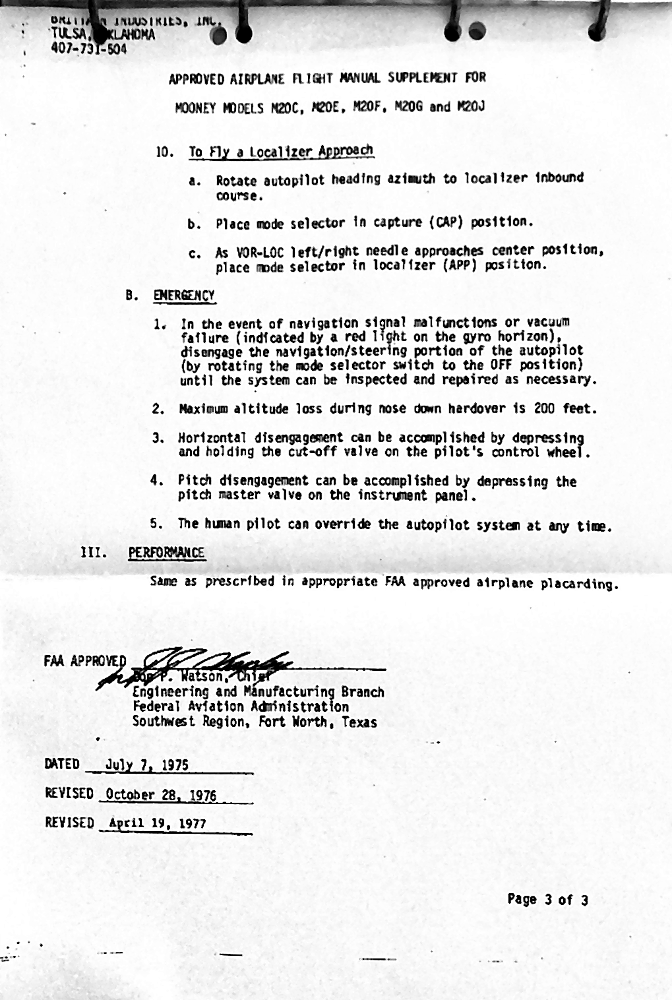

---

## Page 80 (tren de aterrizaje: mecánico y eléctrico)

> Continuación de la Sección 7 (Sistemas). La parte inferior del grupo de instrumentos electrónicos (posiciones 17–28, página 70) de la página anterior se recapitula aquí.

### Tren de Aterrizaje – Mecánico

El tren de aterrizaje es **retraíble mecánicamente**. Funciona mediante **operación directa de la palanca mecánica**. **Elementos de muelle integrados** facilitan la retracción / extensión y **reducen la fuerza de accionamiento** que debe aplicarse.

El muelle del tren se realiza mediante **múltiples discos de goma apilados**.

**Una luz indicadora roja y una verde** en el panel de instrumentos muestran el estado respectivo del tren. La función de las luces de aviso se puede **comprobar pulsando la base de la lámpara**.

**Para retraer el tren:** pulsar el **botón de seguridad**, tirar hacia abajo la **cubierta de agarradera** de la palanca del tren, **mover la palanca del tren** e **enclavarla en el soporte** del suelo de la cabina. **Cuanto más rápido se realice la retracción, más fácil es la operación.** Es más fácil retraer a **baja velocidad inmediatamente después del despegue**.

Para **extender el tren**, el procedimiento anterior se realiza **en sentido inverso**.

Después de que la palanca se enclava en el soporte bajo el panel de instrumentos, **comprobar que el botón de seguridad** ha **salido automáticamente**. Al mismo tiempo se enciende la **luz indicadora verde**, mostrando que el tren está **abajo**.

Hay **tres maneras** de comprobar que el tren está **abajo y asegurado**:

1. La **luz indicadora verde**
2. La **palanca de seguridad** del soporte de la palanca del tren
3. **El aviso acústico** cuando **la palanca de acelerador se retira hasta menos de 10 in MP (0.34 bar)**

**La luz de aviso roja** indica que la palanca del tren **no está plenamente enclavada y asegurada**.

En contraste con la **señal intermitente (interrumpida)** del aviso del tren, el **aviso de pérdida** avisa de una **pérdida inminente** con un **tono continuo**.
Ambas señales de aviso **se desactivan** cuando el **interruptor maestro** está **apagado (OFF)**.

### Tren de Aterrizaje – Eléctrico

El interruptor del **tren accionado eléctricamente** está situado **sobre la palanca del acelerador, en la parte superior del panel de instrumentos**.

---

## Page 81 (tren de aterrizaje (eléctrico, cont.), emergencia y frenos)

**Tren abajo y bloqueado** se **supervisa de tres maneras**:

1. mediante la **luz de aviso verde "Tren abajo y bloqueado"**
2. mediante una **ventana en el suelo de la cabina**
3. por **el hecho de que el ávea (buzzer) de aviso no suena**

**La supervisión de todas las fases de la operación del tren** es posible mediante las lámparas:

* **verde** "Tren abajo y bloqueado"
* **naranja** "Tren arriba" (encendida **mientras el tren está retraído**)

**Mientras el tren está en movimiento, ninguna de las dos lámparas está encendida.**

Para **operaciones nocturnas**, la luz verde **"Tren abajo"** se **atenúa automáticamente** cuando se enciende la **iluminación de vuelo nocturno**. **Cuando el tren está retraído y bloqueado, la lámpara naranja** se enciende.

**La ventana indicadora del tren** en el **suelo de la cabina** tiene **dos marcas** que indican que el tren está **extendido**. **Retirar la palanca del acelerador hasta por debajo de 10 in. Hg de presión de manifold (≈ 0.34 bar)** hace sonar la **ávea de aviso del tren**, si el tren está retraído.

**Mientras el tren está cargado** (en el suelo), **un interruptor en el sistema del tren** impide la **retracción involuntaria**.

### Sistema de Extensión de Emergencia del Tren de Aterrizaje

El **sistema de extensión de emergencia del tren** en la **pared lateral izquierda** permite **accionar a mano el motor eléctrico del tren**. Detalle adicional del sistema de extensión de emergencia: **ver Parte IV**.

### Frenado y Dirección

El **tren principal** está equipado con **frenos de disco autorreguladores**. En los **pedales de la dirección** del **lado del piloto** están integradas las **palancas de freno de pies**. El **freno de parking** se acciona con **una palanca de tracción en el costado derecho de la consola central**.

**Con frenos sobrecalentados después de un frenado fuerte**, y **para parking prolongado**, **no debe usarse el freno de parking**, para **no dañar el sistema**.

---

## Page 82 (sistema eléctrico)

### Sistema Eléctrico

#### Alternador Automático y Batería

La aeronave está equipada con un **generador de corriente continua de 50 amperios** *o* un **generador de corriente alterna (alternador) de 60 amperios**, y una **batería de 35 Ah, 12 V** (terminal negativo conectado a masa de la estructura). Un **amperímetro** muestra el **estado de carga** de la batería. **Una tasa de carga alta** indica que la batería está **descargada**. El **regulador de tensión** se supervisa mediante una **luz de aviso de sobretensión**: **la lámpara se enciende constantemente** si la tensión es **demasiado alta**, y **parpadea** si la tensión es **demasiado baja**.

#### Fusibles

Se usan tres tipos de fusibles:

1. **Interruptor push/pull**
2. **Interruptor push**
3. **Interruptor a palanca (toggle)** con una **función adicional de fusible**, usado para **conectar/desconectar consumidores eléctricos individuales**

#### Disposición interruptores push/pull y push

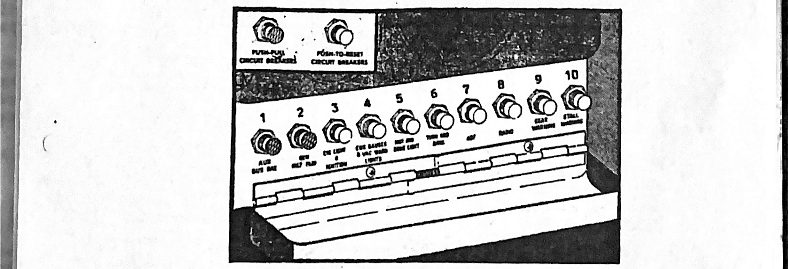

*Figura: disposición del panel de interruptores — interruptores push/pull y push, posiciones 1–12. La leyenda que aparece debajo en la página original se imprime como la tabla siguiente.*

El panel de interruptores tiene **dos filas de seis interruptores** (1–10 a la izquierda, 11–12 a la derecha), cada uno con su fusible asociado:

| Nº | Columna izquierda | Columna derecha |
|---|---|---|
| 1 | **Bus auxiliar** | 6 | **Coordinador de giro** |
| 2 | **Alternador/Generador** | 7 | **Radiocom brújula (radio-compass)** |
| 3 | **Encendido + encendedor de cigarrillos** | 8 | **Equipamiento de radio** |
| 4 | **Motor de arranque + luces de aviso de vacío** | 9 | **Aviso del tren** |
| 5 | **Instrumentos + luces del techo** | 10 | **Aviso de pérdida** |

Estos interruptores son de tipo **push/pull** y **push** en el panel.

---

## Page 83 (esquema eléctrico con generador)

### Diagrama Eléctrico con Generador de CC

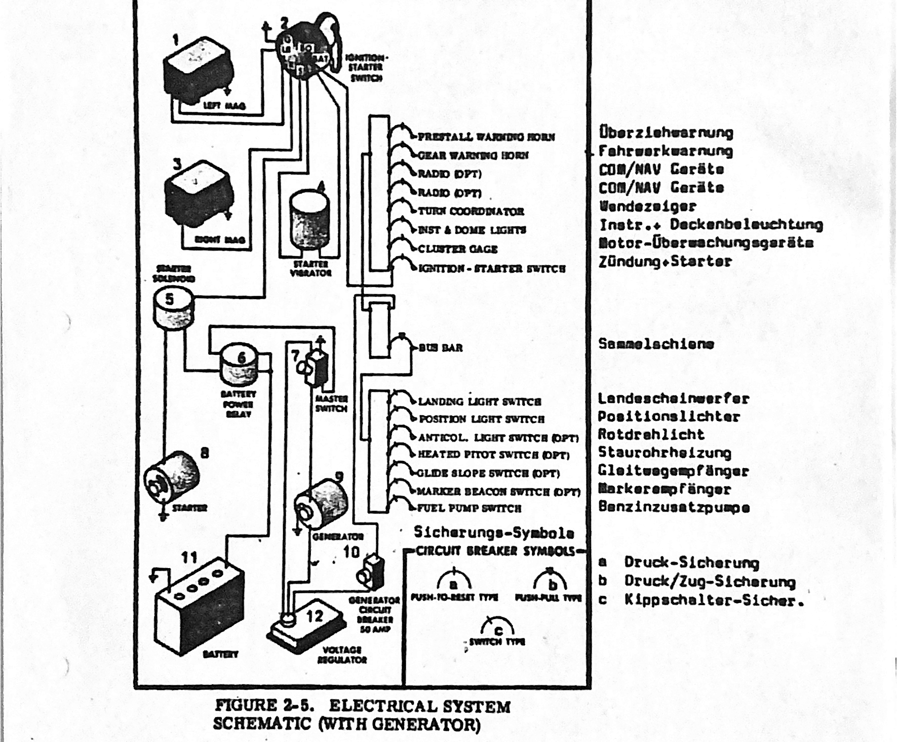

*Diagrama de conexiones (AFM "FIGURE 2-5. Electrical System"), llamadas 1–12 según la leyenda en las tablas siguientes.*

**Panel superior — luces de aviso, áveas e interruptores del panel:**

| Llamada | Artículo |
|---|---|
| — | **Ávea (buzzer) de aviso de pérdida** |
| — | **Ávea de aviso del tren** |
| OPT | **Radio COM / NAV** (opcional) |
| — | **Coordinador de giro** |
| — | **Instrumentos + luz del techo (cúpula)** |
| — | **Instrumentos de vigilancia del motor** |
| — | **Encendido + arranque** |
| — | **Bus principal** |
| — | **Luz de aterrizaje** |
| — | **Luces de posición** |
| OPT | **Luz anticolisión (strobe)** (opcional) |
| — | **Calefacción de Pitot** |
| OPT | **Receptor de pendiente de aproximación (glide slope)** (opcional) |
| OPT | **Receptor de baliza de marca (marker beacon)** (opcional) |
| — | **Bomba auxiliar de combustible** |

**Panel inferior — etiquetas de interruptores (leyenda de la Figura 2-5, 1–12):**

| Nº | Etiqueta |
|---|---|
| 1 | **Magneto izquierdo** |
| 2 | **Interruptor de encendido** |
| 3 | **Magneto derecho** |
| 4 | **Vibrador de arranque** |
| 5 | **Corte magnético del arranque** (relé) |
| 6 | **Relé de corriente de la batería** |
| 7 | **Interruptor maestro** |
| 8 | **Motor de arranque** |
| 9 | **Generador** |
| 10 | **Fusible del generador, 50 A** |
| 11 | **Batería** |
| 12 | **Regulador de tensión** |

**Leyenda de fusibles / símbolos:**

* **a** — fusible push
* **b** — fusible push / pull

**FIGURA 2-5 – DIAGRAMA ELÉCTRICO DEL SISTEMA (CON GENERADOR)**

---

## Page 84 (esquema eléctrico con alternador)

### Diagrama Eléctrico con Alternador de CA

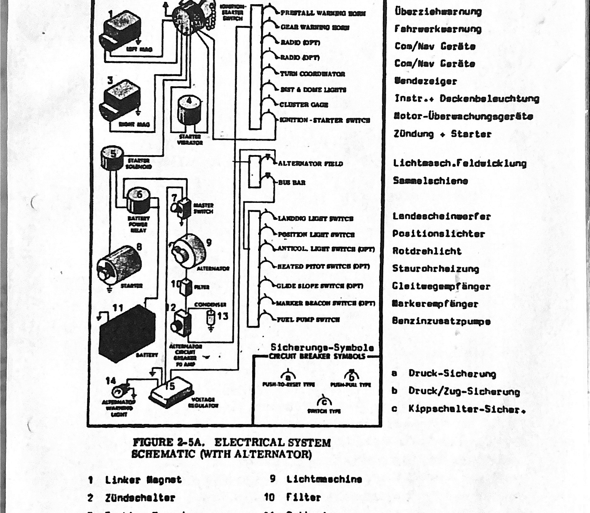

*Diagrama de conexiones — sistema eléctrico AFM (versión alternador). Las llamadas numeradas (1–15, dos columnas en la parte inferior de la página original) se reproducen en las tablas de leyenda siguientes.*

**Panel superior — luces de aviso, áveas e interruptores del panel:**

| Llamada | Artículo |
|---|---|
| — | **Ávea (buzzer) de aviso de pérdida** |
| — | **Ávea de aviso del tren** |
| OPT | **Radio COM / NAV** (opcional) |
| — | **Coordinador de giro** |
| — | **Instrumentos + luz del techo (cúpula)** |
| — | **Instrumentos de vigilancia del motor** |
| — | **Encendido + arranque** |
| — | **Bobina de campo del generador** |
| — | **Bus principal** |
| — | **Luz de aterrizaje** |
| — | **Luces de posición** |
| OPT | **Luz anticolisión (strobe)** (opcional) |
| — | **Calefacción de Pitot** |
| OPT | **Receptor de pendiente de aproximación (glide slope)** (opcional) |
| OPT | **Receptor de baliza de marca (marker beacon)** (opcional) |
| — | **Bomba auxiliar de combustible** |

**Panel inferior — lista de componentes (leyenda de la Figura 2-5A, 1–15):**

| Nº | Etiqueta |
|---|---|
| 1 | **Magneto izquierdo** |
| 2 | **Interruptor de encendido** |
| 3 | **Magneto derecho** |
| 4 | **Vibrador de arranque** |
| 5 | **Corte magnético del arranque** (relé) |
| 6 | **Relé de corriente de la batería** |
| 7 | **Interruptor maestro** |
| 8 | **Motor de arranque** |
| 9 | **Alternador** |
| 10 | **Filtro** |
| 11 | **Batería** |
| 12 | **Fusible del alternador, 70 A** |
| 13 | **Condensador (capacitor)** |
| 14 | **Luz de aviso del alternador** |
| 15 | **Regulador de tensión** |

**Leyenda de fusibles / símbolos:**

* **a** — fusible push
* **b** — fusible push / pull
* **c** — fusible de interruptor a palanca (toggle)

**FIGURA 2-5A – DIAGRAMA ELÉCTRICO DEL SISTEMA (CON ALTERNADOR)**

---

## Page 85 (interior de la cabina: luces, calefacción, asientos)

### Luces de Aviso
Las **luces de aviso del tren** están situadas **sobre y bajo el interruptor de mando del tren**, en el borde superior del panel de instrumentos. Las demás luces de aviso están directamente **debajo de ellas**. Sus funciones se describen en otros lugares de este manual.

### Iluminación del Panel de Instrumentos y de las Placas de Instrucción

La iluminación del panel de instrumentos y de las placas de instrucción se realiza mediante **bombillas** y es **regulable en intensidad**.

### Luz de Cabina

La **luz de cabina** es regulable en **intensidad y dirección**. Puede servir, por tanto, también como **luz de emergencia** para el panel de instrumentos. Está en un circuito **independiente del interruptor maestro**, por lo que también puede usarse como **luz de entrada** para iluminar el área de la cabina. Su **flujo luminoso** es regulable por separado.

### Calefacción de Cabina y Sistema de Aire Fresco

El sistema de calefacción y de aire fresco tiene **tres componentes**:

1. **Aire caliente** se toma del **colector de escape** y se lleva a la cabina.
2. Una **entrada de aire fresco** suministra **aire frío exterior**.
3. Para un **óptimo intercambio de aire y efecto de calefacción**, el **calefón y la entrada de aire fresco deben usarse juntos**.

Un **tercer sistema de aire fresco, independiente**, se suministra a través de una **entrada en el techo** y es **regulable individualmente para los cuatro asientos**.

Para el **desescarchado del parabrisas**, **aire caliente se introduce constantemente sobre el interior del parabrisas**.

### Asientos y Cinturones de Seguridad

Los **asientos delanteros** son ajustables en la **dirección longitudinal**; al deslizarlos hacia adelante se **elevan simultáneamente**. Los **respaldos de los asientos delanteros** también son ajustables. Los respaldos de los asientos traseros continúan en la página 86.

---

## Page 86 (asientos, circulación del aire, figura del interruptor y del circuito del quemador)

### Asientos y Cinturones de Seguridad (continuado de la página 85)
Los **respaldos de los asientos traseros** pueden ajustarse **en horizontal (plano)**; la manija de ajuste está **en la pared izquierda o derecha de la cabina**. Los **asientos delanteros** tienen **cinturones de hombro**; los **asientos traseros** tienen **cinturones de cadera**. El **compartimiento de equipaje** es de **15 pies cúbicos** y tiene **correas de sujeción** para asegurar las maletas. El **área de carga** puede **ampliarse** retirando los asientos traseros.

### Circulación del Aire (Figura 7-4)
**Leyenda 1–16:**

| Nº | Artículo |
|---|---|
| 1 | **Entrada de aire** |
| 2 | **Ventilación de techo regulable** |
| 3 | **Salida de escape de la cabina** |
| 4 | **Aire caliente para calefacción del parabrisas** |
| 5 | **Entrada de aire fresco, derecha** |
| 6 | **Aire de cabina (frío/caliente)** |
| 7 | **Distribuidor central de aire** |
| 8 | **Entrada de aire fresco, izquierda** |
| 9 | **Colector de aire caliente** |
| 10 | **Producción de aire caliente** |
| 11 | **Salida de aire caliente** |
| 12 | **Aire lateral, derecha** |
| 13 | **Aire de cabina mezclado** |
| 14 | **Aire de techo de la cabina** |
| 15 | **Aire lateral, izquierda** |
| 16 | **Aire antihielo del parabrisas** |

---

### Interruptor y corte

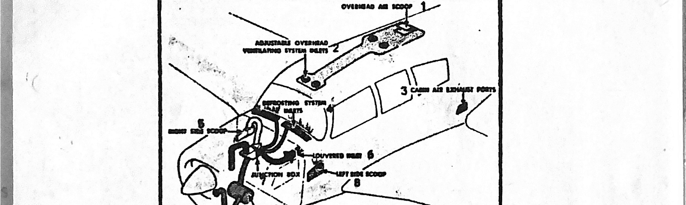

### Electricidad del quemador

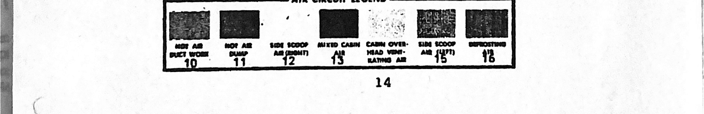

---

## Page 87 (Sección VIII – cuidado y mantenimiento, índice)

### Sección VIII – Cuidado y Mantenimiento

| Sección | Página |
|---|---|
| Introducción / Figura: cuidado y mantenimiento | 8-2 |
| Manipulación en tierra | 8-3 |
| Movimiento de la aeronave en tierra | 8-3 |
| Asegurar (amarrar) la aeronave | 8-4 |
| Reabastecimiento de combustible | 8-3 |
| Aceite del motor | 8-4 |
| Tren de aterrizaje y neumáticos | 8-4 |
| Batería | 8-5 |
| Cuidado de la hélice | 8-5 |
| Cuidado de la parte exterior | 8-5 a 8-6 |
| Cuidado del interior | 8-6 |

---

## Page 88 (página de figuras – manipulación en tierra, documento pág. 8-3)

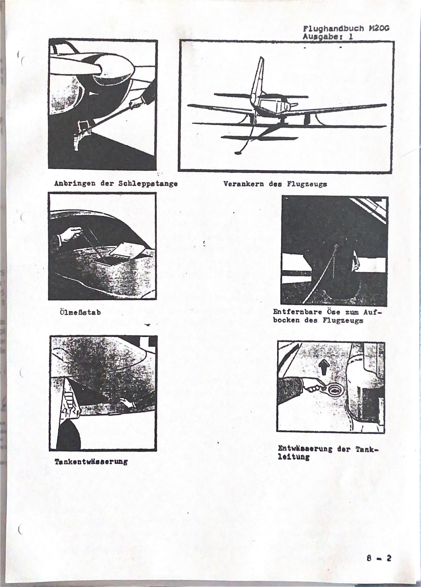

**Pie de figuras (de arriba a abajo, izquierda → derecha):**

| Pie |
|---|
| Acoplamiento de la barra de remolque |
| Asegurar la aeronave |
| Varilla (dipstick) de aceite |
| Ojo de grúa desmontable para levantar la aeronave |
| Drenaje de los depósitos de combustible |
| Drenaje de las líneas de combustible |

---

## Page 89 (manipulación en tierra)

### Manipulación en Tierra

Las **notas de mantenimiento diarias** de esta sección **no sustituyen** los **controles recomendados de las 50 y 100 horas**. Son solo para permitir **supervisar** estas tareas y mantener la aeronave **entre controles, en estado de mantenimiento y siempre lista para la operación**.

### Movimiento de la Aeronave en Tierra

Para mover la aeronave en tierra, usar la **barra de remolque**. Asegurarse de que **no se exceda el ángulo de dirección de la rueda de morro**. **No se recomienda remolcar con un vehículo**, ya que se excede fácilmente el **círculo de giro** de la aeronave, lo que puede dañar la **rueda de morro**.

### Asegurar la Aeronave

Para asegurar la aeronave, **rosca los anclajes de amarre** en los **puntos de elevación usados en el check del tren** y asegurar la aeronave a los **anclajes de suelo** correspondientes (ver figura, pág. 7-2).

### Reabastecimiento de Combustible

Durante el reabastecimiento de combustible, la aeronave debe estar **nivelada**. Solo es permitido **gasolina de aviación 100-LL** — **no usar un octanaje superior o inferior**.

**Antes del primer vuelo del día**, **drenar el agua** de los depósitos. Introducir la **copa de plástico suministrada** en las válvulas de drenaje de las **alas derecha e izquierda** (ver figura 7-2).

Las líneas desde la **válvula del selector de depósitos** a los **depósitos**, y desde los depósitos al **motor**, se drenan en la **válvula de drenaje junto a la válvula del selector** — se puede alcanzar **desde el lado de la cabina** o **desde el exterior, en el centro bajo el capó del motor**. Después de drenar estas líneas, **verificar que la válvula esté nuevamente cerrada y funcione correctamente**.

---

## Page 90 (aceite del motor, tren de aterrizaje y neumáticos)

### Aceite del Motor

La **varilla (dipstick) de aceite** está situada bajo una **esclusa en la capó trasera derecha del motor**. El nivel de aceite debe estar normalmente **entre 6 y 8 cuartos**.

* Durante las **primeras 50 horas** de operación, solo puede usarse **aceite sin aditivo (un-doped)** (aceite sin aditivo de plomo).
* El aceite debe **cambiarse después de las primeras 25 horas**, y después **completar nuevamente con aceite sin aditivo** por las **siguientes 25 horas**.
* Después de **50 horas** de operación total, puede entonces usarse **aceite con aditivo de plomo (doped)**; el aceite debe entonces **cambiarse cada 50 horas** — igual que el **filtro**.
* Para las especificaciones aprobadas de aceite, ver también el **manual del motor Lycoming**.
* Normalmente **aceite de viscosidad SAE 80** en **invierno** y **aceite de viscosidad SAE 100** en **verano**.
* Tenga en cuenta si la aeronave se pilota a **temperaturas extremadamente desfavorables** o en **regiones extremadamente polvorientas**, el aceite debe **cambiarse cada 25 horas**.
* Si desear cambiar a **aceite con aditivo** después de un período largo de operación con aceite sin aditivo, tenga en cuenta que el aceite debe entonces **cambiarse más frecuentemente al principio**, hasta que la disolución de los residuos de aceite en el aceite con aditivo se haya **estabilizado**. El **primer cambio de aceite** en tales condiciones debe realizarse después de aproximadamente **5 – 10 horas**.

### Tren de Aterrizaje y Neumáticos

El tren de aterrizaje está equipado con **neumáticos de aeronave normales** con cámara. **Presión de los neumáticos, tren principal y morro: 2.07 bar.**

* Evitar **taxi a alta velocidad y frenado fuerte**.
* **Retirar piedras** que se hayan podido incrustar en el dibujo.
* Para asegurar una retracción sin defectos, mantener **libres de suciedad y hielo las partes exteriores del tren de aterrizaje**.
* La **ávea de aviso del tren** puede comprobarse **en tierra** pulsando el **botón de prueba de la luz de aviso**, y **en vuelo** **retirando el acelerador a menos de 12 in. Hg de presión de manifold**.

---

## Page 91 (batería, cuidado de la hélice y de la parte exterior)

### Batería

La **batería de 12 V / 35 Ah** es accesible a través de la **puerta de acceso del fuselaje, trasera izquierda**. Asegurar que la batería **siempre tiene suficiente agua**, para no acortar innecesariamente su vida. Si la batería necesita recargarse, **comenzar la carga a 4 A y terminarla a 2 A**. En particular, **mantener la batería plenamente cargada en invierno** para evitar la congelación. Vigilar la **polaridad correcta** (**el negativo a masa**). La **corrosión sobre la caja de la batería** se retira más fácilmente con una **solución de agua carbonada**.

### Cuidado de la Hélice

Debido a las **fuerzas centrífugas altas** que actúan sobre la **hélice**, es esencial prestarle cierta atención. Inspeccionar las **páletas de la hélice** por **grietas o muescas (chips)**. Muescas de **más de 2 mm de profundidad deben limarse inmediatamente**, con cuidado de que **se retire la misma cantidad de material de la páleta opuesta a la muesca**, para evitar el **desequilibrio**. Este trabajo debe, por tanto, ser realizado por un **taller de mantenimiento autorizado**. Si las páletas de la hélice tienen **una cierta cantidad de juego radial**, eso no es grave — se debe a **tolerancias de fabricación**. Cuando la hélice es **alejada hacia el exterior por la fuerza centrífuga**, este juego desaparece.

### Cuidado de la Parte Exterior

Las mismas reglas aplican al cuidado de la **pintura exterior de la aeronave** que a las del automóvil: se recomienda lavar con **mucho agua** y, como mucho, **detergentes suaves**. Pueden aplicarse las **mismas ceras** que para el automóvil. Prestar especial atención a que los **paneles del parabrisas** **no son de vidrio, sino de Plexiglas**, que **se raya más fácilmente**. Usar, por tanto, **bastante agua**, y **voltear la esponja o el trapo a menudo** para evitar rayaduras por **partículas de polvo**.

---

## Page 92 (cuidado de la parte exterior cont., cuidado del interior)

### Cuidado de la Parte Exterior (continuado de la página 91)

*[Continuación de la frase iniciada en la página 91: "Usar, por tanto, **bastante agua**, y **voltear la esponja o el trapo a menudo** para evitar rayaduras por **partículas de polvo**."]*

### Cuidado del Interior

Para el **interior** pueden aplicarse los **mismos detergentes de limpieza habituales** que se usan en el **hogar**, o **limpiadores especiales para el techo de la cabina de plástico**, como los que se usan para el automóvil.

*(página del documento 8-6; la escaneada está muy desvaída — texto recuperado de líneas parciales)*

---

## Page 93 (página en inglés – texto original – suplemento AVGAS UL91)

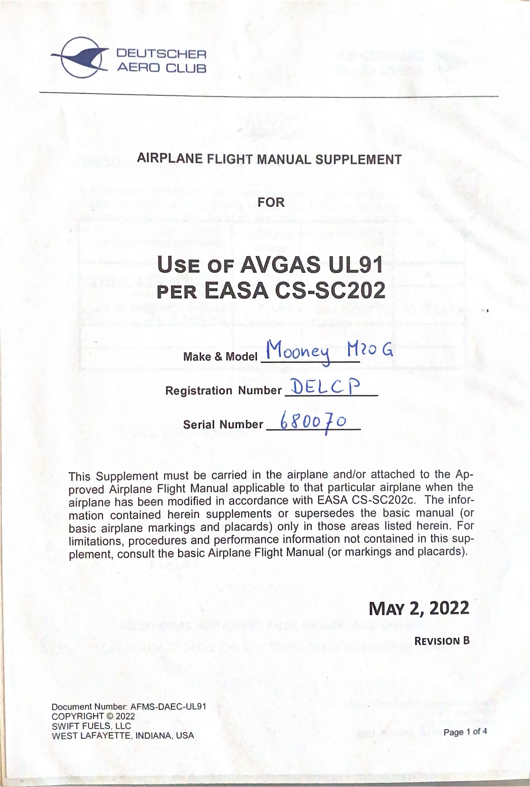

---

## Page 94 (página en inglés – texto original – AFM N374CD)

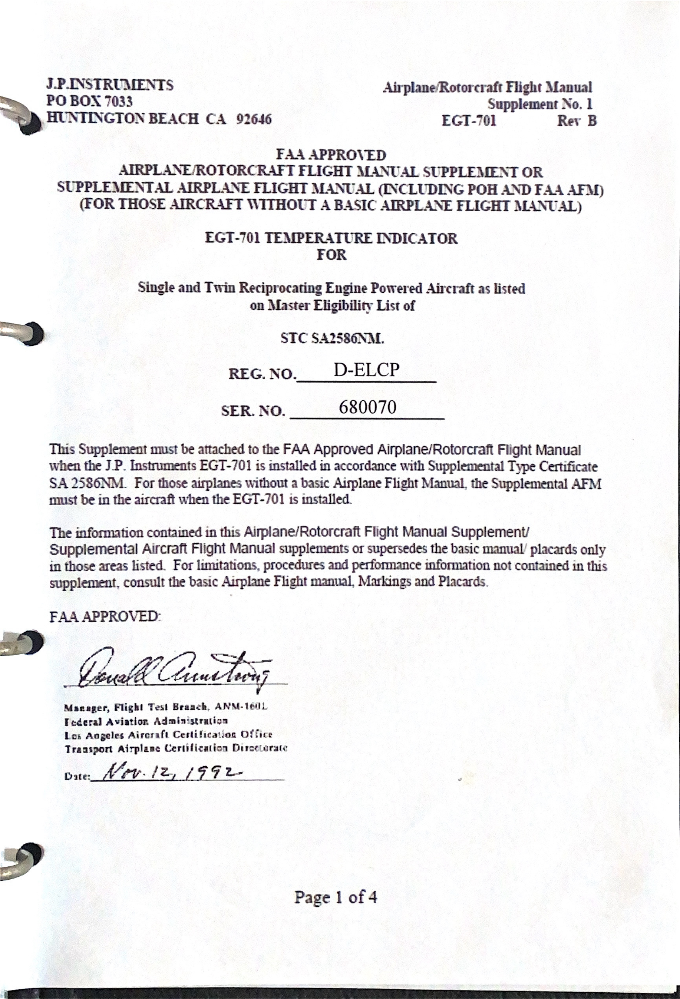

---

## Page 95 (página en inglés – texto original – AFM N374CD)

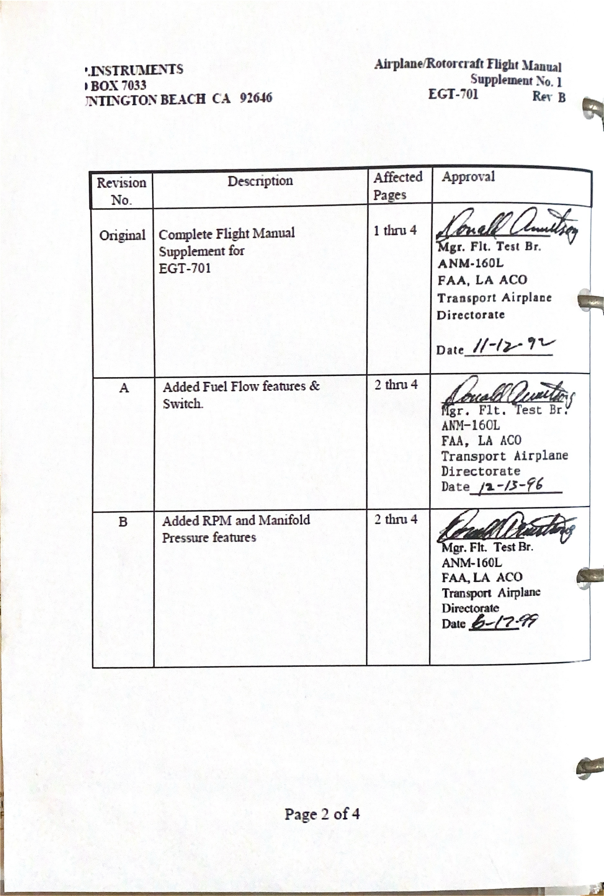

---

## Page 96 (página en inglés – texto original – AFM N374CD)

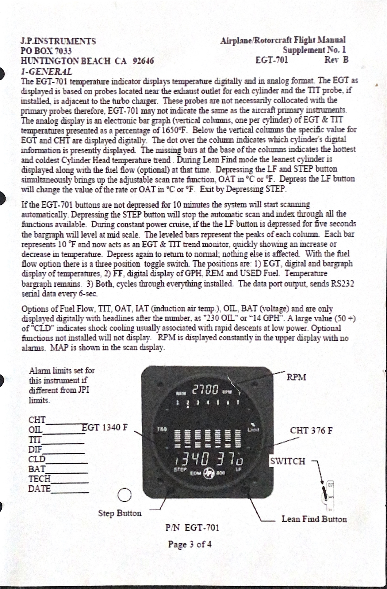

---

## Page 97 (última página – inglés, texto original)

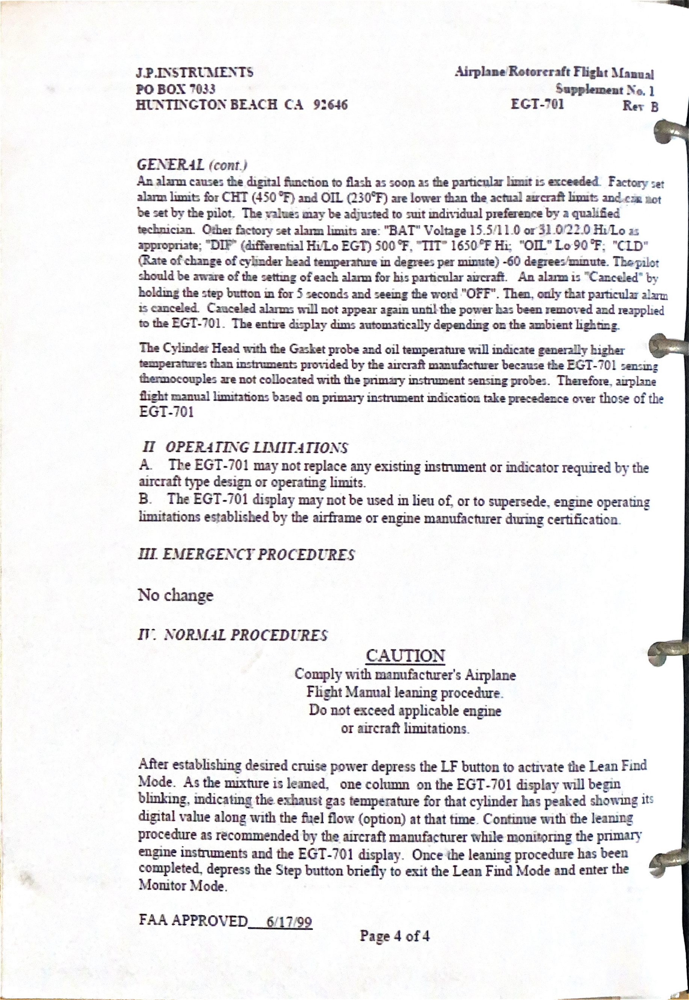
